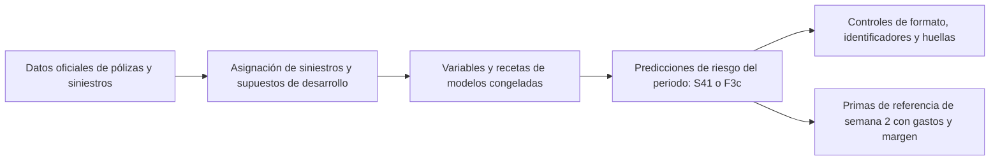

# IAA AI Hackathon 2026 · Tarificación actuarial entre mercados

Construí una cadena de tarificación asistida por IA para un mercado asegurador desarrollado y la adapté a un mercado emergente con menos historia de siniestros y una entrada importante de negocio nuevo. Mi entrega cubre autos, edificios y contenido, con un recorrido reproducible desde los datos originales del concurso hasta las predicciones elegidas.

Manuel Rodríguez · Participante individual · [Read in English](README.md)

[Video del proyecto · 4:59](https://www.youtube.com/watch?v=AYLkpDmZfZo) · [Reproducir las entregas](#cómo-reproduzco-las-entregas) · [Métodos y evidencia](docs/README.md) · [Uso de IA](docs/entrega/USO_DE_IA_ES.md)

## Qué entrego

Estimo el coste último esperado de los siniestros de cada periodo de póliza de 2025, neto de franquicias y recuperaciones y sin siniestros rechazados. Cada predicción corresponde al periodo de su fila. Para el mercado emergente calculo también las primas comerciales de las veinte pólizas de referencia, con los gastos y recargos suministrados.

| Entregable | Enfoque elegido | Entrada de reproducción |
| --- | --- | --- |
| Semana 1: riesgo del mercado desarrollado | S41: mezcla de modelos S30 y ajuste de nivel congelado basado en credibilidad | [Notebook de semana 1](notebooks/week1_developed_market.ipynb) |
| Semana 2: riesgo del mercado emergente | F3c: transferencia del mercado desarrollado, calibración al emergente y ajustes residuales documentados | [Notebook de semana 2](notebooks/week2_emerging_market.ipynb) |
| Ejercicio de prima comercial | Gastos y margen para veinte pólizas de referencia del mercado emergente | Sección final del notebook de semana 2 |
| Explicación del proyecto | Mis decisiones, el uso de IA, las comprobaciones y los límites | [Video en inglés](https://www.youtube.com/watch?v=AYLkpDmZfZo) y [flujo de trabajo con IA](docs/entrega/USO_DE_IA_ES.md) |

Los archivos de predicción tienen columnas `row_id,prediction`. Calculo las primas comerciales por separado; no son los valores que envío para la tarea de predicción de riesgo.

## Cómo funciona la cadena

En la primera semana combino modelos Tweedie de coste total con modelos de frecuencia y severidad por peligro. S41 aplica a esa mezcla la calibración de nivel registrada para cada ramo. Explico los supuestos y la selección en el [modelo final de semana 1](docs/MODELO_FINAL_S41.md) y en la [decisión](docs/DECISION_FINAL_S41.md).

En la segunda semana transfiero estructura del mercado desarrollado mediante los componentes T2b y A1 y después aplico la cadena de calibración F3c. Confirmé F3c el 28 de octubre, tras una comparación posterior con F3c-R que no cumplió los criterios conjuntos registrados. La [decisión final](registro/semana2_decision_final_F3c_20261028.json) y el [cierre de la comparación](docs/semana2/F3C_REGULARIZADO_CIERRE_20261028.md) conservan la evidencia y los resultados adversos.

## Cómo reproduzco las entregas

Preparé dos notebooks Jupyter autocontenidos. Cada uno incluye su código y configuración congelada y crea un espacio de trabajo nuevo a partir de los datos oficiales. Para correrlos no necesito clonar el repositorio ni aportar modelos entrenados o predicciones anteriores.

1. Abro el notebook del mercado que quiero reconstruir.
2. Adjunto los datos oficiales correspondientes. Semana 1 necesita los once Parquet del mercado desarrollado. Semana 2 requiere la carpeta desarrollada y los trece archivos de la carpeta emergente, incluidos gastos y pólizas de referencia.
3. Compruebo la sección del entorno. Cada notebook contiene las versiones de referencia y una celda de instalación opcional; después de instalar debo reiniciar el kernel.
4. Sigo el orden de las celdas en un entorno CPU. Las celdas posteriores de ejecución entrenan las recetas congeladas. El notebook muestra dónde deja la corrida temporal, los registros y las exportaciones.
5. Reviso los controles finales antes de usar los CSV generados. Una huella distinta de la histórica detiene la exportación final y requiere investigar la diferencia.

| Notebook | Archivos exportados tras superar los controles |
| --- | --- |
| [Semana 1](notebooks/week1_developed_market.ipynb) | `submission_week1_S41.csv` |
| [Semana 2](notebooks/week2_emerging_market.ipynb) | `submission_week2_F3c.csv` y `commercial_reference_premiums.csv` |

En mi carpeta local los notebooks resuelven las bases mediante `RUTAS_PROYECTO.json`. En otra copia defino `IAA_W1_DATA`, o `IAA_W2_DEVELOPED` e `IAA_W2_EMERGING`, con las carpetas de los Parquet; `IAA_DATA_ROOT` puede indicar su carpeta común. Antes de entrenar contrasto cada archivo con la huella archivada de su descarga y valido los identificadores de las plantillas. Puedo comprobar sólo esa conexión con `python herramientas/entradas_notebooks.py --week both`.

Elijo almacenamiento temporal y exportaciones privadas fuera de las entradas mediante `IAA_NOTEBOOK_WORK` e `IAA_NOTEBOOK_EXPORT`. Cada corrida guarda `input_manifest.json`. La [guía de los notebooks](notebooks/README.md) detalla la configuración, los recursos conocidos y las comprobaciones ante fallos.

El entrenamiento puede tardar varias horas. No he medido tiempo ni almacenamiento máximo en una ejecución alojada en Kaggle. Los modelos y datos intermedios quedan en almacenamiento temporal y no se conservan automáticamente.

## Qué comprobé y qué sigue abierto

| Evidencia | Alcance y límite |
| --- | --- |
| Reconstrucción local de los CSV elegidos | Las corridas locales reanudadas recuperaron las huellas históricas de S41 y F3c. Son comprobaciones dentro del mismo proyecto asistido por IA. |
| Contratos de entrada y salida | Los notebooks revisan archivos requeridos, identificadores y orden de la plantilla, formato de predicciones y valores positivos y finitos. |
| Artefactos intermedios de semana 1 | La reconstrucción registró 160 diferencias, incluidas tres huellas de tablas de variables cuya causa no se estableció. La igualdad del CSV final no las resuelve. |
| Entorno de ejecución | No he acreditado un Run All ininterrumpido de ambos notebooks ni una ejecución alojada en Kaggle. Cambiar paquetes o hardware puede modificar los resultados numéricos. |
| Aplicación actuarial | Parte de la calibración usó sondas del marcador público. La disponibilidad de variables al cotizar, las reservas, el traslado a negocio nuevo y los efectos diferenciales requieren revisión antes de una aplicación operativa. |

Conservo los [recibos de reproducción](registro/notebooks_kaggle_actual.json) y la [revisión de entrega](registro/revision_entrega_actual.json). Distingo reproducción de archivos, evaluación de modelos y revisión profesional independiente. La selección no acredita superioridad en el marcador privado ni aprobación de una tarifa operativa.

## Cómo trabajé con IA

Dirigí a Claude y Codex para explorar datos, proponer reglas, programar modelos, cuestionar supuestos y construir verificadores. Claude desarrolló las líneas principales de modelización; Codex aportó reglas de datos, reconstrucción, comprobaciones y documentación. Las decisiones de entrega son mías y conservo la autoría real del código y las revisiones.

Guardé hipótesis, fuentes, alternativas fallidas y correcciones. También usé IA para explicar, traducir y preparar el material audiovisual. En el [flujo de trabajo con IA](docs/entrega/USO_DE_IA_ES.md) explico esas aportaciones y cómo las contrasté. Repetir un cálculo en otra sesión de IA sigue siendo una comprobación asistida.

## Dónde está el soporte

| Ubicación | Qué conservo allí |
| --- | --- |
| [`notebooks/`](notebooks/) | Notebooks autocontenidos y su guía de ejecución |
| [`src/`](src/) y [`receta/`](receta/) | Código, procedencia y recetas congeladas de reproducción |
| [`herramientas/`](herramientas/) | Herramientas de reproducción, comprobación y documentación |
| [`docs/README.md`](docs/README.md) | Entrada a los métodos y decisiones vigentes |
| [`docs/archivo/`](docs/archivo/) | Propuestas y revisiones anteriores, con su [mapa de rutas y versiones](registro/archivo_documental_actual.json) |
| [`registro/`](registro/) | Decisiones, recibos de comprobación y registros de entrega |

## Entrega, acceso y licencia

La [guía del formulario](docs/entrega/FORMULARIO_FINAL.md) identifica los archivos y enlaces de entrega. Mi carpeta local `Hackaton/Entrega_final` reúne los archivos de predicción y los informes elegidos, con sus versiones vigentes en el manifiesto. Mantengo el repositorio privado hasta el cierre según la política del proyecto y debo confirmar el acceso del jurado.

Conservo el paquete de código congelado bajo `entrega-codigo-20261029`; las mejoras posteriores de presentación permanecen en el historial de Git. La [guía de control de versiones](docs/CONTROL_DE_VERSIONES.md) explica ese registro.

Mi código y documentación tienen [licencia MIT](LICENSE). Los datos del concurso, modelos entrenados, predicciones por fila, primas de referencia individuales y conversaciones privadas permanecen fuera de Git. Los materiales ajenos conservan sus condiciones; [NOTICE.md](NOTICE.md) detalla ese alcance.
