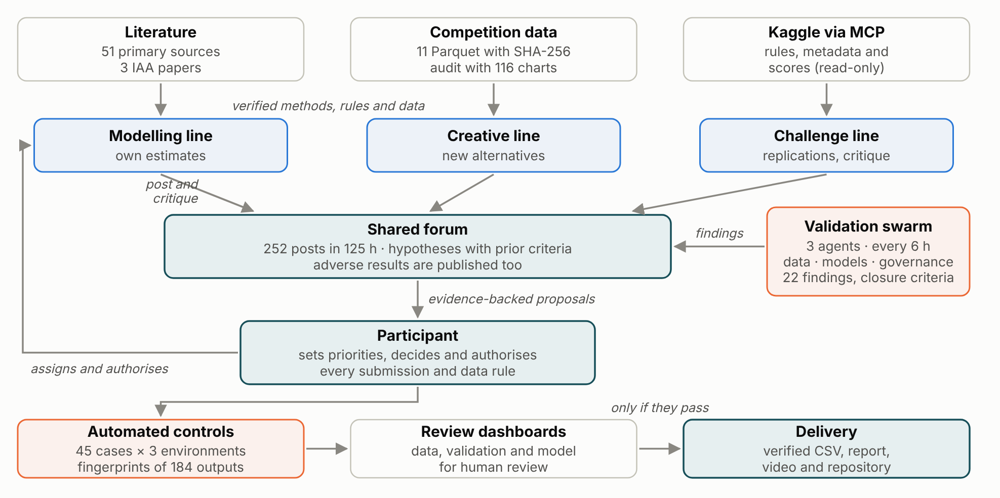

# A risk premium for every policy period, built and challenged with AI

IAA AI Hackathon 2026 · Part 1, established market · Manuel Rodríguez, individual team (Kaggle: manoloriveros). A Spanish copy of this page is in [README.es.md](README.es.md).

The joint Spanish report now covers both weeks in [five total pages](privado/entrega_final/informe_dos_semanas.pdf), available locally outside Git because it includes the twenty reference prices. See the [comparison dashboard](docs/entrega/panel_analisis.html) and [sources, figures and checks](docs/entrega/informe_final/README.md). The Week 1 account below is preserved; the Week 2 final selection remains open at the 26 October cut.

The model predicts, for every 2025 policy period in private motor, home buildings and home contents, the expected ultimate cost of the claims that occur in the period, net of excess and recoveries and excluding declined claims. The final model is the Per-peril blend (S30 in code and receipts). It blends Tweedie total-cost models with per-peril frequency × severity models in each line and sets the 2025 level with two out-of-sample years. The final submission, S41, keeps that model and calibrates only its 2025 level, with one factor per line (0.9962 motor, 1.0260 buildings, 1.0126 contents) read from six probe submissions to the public leaderboard and applied with a credibility rule fixed before they were scored; nothing was retrained. AI took part in every stage, mostly to challenge positions: three work lines posted their hypotheses to a shared forum before computing them, and a swarm of validation agents audited the project every six hours. The data are synthetic and amounts are in a fictional currency unit (CU).

| Figure | Value |
| --- | --- |
| Public score of the final submission (Tweedie D², power 1.5) | 0.13016; the team ranked first of 43 teams on the public leaderboard when checked on 22 October; the model alone (S30) scored 0.12996 |
| Out-of-sample D² on 2024 | 0.138, against 0.071 for a constant rate per line |
| 2025 policy periods predicted | 626,639, with ten format and integrity checks |
| Expected 2025 cost | 213.7 million CU in the final submission (212.0 million before the level calibration) |

Earlier submissions, the six level probes and two later calibrations of the same leaderboard appear only on the learning curve of the report, as the path that led to the final submission. Page 4 of the report tells the level calibration in full: what S41 consists of, the closed form, the rule fixed before looking, the hypotheses it rests on and why it was selected after a sensitivity battery corrected the noise of the public optimum.


Start the participant review with [the current review guide](docs/REVISION_PENDIENTE_PARTICIPANTE.md) and the [review dashboard](docs/panel_revision.html#revision). Recorded technical decisions and accepted limitations are separate from the pending general review.

## Final deliverables

| Deliverable | File |
| --- | --- |
| Report, five graded pages and an appendix | [docs/entrega/report_en.pdf](docs/entrega/report_en.pdf) · Spanish copy [informe_es.pdf](docs/entrega/informe_es.pdf) |
| Model dashboard, offline, English or Spanish | [docs/entrega/panel_modelo.html](docs/entrega/panel_modelo.html) (download and open it in a browser) |
| Video slides and script | [docs/entrega/video/](docs/entrega/video/) |
| How AI was used and how it was checked | [docs/entrega/AI_WORKFLOW_EN.md](docs/entrega/AI_WORKFLOW_EN.md) · [USO_DE_IA_ES.md](docs/entrega/USO_DE_IA_ES.md) |
| The numbers behind every deliverable | [docs/entrega/datos/cifras_entregables.json](docs/entrega/datos/cifras_entregables.json), with the path and SHA-256 of each source |
| Working record: forum and decision log | [docs/expediente/](docs/expediente/) |
| Week 2 adaptation | [Joint report and figures](docs/entrega/informe_final/README.md), as of 26 October; final selection pending |

## How the work was organised

Two AI assistants, Claude and Codex, worked in three lines: modelling, creative alternatives and challenge. No line could use another line's predictions without authorisation. Hypotheses went to the forum with their acceptance criterion before they were computed, and adverse results were posted like favourable ones. Three validation agents (data, models and governance) ran on a schedule and recorded each finding with a closure criterion and the human reviewer it needs. Kaggle's rules, metadata and scores were read through a read-only MCP connection, and every submission was sent under the participant's written authorisation. The participant authorised the data rules and the submissions, approved the final model and confirmed it as definitive on 20 October; on 22 October the participant authorised the probes and, on 23 October, after the sensitivity battery, selected S41 as the final submission in Kaggle. AI checks are not presented as independent professional review.



## Reproduce

For the current two-week reproduction status, see [REPRODUCCION_DOS_SEMANAS.md](docs/REPRODUCCION_DOS_SEMANAS.md). The 26 October Windows check rebuilt S41 from its Git tag and F3c/F3d exactly in a new Python environment using original labels and saved OOF predictions. Full source-model retraining, F4c reconstruction and reproduction by another person remain open. See also [version control](docs/CONTROL_DE_VERSIONES.md) and [LICENSE](LICENSE).

The competition data are not in this repository: the rules forbid redistributing them. The scripts read them from a folder with the structure of `Hackaton/Semana 1`, passed with `--semana1=<folder>` or the `IAA_SEMANA1` variable. Install the versions in `requirements.txt` (Python 3.13); with other versions the blend repeats exactly, but retraining may not be byte for byte.

```text
python reproducir.py plan --objetivo=S30
python reproducir.py mezcla --objetivo=S30 --semana1=<folder> --trabajo=trabajo_mezcla
python reproducir.py todo --objetivo=S30 --semana1=<folder> --trabajo=desde_cero
python reproducir.py verificar --trabajo=desde_cero
python herramientas/regenerar_s41.py --raiz <workspace>
```

`regenerar_s41.py` applies the three level factors to the blend's CSV, checks that the copy has the SHA-256 of the final submission and runs the ten delivery checks; it needs the original test files to know each row's line. `mezcla` rebuilds the blend's CSV from the saved components in seconds and compares its SHA-256 with the file Kaggle received; the saved components live outside Git. `todo` starts from the eleven original files and retrains every component (30 nodes for the final model, about ten hours on two cores). The exit code is 0 for an exact match, 1 for a failure or a difference, 2 for incorrect usage and 3 when `--continuar-si-difiere` was requested and intermediate files differ while the CSV matches. Retraining the whole recipe from the originals in the reference cloud rebuilt the delivered file byte for byte, and a replay from the saved estimators, with refitting blocked, matched every output; `docs/REPRODUCCION_COMPLETA.md` holds the receipt and the kit for another operator.

To regenerate and check the deliverables from the same sources:

```text
python herramientas/cifras_entregables.py --raiz <workspace> --salida docs/entrega/datos/cifras_entregables.json
python herramientas/construir_entrega.py todo
python herramientas/verificar_entregables.py
```

## What is in each folder

| Folder or file | Contents |
| --- | --- |
| `reproducir.py` | Single entry point (`plan`, `datos`, `componentes`, `todo`, `mezcla`, `verificar`), version 1.2 |
| `receta/` | The frozen recipe: 36 nodes with scripts, arguments, dependencies, outputs and expected fingerprints |
| `src/` | Data stages, features, models, severities, blend and validation code, copied unchanged from where it ran |
| `herramientas/` | Fingerprints, inventory, the 45-case control battery, the deliverable builders and the deliverable checker |
| `docs/entrega/` | Final deliverables: report, dashboard, slides, video script, AI guide and the data file behind them |
| `docs/expediente/` | Working record exported with synthetic identifiers masked: shared forum and decision log |
| `docs/controles/`, `docs/evidencia/`, `docs/fuentes/` | Control battery results, findings, replay receipts and the official rules as consulted |
| `registro/` | Delivery status, requirements, dated human decisions and receipts |
| `privado/` | Exact copies of CSV files, saved components and new runs; excluded from Git |

The [technical guide](docs/GUIA_TECNICA.md) keeps the detailed reproduction notes, the verification history and the version-control conventions.

## Limits

After the choice, eleven pre-registered experiments, an IBNR backtest among them, and a reserve analysis measured these limits; the report's appendix lists them, with a twelfth that did not need running. A single claims valuation (31-12-2024) means reserve adequacy cannot be proven. Reserves at ×0.75 and ×1.25 move the 2024 D² only from 0.1379 to 0.1372, but they move the blend's 2025 level by up to 6.8% and S41's by up to 5.7%, and a 4.4% error in motor case reserves already moves S41's level by 1%: reserves remain a material uncertainty in all three lines, a limitation the participant kept for S41. The 2025 level is the weakest point. The two buildings cuts sit 3.4% from their mean, and a scenario puts the blend's motor level 1.5% to 2.5% high; the final submission recalibrated the level with a third of the test, so the private set is its only independent check: with the noise of the public optimum corrected, the expected gain of S41 over the blend is +0.000019 to +0.000083 under the three priors tested, and, set against three indicators that do not use the leaderboard, the factors are supported in buildings and contents and only partly in motor, under either reading of the written premium (open finding DATA-006). The final model's lead over the previous best submission is not robust: removing six customers reverses it. The 2023 and 2024 cuts were used for selection, so they are not an independent final test. Feature availability at quotation still needs confirmation from the data owner, and 149 sums insured divided by 1,000 still lack historical confirmation. Independent review has not taken place: the reproduction was run by the same workflow, and the participant declared independence and reserve adequacy as limitations of the exercise. The report lists each limit with its effect and the check that would close it.
