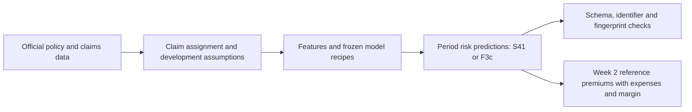

# IAA AI Hackathon 2026 · Actuarial pricing across markets

I built an AI-assisted pricing workflow for a developed insurance market and adapted it to an emerging market with shorter claims history and substantial new business. My submission covers motor, buildings and contents, with a reproducible path from the competition's original data to the selected predictions.

Manuel Rodríguez · Individual participant · [Leer en español](README.es.md)

[Video demonstration · 4:59](https://www.youtube.com/watch?v=AYLkpDmZfZo) · [Run the notebooks](#reproduce-the-submissions) · [Methods and evidence](docs/README.md) · [AI workflow](docs/entrega/AI_WORKFLOW_EN.md)

## What this project delivers

I estimate the expected ultimate claim cost for each 2025 policy period, net of excess and recoveries and excluding declined claims. Each prediction covers the period represented by its row. For the emerging market, I also calculate commercial premiums for the twenty official reference policies using the supplied expense assumptions.

| Deliverable | Selected approach | Reproduction entry point |
| --- | --- | --- |
| Week 1: developed-market risk predictions | S41: the S30 model blend with a frozen credibility-based level adjustment | [Week 1 notebook](notebooks/week1_developed_market.ipynb) |
| Week 2: emerging-market risk predictions | F3c: developed-market transfer, emerging-market calibration and documented residual adjustments | [Week 2 notebook](notebooks/week2_emerging_market.ipynb) |
| Commercial pricing exercise | Expense and margin calculation for twenty emerging-market reference policies | Final section of the Week 2 notebook |
| Explanation of the project | My decisions, use of AI, verification and limitations | [English video](https://www.youtube.com/watch?v=AYLkpDmZfZo) and [AI workflow](docs/entrega/AI_WORKFLOW_EN.md) |

The risk-prediction files use `row_id,prediction`. I calculate commercial premiums separately; they are not the values submitted for the risk-prediction task.

## How the pricing workflow works

For Week 1, I combine total-cost Tweedie models with peril-specific frequency–severity models. S41 applies the recorded line-level calibration to that blend. I explain the assumptions and selection in the [final Week 1 model](docs/MODELO_FINAL_S41.md) and [decision](docs/DECISION_FINAL_S41.md).

For Week 2, I transfer developed-market structure through the T2b and A1 components, then apply the frozen F3c calibration chain. I confirmed F3c on 28 October after the later F3c-R comparison failed the registered joint criteria. The [final decision](registro/semana2_decision_final_F3c_20261028.json) and [comparison close](docs/semana2/F3C_REGULARIZADO_CIERRE_20261028.md) retain the evidence and adverse findings.

## Reproduce the submissions

I provide two standalone Jupyter notebooks. Each contains its source code and frozen configuration; it creates a fresh workspace from official competition inputs. A repository checkout, fitted models and previous prediction files are not required to run them.

1. Open the notebook for the market I want to reconstruct.
2. Attach the corresponding official competition data. Week 1 needs the eleven developed-market Parquet files. Week 2 needs the developed folder and the thirteen-file emerging folder, including expenses and reference policies.
3. Check the notebook's environment section. The reference package versions and optional installation cell are included; installation requires a kernel restart.
4. Run the cells in order in a CPU environment. The later execution cells train the frozen recipes. The notebooks print the temporary run folder, logs and export location.
5. Inspect the final checks before using the generated CSVs. A different historical fingerprint stops the final export and requires investigation.

| Notebook | Exported files after successful checks |
| --- | --- |
| [Week 1](notebooks/week1_developed_market.ipynb) | `submission_week1_S41.csv` |
| [Week 2](notebooks/week2_emerging_market.ipynb) | `submission_week2_F3c.csv` and `commercial_reference_premiums.csv` |

In my local workspace the notebooks resolve the data through `RUTAS_PROYECTO.json`. In another checkout I set `IAA_W1_DATA`, or `IAA_W2_DEVELOPED` and `IAA_W2_EMERGING`, to the Parquet directories; `IAA_DATA_ROOT` can identify their common parent. Before training I compare every required file with its archived download fingerprint and validate template IDs. I can check only this connection with `python herramientas/entradas_notebooks.py --week both`.

`IAA_NOTEBOOK_WORK` and `IAA_NOTEBOOK_EXPORT` let me choose temporary storage and private exports outside the input folders. Each run saves `input_manifest.json`. The [notebook guide](notebooks/README.md) provides the configuration, resource evidence and troubleshooting steps.

Training can take several hours. I have not measured runtime or peak storage in a hosted Kaggle run. The notebooks keep intermediate models and data in temporary storage, which does not persist automatically.

## What I verified, and what remains open

| Evidence | Scope and limitation |
| --- | --- |
| Fresh local execution | The preceding frozen Week 2 edition completed all 91 code cells and 48 stages, reproducing F3c exactly. The fresh S41 execution remains in progress in the [execution record](registro/ejecucion_notebooks_actual.json). |
| Input and output contracts | The notebooks check required input files, template identifiers and order, prediction schema, and positive finite predictions. |
| Week 1 intermediate artifacts | The reconstruction reported 160 intermediate differences, including three unexplained feature-table fingerprints. A matching final CSV does not resolve them. |
| English delivery source | I revised the comments and docstrings and adopted neutral runtime names. All 123 sources passed normalized executable-structure checks; original-data preparation and runtime paths passed separate checks. This is not another full Run All of the edited edition. |
| Execution environment | The fresh local run uses Windows, Python 3.12 and the declared package versions in a new environment. Hosted Kaggle execution remains unverified. Different packages or hardware can change numerical results. |
| Actuarial use | Public leaderboard probes informed parts of the calibration. Quote-time feature availability, reserve assumptions, transport to new business and differential effects require further review before operational use. |

I retain the [execution record](registro/ejecucion_notebooks_actual.json), [source review](registro/documentacion_codigo_actual.json), earlier [reproduction receipts](registro/notebooks_kaggle_actual.json) and [delivery review](registro/revision_entrega_actual.json). They distinguish file reproduction, model assessment and independent professional review. The selected models do not establish superiority on the private leaderboard or approval of an operational tariff.

## How I worked with AI

I directed Claude and Codex to explore the data, propose rules, implement models, question assumptions and construct verification tools. Claude developed the main modeling lines; Codex contributed data rules, reconstruction, checks and documentation. I made the delivery choices and kept the actual authorship of code and reviews.

I preserved hypotheses, source references, failed alternatives and corrections. I also used AI for explanation, translation and audiovisual preparation. My [AI workflow](docs/entrega/AI_WORKFLOW_EN.md) explains those contributions and how I checked them; repeated calculations by another AI session remain AI-assisted checks.

## Find the supporting material

| Location | What I keep there |
| --- | --- |
| [`notebooks/`](notebooks/) | Standalone reproduction notebooks and their run guide |
| [`src/runtime/`](src/runtime/) | Readable English source package embedded in the final notebooks, with a checked build manifest |
| Other [`src/`](src/) directories and [`receta/`](receta/) | Historical model source, provenance and frozen original recipes |
| [`herramientas/`](herramientas/) | Reproduction, checking and documentation tools |
| [`docs/README.md`](docs/README.md) | Entry point to the current methods and decisions |
| [`docs/archivo/`](docs/archivo/) | Earlier proposals and reviews, with a [path and version map](registro/archivo_documental_actual.json) |
| [`registro/`](registro/) | Decisions, verification receipts and delivery records |

## Delivery, access and license

The [submission guide](docs/entrega/FORMULARIO_FINAL.md) identifies the files and links for the final form. My local `Hackaton/Entrega_final` folder holds the selected prediction files and reports, with their current versions recorded in its manifest. The repository stays private under my policy until the competition closes, and judges' access still needs confirmation.

I preserve the frozen code package under `entrega-codigo-20261029`; subsequent presentation changes remain in the Git history. The [version-control guide](docs/VERSION_CONTROL.md) explains that record.

My code and documentation use the [MIT License](LICENSE). Competition data, fitted models, row-level predictions, individual reference premiums and private conversations are excluded from Git. Third-party materials retain their own terms; [NOTICE.md](NOTICE.md) describes the boundary.
