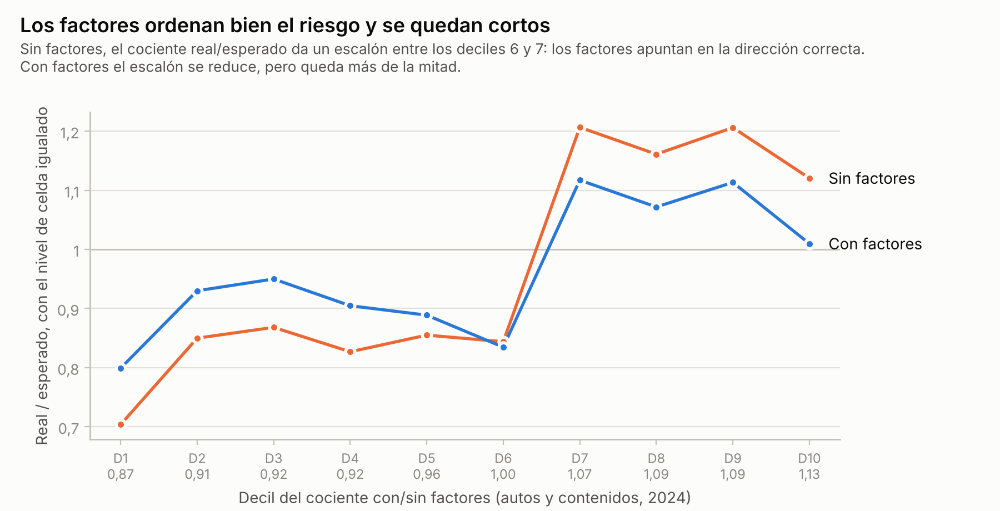
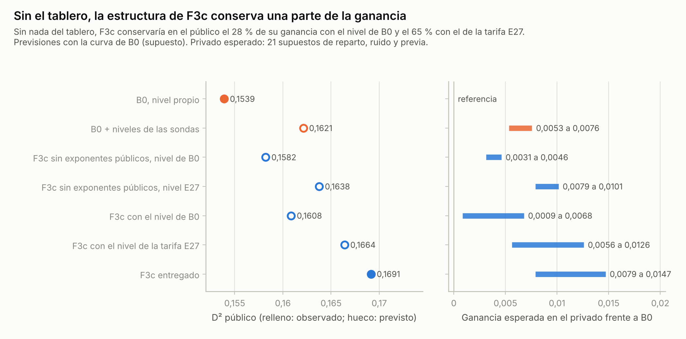
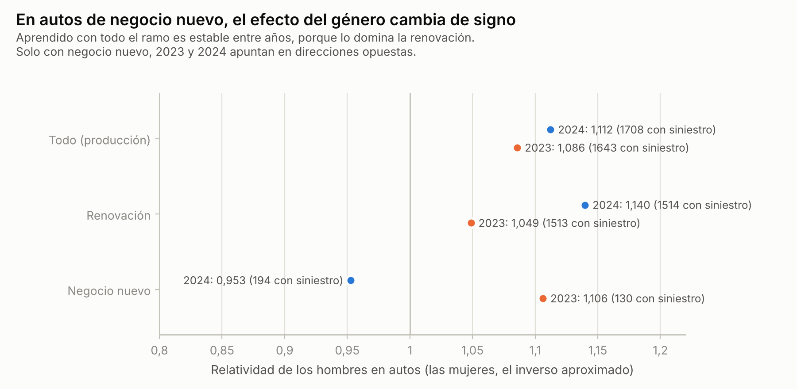
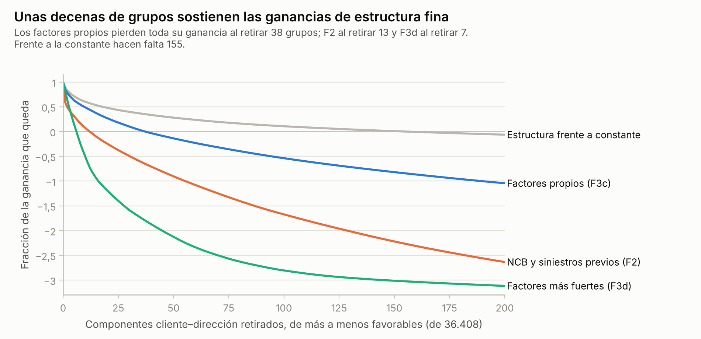

# Pendientes 1 a 5 de F3c: contraste de Claude sobre el cierre de Codex

Claude (Cowork), 26 de octubre de 2026. Manuel pegó una lista de doce pendientes y pidió triaje de los doce y cálculo de los puntos 1 a 5, con informe, registro y foro. Codex había recibido la misma lista y a las 21:57 UTC congeló un plan (CIERRE-12-F3C-20261026). Manuel eligió que Claude siguiera ese plan y contrastara: calcular con código propio, sin mirar las cifras de Codex hasta tener las suyas, y comparar después. El plan de este contraste se guardó antes de calcular (`privado/corridas/pend15_20261026T220855Z_dcf755e1/PLAN_PREREGISTRO.md`, SHA-256 dcf755e10b7d1603235f0f30f91535cf542b7c14b9af7b60a57b7a5ebefe86a4). Las huellas de mis resultados de los puntos 1 a 5 quedaron registradas a las 22:18:21 UTC, antes de leer cualquier resultado de Codex sobre ellos; el resumen de su cierre lleva hora 22:18:46 UTC. Lo añadido después de leerlo va marcado.

Es verificación de IA, no revisión profesional humana: dos asistentes que comparten datos, recetas y parte de las instrucciones no equivalen a una reproducción independiente. No hay envíos ni cambios de marca.

## Resumen

Codex y Claude calcularon por separado el mismo contraste congelado y llegan a las mismas cifras. Las diferencias en los puntos son como mucho de 0,0000054 y en los límites de los intervalos de 0,00009; la peor retirada al azar difiere en 0,0002 porque las retiradas no son las mismas.

En 2024, con todo aprendido en 2023, la receta de F3c gana +0,00239 de D² a la misma receta sin factores propios. La banda simultánea de la familia de seis contrastes va de +0,000554 a +0,00439: supera el margen de 0,0005 por muy poco. Con la composición de 2025 la ganancia baja a +0,00120 y el intervalo del 95 % va de −0,00298 a +0,00516. De 2023 a 2024 la ganancia viene casi toda de la renovación (97 %); en el negocio nuevo, que en 2025 es el 76 % de las filas (P19 de Codex), es prácticamente nula, y en autos de negocio nuevo el D² de la celda empeora 0,00101. En el sentido contrario, de 2024 a 2023, la mitad de la ganancia (52 %) viene precisamente de autos de negocio nuevo: la evidencia local sobre el negocio nuevo se contradice entre años.

El negocio nuevo sigue sin protección demostrable. La regla original de SEL01 tampoco se cumple para este contraste (límite del 95 % en −0,00378) y su potencia es del 10 %. En edificios y contenidos casi ninguna celda material tiene 30 grupos con siniestro en el histórico.

Sin nada del tablero (nivel de B0 y sin los exponentes de negocio nuevo que salieron del público), F3c haría 0,15821 en el público, frente a 0,15390 de B0 y 0,16914 de F3c: conservaría el 28 % de su ganancia. Con la tarifa E27, que se construyó sin tablero, conservaría el 65 %. Estas cifras salen de la forma cerrada de las sondas y suponen que F3c responde al nivel como B0. El nivel pesa mucho en los dos años: en 2024 acertar el nivel de celda vale +0,0134 de D², más de cinco veces lo que valen los factores propios.

Los factores aprendidos con todo el ramo son estables entre años, pero el de género aprendido solo con autos de negocio nuevo cambia de signo y el segmento de marketing tiene una reversión material. La ganancia de los factores desaparece al retirar 38 de 36.408 grupos cliente–dirección. F2 y F3d se anulan con menos grupos con las mismas reglas, y la estructura frente a la constante necesita muchos más.

Nada de esto cambia la marca por sí solo: la lectura pública de F3c (+0,00395 sobre final_creible, medida en la población de 2025) sigue siendo la evidencia más directa. Sí cambia lo que se puede afirmar: los factores propios se sostienen sobre todo en el público y en la renovación, y en el negocio nuevo la evidencia local no permite afirmar que funcionen ni que no.

## Triaje de los doce pendientes

Codex cerró hoy los doce con su matriz de criterio, resultado y consecuencia (`docs/archivo/semana2/CIERRE_DOCE_PENDIENTES_F3C.md`, SHA 78cebe98…). La tabla resume dónde está cada uno, contando también la evidencia de Claude.

| N.º | Qué hay | Qué queda abierto | Quién |
| --- | --- | --- | --- |
| 1 | Contraste congelado calculado por Codex y por Claude, con resultados iguales (este informe) | Ganancia incierta con la composición de 2025; autos de negocio nuevo en el límite | Nada más que calcular con estos datos |
| 2 | Salvaguarda original fallida y visible; regla aplicada al contraste; soporte por celdas (este informe) | Más historia de negocio nuevo; no se resuelve con los datos actuales | Datos que no existen |
| 3 | Vista local de Codex; cuadro con la forma cerrada de las sondas en 2025 (este informe) | La referencia constante no se puede calibrar con el público sin sondas propias | Identificación imposible sin sondas nuevas |
| 4 | Factores por año, ramo y negocio en los dos informes | Estabilidad no afirmable en autos de negocio nuevo ni en segmento | Decisión de lenguaje del informe final |
| 5 | Misma batería de exclusiones para F3c y sus referencias (este informe) | Fragilidad cuantificada; no hay más datos que la reduzcan | Decisión de lenguaje |
| 6 | Codex separó curvas de conteo y de coste: en lesiones, la severidad tardía es 1,645 veces la temprana y la completitud de coste 0,482 frente a 0,605 de conteo. Claude midió un coste tardío 1,427 veces el previsto (S2-RESERVAS-CLAUDE-20261026) | El coste último real no está identificado con una sola valoración | Codex, si se quiere un escenario adicional |
| 7 | Codex: 45 escenarios por ramo y peligro; con reserva ±25 % las veinte primas cambian hasta 4,43 %. Claude: β de reserva por ramo | Suficiencia real de reservas | Fuera del alcance de los datos |
| 8 | Auditoría estática de Codex: la capa nueva pasa el control adverso; 256 componentes de 2024 quedaron partidos por los folds de cliente | Ancestros T2b y A1 sin replay protegido; cadena integral no acreditada | Codex, grande |
| 9 | Inventario con hash de 500 documentos que mencionan 2024; todo es exploratorio | No se puede restaurar una confirmación intacta | Lenguaje del informe |
| 10 | Disponibilidad al cotizar no acreditada; regla de contingencia: neutralizar los factores propios y volver a final_creible si falta | Fechas de los maestros de cliente y dirección | Datos que no existen |
| 11 | F3c y F3d se reconstruyen con SHA exacto desde las predicciones guardadas | Grafo de ancestros desde los originales y reproducción por otra persona | Codex y una persona real |
| 12 | Veinte primas por candidato: F3c 20.304,23 CU, final_creible 19.481,61 CU; con la severidad tardía ×2 el total sube 21,25 % | Margen explícito por incertidumbre | Decisión del participante |

## Qué se comparó

Los tres candidatos del plan se aprenden con los datos de 2023 y se evalúan en 2024, sobre las predicciones de T2b entrenado con 2023 y el coste observado al 31 de diciembre de 2024 (T0). Ninguno usa etiquetas de 2024 para aprender.

- Sin factores (SF): la cadena de final_creible. Factores de NCB y de siniestros previos (F2), forma 0,9 en la renovación de autos y los exponentes de negocio nuevo que salieron del público (autos 1,3715; edificios 1,0018; contenidos 1,0546).
- Con factores (FC): SF más los factores propios de F3c (género en autos y contenidos, teletrabajo y segmento de marketing en contenidos), con credibilidad n/(n+300).
- Constante (K): una tasa por ramo × tipo de negocio, por exposición y completitud.

Cada candidato recibe un nivel por celda estimado solo en 2023 (calibración histórica). El D² es el de Tweedie 1,5 sobre el coste observado. Los intervalos salen de 10.000 remuestreos de grupos cliente–dirección: clientes y direcciones unidos por sus pólizas, de modo que cada grupo se remuestrea entero en cada réplica. El plan decía construir el grafo con las pólizas de 2023 y 2024 y usar el mío si difería del de Codex. Con los dos años juntos salían 36.398 grupos en 2024 (la cifra que también trae la tabla de auditoría de Codex), frente a los 36.408 de su diseño; construyendo el grafo dentro de cada año salen exactamente los de Codex (30.869 en 2023 y 36.408 en 2024), y eso es lo que usé. Es una desviación del plan, decidida antes de calcular ningún D². La familia de seis contrastes (FC − SF, FC − K y SF − K, con y sin los exponentes públicos) usa la banda simultánea 0,4167–99,5833 %. SF y FC llevan los exponentes públicos de negocio nuevo, salvo en la vista que los quita.

## Punto 1: F3c frente a la alternativa sin factores

### Ganancia global y sus intervalos

| Contraste en 2024 | Ganancia de D² | Banda simultánea (familia de 6) |
| --- | --- | --- |
| FC − SF | +0,00239 | +0,000554 a +0,00439 |
| FC − SF sin exponentes públicos | +0,00240 | +0,000591 a +0,00437 |
| SF − K | +0,0510 | +0,0279 a +0,0775 |
| FC − SF con la composición de 2025 | +0,00120 | −0,00444 a +0,00653 |

Los D² de los tres candidatos son 0,12375 (FC), 0,12135 (SF) y 0,07039 (K). Con las bases A1 y mezcla, la diferencia FC − SF es +0,00261 y +0,00247; aprendiendo en 2024 y evaluando en 2023 es +0,00202, con banda desde −0,00039. Las tres vistas de 2024 comparten etiquetas: no son tres pruebas.

La composición importa. Ponderando cada celda ramo × negocio × banda de exposición como en 2025, el negocio nuevo pesa mucho más y la ganancia queda en +0,00120, con un intervalo del 95 % de −0,00298 a +0,00516.

### Por ramo y tipo de negocio

| Segmento | D² del segmento | Aporte al D² global |
| --- | --- | --- |
| Autos | +0,00318 | +0,00147 |
| Contenidos | +0,00470 | +0,00092 |
| Negocio nuevo | +0,00048 | +0,00006 |
| Renovación | +0,00268 | +0,00233 |
| Autos de negocio nuevo | −0,00101 | −0,00006 |

Edificios no tiene factores propios y su diferencia es cero. La segunda columna mide el cambio del D² dentro del segmento; la tercera, cuánto aporta el segmento al D² de toda la cartera. Las dos dicen lo mismo: la ganancia viene de la renovación. En aporte al D² global destaca la renovación de autos (+0,00153); dentro de cada ramo, contenidos mejora más que autos. En autos de negocio nuevo el D² propio de la celda empeora 0,00101 y queda justo por debajo del piso de −0,001 que Codex aplica a las celdas.

### Calibración

Con la calibración histórica, el nivel de 2024 sale muy desviado y en las dos direcciones. El cociente real/esperado de SF es 0,84 en toda la cartera, 0,49 en autos de negocio nuevo y 1,52 en contenidos de negocio nuevo. Es un error de nivel común a los tres candidatos y lo trata el punto 3.

Para ver si los factores ordenan bien el riesgo hay que quitar ese error. La figura de arriba iguala el nivel de cada celda y agrupa las filas de autos y contenidos por decil del cociente FC/SF, de 0,87 a 1,13. Sin factores el cociente real/esperado forma un escalón: entre 0,70 y 0,87 en los deciles 1 a 6 y entre 1,12 y 1,21 en los deciles 7 a 10. Las filas a las que los factores suben la prima tienen de verdad más coste. Con factores el escalón se reduce, pero queda más de la mitad: en logaritmo pasa de 0,35 a 0,20. La credibilidad explica poco de eso, porque en el género de autos su peso va de 0,82 a 0,85. Encaja mejor con un efecto más fuerte en 2024 que en 2023: en la renovación de autos, el factor de los hombres pasa de 1,049 a 1,140.

### Criterio

El criterio 01 del plan pide tres cosas para recomendar la estructura con factores. Una banda simultánea por encima de 0,0005: se cumple, con +0,000554. Los cinco segmentos por encima de −0,001 con el denominador global: se cumple. Las guardas: el traslado inverso da +0,00202 y, sin los 31 grupos más favorables, quedan +0,000204. Con la convención que fijé, la respuesta es sí.

Con el D² propio de cada segmento, que es lo que usa el cierre de Codex, los cinco segmentos también pasan. La diferencia está en otra regla: Codex añade un piso de −0,001 a cada celda ramo × negocio, y mi criterio no evalúa celdas. Autos de negocio nuevo cruza ese piso por 0,0000073, y con él la respuesta sería no; Codex no acredita la promoción. Mi plan atribuyó a las puertas de Codex el denominador global, y su cierre no lo usa. Las cifras de los dos coinciden. Ninguna de las dos lecturas sostiene que la ganancia de los factores sea robusta en una cartera dominada por el negocio nuevo.

## Punto 2: el negocio nuevo

La salvaguarda original queda tal como se registró. A1 frente a R0 en cliente nuevo dio +0,0131 con límite del 95 % en −0,0105 (entre −0,0153 y −0,0104 según la variante), por debajo de −0,001: falló. La potencia era del 26 % con 9.063 filas y 447 siniestros; para un 80 % habrían hecho falta unas 55.900 filas. La enmienda v2 del 24 de octubre la convirtió en diagnóstico por decisión explícita de Manuel, conociendo el acta. Eso describe una decisión, no una aprobación estadística.

Aplicada la misma regla a FC − SF en el negocio nuevo de 2024, la diferencia es +0,00048, con intervalo del 95 % de −0,00378 a +0,00463. Tampoco pasa. Con ese efecto, la regla se cumpliría el 10 % de las veces y para un 80 % harían falta unas 148.000 filas de negocio nuevo, casi tantas como todo el negocio nuevo de 2025 (158.980 filas).

El histórico es pequeño frente a lo que hay que tarifar:

| Ramo | Exposición NB 2025 | Exposición NB 2023–2024 | Veces | Filas históricas con siniestro |
| --- | --- | --- | --- | --- |
| Autos | 60.719 | 3.040 | 20 | 613 |
| Edificios | 36.367 | 1.810 | 20 | 75 |
| Contenidos | 45.454 | 2.233 | 20 | 100 |

Para la composición del riesgo dividí el negocio nuevo de cada ramo por ocho variables, una a una: edad, canal, región, género, segmento de marketing y siniestros previos en los tres ramos; NCB y grupo de valor del vehículo en autos; decil de suma asegurada en hogar, construcción en edificios y teletrabajo en contenidos. Una celda tiene alerta si su histórico no llega a 100 filas efectivas, si tiene menos de 30 grupos con siniestro o si el nivel no aparece. Ningún nivel de 2025 falta en el histórico. Pero de 140 celdas materiales (al menos el 1 % de la exposición del ramo), 87 tienen alerta: las 87 por tener menos de 30 grupos con siniestro, y 7 de ellas además por no llegar a 100 filas efectivas. El 38 % de la exposición de negocio nuevo de autos cae en alguna celda con alerta; en edificios y contenidos, el 100 % y el 100 %. En todo el negocio nuevo de 2025, el 74 %.

La falta de potencia no se puede leer como protección. El negocio nuevo de hogar en 2025 se tarifa con relatividades que el histórico de negocio nuevo no puede confirmar ni desmentir.

## Punto 3: cuánto aporta el modelo y cuánto las sondas

### En 2024, con calibración histórica

| D² en 2024 | Nivel histórico (2023) | Nivel de celda acertado (oráculo) |
| --- | --- | --- |
| Constante | 0,07039 | 0,08171 |
| Sin factores | 0,12135 | 0,13471 |
| Con factores | 0,12375 | 0,13682 |

El nivel de celda acertado es un diagnóstico no preinscrito: usa las etiquetas de 2024 y ninguna aseguradora lo tendría. Sirve para medir el tamaño del problema. Acertar el nivel vale +0,0134 de D² para SF, mientras que los factores valen +0,00239 con el nivel histórico y +0,00211 con el acertado. Las diferencias de estructura apenas dependen de la calibración, y el nivel pesa más de cinco veces lo que pesan los factores propios. SF y FC llevan aquí los exponentes públicos de negocio nuevo; la vista sin ellos da el mismo contraste (punto 1).

Los exponentes de negocio nuevo que salieron del público empeoran 2024: SF frente a F2 da −0,00137, con banda simultánea de −0,00260 a −0,00048, y casi lo mismo con el nivel acertado (−0,00141). Lo que el tablero eligió como forma para 2025 no se traslada a 2024.

El plan pedía además un overlay público común: el mismo multiplicador de celda para los tres candidatos. Mi versión usa el multiplicador `cred` de `final_info_3puntos.json`, que incluye el factor global de la sonda y empeora 2024; la de Codex usa otro multiplicador guardado y lo mejora. En las dos, FC − SF queda en +0,00242 o muy cerca: el overlay no cambia el contraste.

### En 2025, con la forma cerrada de las sondas

Este cálculo es un añadido de Claude. Las sondas públicas midieron cómo responde el D² público de B0 a un cambio de nivel en cada celda. Si se supone que F3c responde igual, con su escala Tweedie equivalente, se puede prever el D² público de F3c con otro nivel de celda. Es un supuesto: la curva medida es la de B0, no la de F3c.

| Modelo en 2025 | D² público | Ganancia esperada en el privado frente a B0 |
| --- | --- | --- |
| B0 con su nivel (observado) | 0,15390 | referencia |
| B0 con los niveles de las sondas (previsto) | 0,16212 | +0,0053 a +0,0076 |
| F3c sin exponentes públicos, nivel de B0 (previsto) | 0,15821 | +0,0031 a +0,0046 |
| F3c sin exponentes públicos, nivel de E27 (previsto) | 0,16376 | +0,0079 a +0,0101 |
| F3c con el nivel de B0 (previsto) | 0,16084 | +0,0009 a +0,0068 |
| F3c con el nivel de la tarifa E27 (previsto) | 0,16640 | +0,0056 a +0,0126 |
| F3c entregado (observado) | 0,16914 | +0,0079 a +0,0147 |

Sin nada del tablero, con el nivel de B0 y sin exponentes públicos, la estructura de F3c gana +0,00431 en el público, el 28 % de lo que gana F3c. Los exponentes públicos añaden +0,00264; con ellos, la ganancia es +0,00694 (46 %). Las sondas de nivel añaden +0,00830 sobre F3c y +0,00822 sobre B0. Que esas dos cifras casi coincidan (interacción de +0,00007) sale en buena parte del supuesto anterior; en el privado esperado la interacción va de +0,00034 a +0,00159. Para el privado uso 21 supuestos: tres previas con dos medidas de ruido cuando el público es el 20 % o el 50 % y con tres cuando es el 33 %. En ellos, la estructura sin nada del tablero gana entre +0,0031 y +0,0046 frente a B0, y las sondas de nivel sobre F3c entre +0,0064 y +0,0084.

La tarifa E27 se construyó con la siniestralidad de 2023 y 2024 sobre la prima escrita, sin tablero, y pide un nivel global 1,130 veces el de B0. Con ella y sin exponentes públicos, F3c haría 0,16376 en el público: una aseguradora sin tablero que hubiera confiado en su propia siniestralidad habría recuperado el 65 % de la ganancia (el 82 % con los exponentes públicos). Dos cautelas. El backtest de E27 en 2024 no mejoró el D² (de 0,1260 a 0,1248, sección 45 de la memoria), así que su acierto en 2025 no estaba garantizado. Y la forma cerrada se equivocó en −0,00015 al prever final_creible, un error menor que las diferencias de esta tabla pero no despreciable; la cifra con E27 y sin exponentes resta la ganancia de forma medida en el público a la cifra con E27, de modo que acumula las dos aproximaciones.

La referencia constante no se puede llevar a este cuadro: no es un reescalado por celda de ningún vector sondeado y no tiene sondas propias. Queda sin identificar, como dice el plan de Codex.

## Punto 4: estabilidad de los factores propios

Aprendidos con todo el ramo, como en producción, los factores apenas cambian entre años:

| Factor | 2023 | 2024 |
| --- | --- | --- |
| Autos, hombres | 1,086 | 1,112 |
| Autos, mujeres | 0,916 | 0,889 |
| Contenidos, mujeres | 1,059 | 1,058 |
| Contenidos, teletrabajo | 1,089 | 1,069 |

El segmento de marketing es otra cosa: varios niveles cruzan 1 entre años y uno lo hace de forma material (senior_affluent, logaritmo −0,038 en 2023 y +0,024 en 2024, con 52 y 56 filas con siniestro).

El género en autos se ve estable porque lo domina la renovación. Aprendido solo con negocio nuevo, el factor de los hombres es 1,106 en 2023 (130 filas con siniestro), parecido al de todo el ramo, y 0,953 en 2024 (194): la estimación puntual cambia de signo, sin intervalo calculado. En 2025, F3c aplica a 68.823 filas de autos de negocio nuevo un factor que el negocio nuevo histórico confirma un año y contradice el otro.

En contribución, los factores aprendidos en 2023 aportan −0,00006 al D² global en autos de negocio nuevo de 2024; aprendidos en 2024, aportan +0,00104 en 2023. Por el lado del D² propio de la celda, Codex mide −0,0029 para el género en autos de negocio nuevo de 2024 con el nivel fijo. Hay 3 reversiones materiales, que son dos fenómenos (el segmento senior_affluent y las dos categorías del género en autos de negocio nuevo); con ellas, el plan no permite afirmar estabilidad.

## Punto 5: dependencia de pocos grupos

Todos los contrastes reciben las mismas reglas de exclusión: los 37 grupos más favorables a cada contraste (el 0,1 %; cambian de un contraste a otro), los 31 más favorables, las 41 filas con coste en el 1 % más alto de los costes positivos y 100 retiradas al azar del 1 % de los grupos (364 cada vez, las mismas para todos).

| Contraste | Ganancia | Sin los 37 más favorables | Sin la cola | Peor retirada al azar | Grupos que la anulan |
| --- | --- | --- | --- | --- | --- |
| Factores propios (FC − SF) | +0,00239 | +0,0000036 | +0,00168 | +0,00190 | 38 |
| F2 frente a la base | +0,00106 | −0,00069 | +0,00125 | +0,00061 | 13 |
| F3d frente a FC | +0,00059 | −0,00105 | +0,00031 | +0,00042 | 7 |
| Estructura frente a constante (SF − K) | +0,0510 | +0,0179 | +0,0296 | +0,0448 | 155 |

La ganancia de los factores sobrevive a la cola y al azar, pero no a quitar a los mejores: sin los 37 grupos más favorables quedan +0,0000036. Por la letra del plan pasa, porque no llega a perderse; en la práctica, el 1 % de grupos más favorables aporta el 256 % de la ganancia neta, lo que quiere decir que el resto de grupos, en conjunto, resta. Las cifras de la tabla usan el denominador original. F2 y F3d se anulan con menos grupos (13 y 7), aunque F2 resiste mejor la exclusión de la cola: conserva el 118 % de su ganancia, frente al 70 % de los factores. La estructura frente a la constante es mucho menos frágil. La lección vale para todo el ajuste fino: con estos volúmenes de siniestros, una mejora de D² del orden de 0,001 o 0,002 la deciden unas decenas de grupos.

## Contraste con los resultados de Codex

| Cifra | Claude | Codex |
| --- | --- | --- |
| FC − SF en 2024 | +0,002393 | +0,002392 |
| Límite inferior de la familia | +0,000554 | +0,000526 |
| Composición 2025 | +0,001203 | +0,001208 |
| Traslado inverso | +0,002020 | +0,002020 |
| D² propio, autos de negocio nuevo | −0,001007 | −0,001004 |
| Sin los 37 más favorables (D² recalculado) | +0,0000037 | +0,0000045 |
| Sin la cola (D² recalculado) | +0,001919 | +0,001919 |

Las cifras coinciden. Hay tres diferencias de convención, ninguna de resultado. Primera: Codex juzga segmentos y celdas con el D² propio y añade un piso de celda; mi criterio usa el denominador global para los cinco segmentos y no evalúa celdas. Segunda: el overlay público usa multiplicadores distintos. Tercera: en las retiradas al azar mi peor caso (+0,001927 con D² recalculado) es más bajo que el de Codex (+0,002146), porque las 100 retiradas no son las mismas aunque compartan semilla.

Lo que este contraste añade al cierre de Codex: el cuadro de 2025 con la forma cerrada (punto 3), el soporte del negocio nuevo por variable (punto 2), la reversión del género en autos de negocio nuevo aprendido solo con ese negocio (punto 4) y la comparación de fragilidad con F2, F3d y la constante bajo los mismos escenarios (punto 5).

## Qué significa para la marca y para el informe final

Estos resultados no piden cambiar la marca. F3c tiene la lectura pública más directa sobre la población de 2025, y la evidencia local de los factores, aunque débil para esa composición, apunta en la misma dirección que el público. Lo que sí cambia es el lenguaje:

1. Los factores propios se apoyan en la lectura pública y en la renovación histórica. En el negocio nuevo la evidencia local se contradice entre años: no permite afirmar que funcionen ni que no, y el género aprendido solo con autos de negocio nuevo cambia de signo.
2. La salvaguarda de negocio nuevo falló, la enmienda fue una decisión del participante y no hay potencia para probar protección. La entrega conserva carácter exploratorio en ese punto.
3. Sin nada del tablero, la estructura de F3c habría ganado +0,00431 en el público con el nivel de B0 y +0,00986 con el de la tarifa E27, frente a +0,01524 con las sondas y los exponentes públicos. Es la mejor respuesta cuantitativa disponible a qué aporta el modelo y qué aporta el tablero, con el supuesto de que F3c responde al nivel como B0.
4. La ganancia de los factores depende de unas decenas de grupos, como cualquier ajuste fino con estos volúmenes.
5. Para la lectura de F3d de esta noche no cambia nada: localmente F3d − FC da +0,00059 con banda de −0,00061 a +0,00186, y también depende de pocos grupos (7). La regla v4 ya parte de una previa a mitad de la ventaja local.

Final_creible se conserva como referencia sencilla, y la regla de contingencia de Codex (neutralizar los factores propios si no se acredita su disponibilidad al cotizar) es la alternativa si el jurado o el participante deciden no apoyarse en ellos. La marca la decide el participante.

## Límites

- 2023 y 2024 ya orientaron muchas decisiones: todo es exploratorio y adaptativo, y la banda de la familia de seis no corrige la búsqueda anterior.
- Los exponentes de negocio nuevo de SF y FC salieron del público de 2025; la vista sin ellos da el mismo contraste.
- El nivel de celda acertado y el cuadro de 2025 son añadidos de Claude. El primero usa etiquetas de 2024 y el segundo depende de la forma cerrada y de las previas de sens_s2.
- Mi criterio 01 no evalúa celdas ramo × negocio; con el piso de celda de Codex, autos de negocio nuevo no pasa.
- Los grupos se construyeron dentro de cada año, no con los dos años como decía el plan (desviación declarada).
- Las cifras de 2025 sin exponentes públicos y con E27 combinan la forma cerrada de nivel con la parábola de forma: son aproximaciones.
- Verificación de IA contra IA, sin revisión humana ni reproducción por otra persona.

## Cómo comprobar este informe

Un subagente revisor (IA, sin participar en los cálculos) leyó el borrador contra la evidencia. Encontró dos fallos de severidad alta: el «sin tablero» incluía los exponentes que salieron del público, y el negocio nuevo se presentaba como sin evidencia cuando la evidencia se contradice entre años. Encontró además quince puntos menores. Todos están corregidos en esta versión; las cifras nuevas están en `p7_revision.json`.

`privado/corridas/pend15_20261026T220855Z_dcf755e1/resultados/verificar_pendientes_1a5.py --autoprueba` recalcula cada cifra desde los JSON de evidencia y comprueba que el informe es la plantilla con esas cifras. También comprueba la huella del plan, las de las figuras y las del manifiesto, y que detecta 8 alteraciones de prueba. `huellas_antes_de_leer_codex.txt`, en la carpeta de la corrida, guarda las huellas de los resultados de los puntos 1 a 5 antes de leer el cierre de Codex. Las figuras que entrega la plataforma llevan un bloque C2PA que cambia su SHA-256; el verificador compara las huellas de los archivos entregados.
