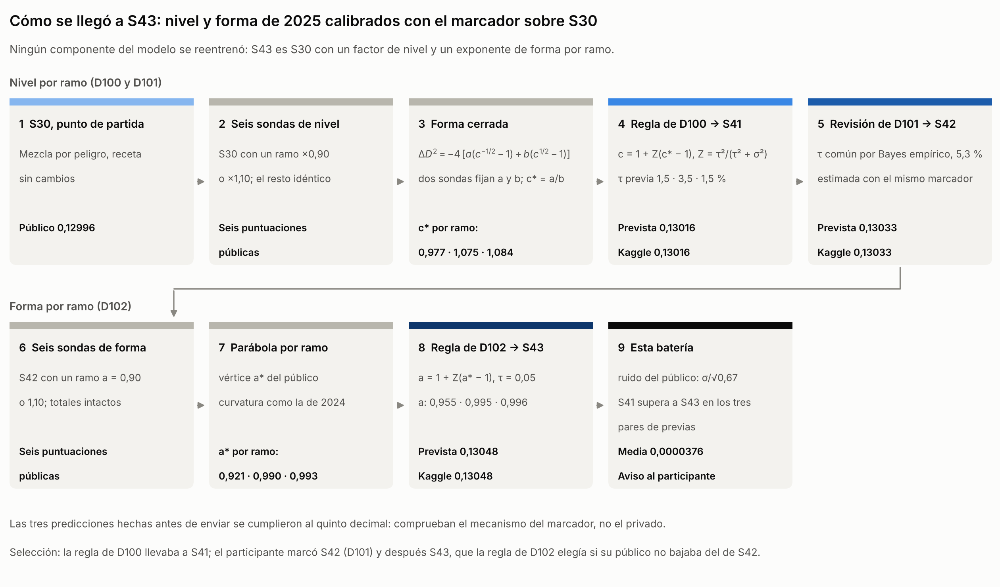
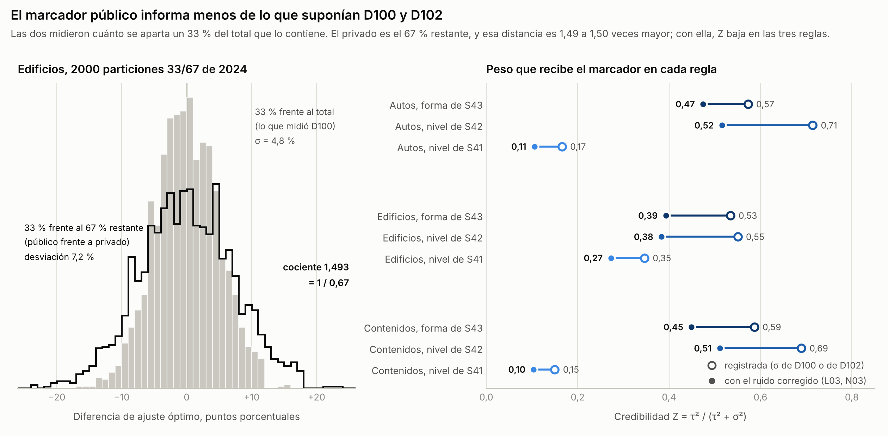
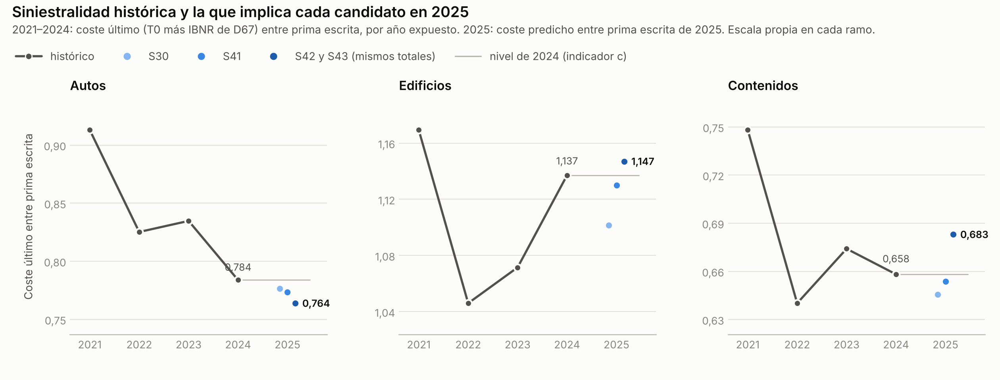
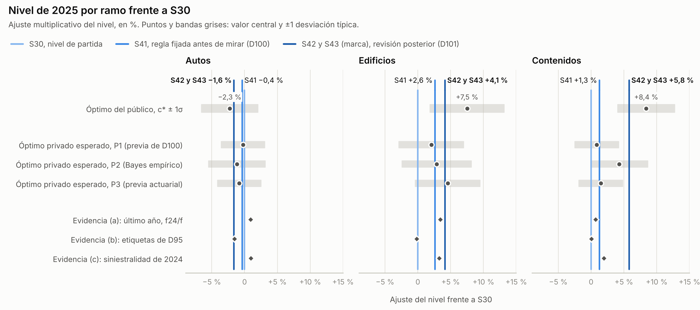
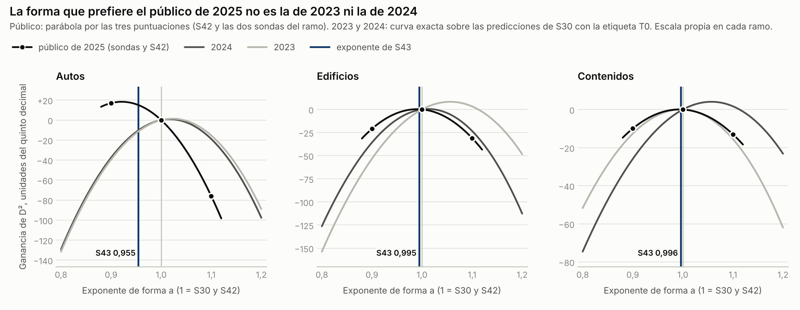
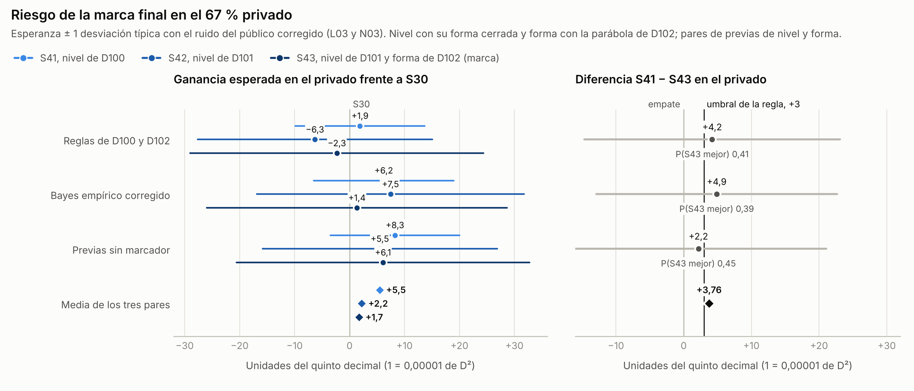

# Sensibilidad de S43: nivel y forma de 2025 calibrados con el marcador, revisados

Claude (Cowork), 23 de octubre de 2026, a pedido del participante («actualiza este ejercicio para S42» y después «Actualiza el modelo a S43»). Trabajo asistido por IA: no es revisión humana ni reproducción por otra persona. No cambia la receta, los archivos entregados, los envíos ni la marca en Kaggle. Hay dos baterías, cada una con su plan fijado antes de calcular: `sens42_20261022T165934Z_6ec8f1fe` para el nivel (L01 a L08) y `sens43_20261023T035154Z_aece6462` para la forma (N01 a N10). El informe que preveía la primera, `docs/SENSIBILIDAD_S42.md`, no se publicó por separado: la entrega final pasó a S43 antes de cerrarlo y quedó integrado aquí. El informe de la parte 1 sobre S30 y S22 (`docs/archivo/semana1/SENSIBILIDAD_S30_S22.md`, D95) se conserva como histórico.

Estado a las 04:17 UTC del 23 de octubre: según el último registro (CIE-D102), la entrega marcada en Kaggle es S43, por decisión del participante. Las reglas de alarma de las dos baterías se cumplieron, la del nivel a favor de S41 frente a S42 y la de la forma a favor de S41 frente a S43, y se avisó al participante de cada una. Puede cambiar la marca hasta las 11:00 de Bogotá del 23 de octubre; si la cambia, hay que actualizar el apartado «Qué significa para la marca final».

## Resumen

S43 es la Mezcla por peligro (S30) con dos ajustes por ramo calibrados con el marcador público: un factor de nivel (0,9838 en autos, 1,0413 en edificios y 1,0579 en contenidos) y un exponente de forma (0,955, 0,995 y 0,996) que comprime o amplía las diferencias de tasa entre pólizas sin mover el total del ramo. Ningún componente se reentrenó. Es una calibración del nivel y de la forma de 2025 con seis parámetros, de los que cuatro se apartan de 1 en más de una centésima (los tres de nivel y el de forma de autos), y así se presenta en todo el informe.

Cada ajuste salió de seis envíos de prueba, las sondas. Para el nivel, una forma cerrada exacta de la desviación Tweedie convierte las sondas en el nivel que maximiza el público; para la forma, una parábola por tres puntos da el exponente que lo maximiza. Una regla fijada antes de mirar aplicó solo la parte creíble de cada óptimo, y en el nivel una revisión posterior (D101) estimó esa credibilidad con los mismos resultados. Las tres predicciones hechas antes de enviar se cumplieron al quinto decimal: 0,1301576, 0,1303301 y 0,1304821, frente a 0,13016, 0,13033 y 0,13048 en Kaggle. Eso confirma que el marcador funciona como se supuso. Del 67 % privado, que decide la clasificación, no dice nada.

Las dos baterías encontraron el mismo error de diseño en D100 y en D102. El ruido del óptimo público se midió frente al total de 2024, que contiene a la propia muestra; frente al 67 % que no se ve, la distancia es 1/0,67 veces mayor, con cocientes medidos de 1,4926 para el nivel de edificios (L03) y 1,5000 para la forma de autos (N03). Con el ruido corregido, S41 tiene más esperanza que S43 en el privado bajo los tres pares de previas evaluados. La diferencia media es 0,0000376, por encima del umbral de 0,00003 fijado en los planes, así que la regla de alarma se cumplió. Resiste el redondeo del marcador (se mantiene en el 99,9 % de las extracciones), las semillas y las demás variantes probadas; solo desaparece si no se corrige el ruido.

La evidencia actuarial independiente del marcador apoya el nivel de edificios y solo en parte los de autos y contenidos (L05). Para la forma de autos no hay apoyo: 2023 y 2024 prefieren ampliar las diferencias (+2,3 % y +1,7 % sobre S30), mientras que S43 las comprime con un exponente de 0,955. Aplicada a esos años, la forma de S43 habría restado 0,000127 y 0,000111 de D² (N06 y N07).

| Experimento | Pregunta fijada en el plan | Resultado frente al criterio |
| --- | --- | --- |
| L01 Recálculo del nivel | ¿Salen los mismos factores, públicos y archivos con código propio? | Sí; SHA-256 de S41 y S42 iguales |
| L02 Redondeo, nivel | ¿Queda el factor de S42 dentro de ±0,2 %? | No en edificios (0,27 %) ni en contenidos (0,41 %). Adverso; efecto acotado |
| L03 Ruido del nivel | ¿Está el cociente entre 1,4 y 1,6? | Sí (1,4925 a 1,4926) |
| L04 Riesgo, nivel | ¿Supera S41 a S42 según la regla de alarma? | Sí, por 0,0000025 sobre el umbral |
| L05 Evidencia del nivel | ¿Apoya la evidencia sin marcador el nivel de S42? | Edificios apoyado; autos parcial; contenidos parcial |
| L06 Herencia, nivel | ¿Es S42/S30 constante dentro de cada ramo? | Sí, salvo el redondeo del CSV |
| L07 Capitales, nivel | ¿Cuánto pesan las 123 filas en S42? | 25.732,84 CU, el 0,0120 % del total |
| N01 Recálculo de la forma | ¿Salen los mismos exponentes, público y archivo? | Sí; SHA-256 de S43 igual |
| N02 Redondeo, forma | ¿Queda el exponente de autos dentro de ±0,005? | Sí (de 0,9533 a 0,9563) |
| N03 Ruido de la forma | ¿Está el cociente entre 1,4 y 1,6? | Sí (1,4913 a 1,5000) |
| N04 Calidad de la parábola | ¿Errores del vértice y del D² dentro de lo fijado? | Sí |
| N05 Riesgo de la marca | ¿Supera S41 o S42 a S43 según la regla de alarma? | S41 sí, por 0,0000076 sobre el umbral; S42 no |
| N06 Evidencia de la forma | ¿Apoya la evidencia sin marcador la forma de S43? | Autos sin apoyo; edificios parcial; contenidos parcial |
| N07 Retroprueba de la forma | ¿Qué habría hecho la forma de S43 en 2023 y 2024? | Empeora los dos años |
| N08 Herencia, forma | ¿Se conservan el orden de las tasas y el total del ramo? | Sí, salvo el redondeo del CSV |
| N09 Capitales, forma | ¿Cuánto pesan las 123 filas en S43? | 25.708,75 CU, el 0,0120 % del total |
| L08 y N10 Narrativa | ¿Cuenta el informe el procedimiento completo? | Sí; el verificador comprueba cada pieza |

## Qué es S43

| Ramo | Nivel de S41 | Nivel de S42 y S43 | Forma de S43 | Total de S30 (CU) | Total de S43 (CU) | Cambio |
| --- | ---: | ---: | ---: | ---: | ---: | ---: |
| Autos | 0,9962 | 0,9838 | 0,955 | 118.900.944 | 116.978.989 | −1,62 % |
| Edificios | 1,0260 | 1,0413 | 0,995 | 74.366.228 | 77.439.072 | +4,13 % |
| Contenidos | 1,0126 | 1,0579 | 0,996 | 18.694.919 | 19.777.819 | +5,79 % |
| Total | | | | 211.962.091 | 214.195.879 | +1,05 % |

El factor de nivel multiplica todas las predicciones del ramo. El exponente de forma actúa sobre la tasa por año expuesto, r = μ/e: con g la tasa media del ramo, la tasa nueva es g·(r/g)^a, y después se reescala para que el total del ramo no cambie. Con a menor que 1 las pólizas de tasa alta bajan y las de tasa baja suben; con a = 1 nada cambia. Por eso los totales de S43 son los de S42 y el orden de las tasas es el de S30 (N08).

Las frecuencias y severidades por peligro, los pesos de la mezcla, la regla de nivel s17 y los factores de año siguiente de S30 siguen como estaban. Para 2023 y 2024, S43 y S30 son el mismo modelo, porque los seis parámetros son una calibración de 2025 que solo existe sobre el test. La descripción correcta es la Mezcla por peligro con el nivel y la forma de 2025 recalibrados por ramo con información del marcador público, que es lo que D100 y D102 pidieron declarar.

## El procedimiento completo



Figura 1. El procedimiento en orden: arriba el nivel, abajo la forma. Las barras de color siguen la escala que usan todas las figuras, de S30 (claro) a S43 (oscuro), de menos a más uso del marcador.

### 1. Seis sondas de nivel

Cada sonda es S30 con un solo ramo multiplicado por 0,90 o por 1,10 y el resto idéntico byte a byte. Codex las envió el 22 de octubre entre las 16:17 y las 16:19 UTC, con autorización directa del participante, y quedaron excluidas de la selección final.

| Sonda | Público D² | Envío en Kaggle |
| --- | ---: | ---: |
| S30, sin cambios | 0,12996 | |
| Autos ×0,90 | 0,12954 | 57531293 |
| Autos ×1,10 | 0,12906 | 57531323 |
| Edificios ×0,90 | 0,12873 | 57531339 |
| Edificios ×1,10 | 0,13018 | 57531344 |
| Contenidos ×0,90 | 0,12929 | 57531358 |
| Contenidos ×1,10 | 0,13011 | 57531364 |

Ya a simple vista se lee la dirección: en autos bajar el nivel perjudica menos que subirlo, y en edificios y contenidos subirlo mejora el público.

### 2. La forma cerrada del nivel

Con la desviación Tweedie de potencia 1,5, cada fila aporta d = 4·(y/√μ + √μ − 2√y), donde y es el coste observado y μ la predicción. Si las predicciones de un ramo se multiplican por c, el cambio del D² público tiene una forma exacta:

D²(c) − D²(1) = −4·[a·(c^−½ − 1) + b·(c^½ − 1)]

con a = Σ y/√μ y b = Σ √μ sobre las filas públicas del ramo, divididas por la desviación nula del público. No hay aproximación; la única incertidumbre es el redondeo de las puntuaciones a cinco decimales (L02). Las dos sondas de un ramo dan dos ecuaciones con dos incógnitas, y resueltas dan a, b y el nivel que maximiza el público, c* = a/b:

| Ramo | a | b | c* | Ajuste que pide el público |
| --- | ---: | ---: | ---: | ---: |
| Autos | 0,06614 | 0,06767 | 0,9774 | −2,3 % |
| Edificios | 0,04835 | 0,04497 | 1,0751 | +7,5 % |
| Contenidos | 0,02480 | 0,02288 | 1,0840 | +8,4 % |

La misma fórmula predice el público de cualquier combinación de factores. Antes de enviar los candidatos predijo 0,1301576 para S41 y 0,1303301 para S42; Kaggle devolvió 0,13016 y 0,13033 (envíos 57531719 y 57531744). Las diferencias (Kaggle menos predicción), +0,00000241 y −0,00000007, son menores que medio dígito del quinto decimal. Así se comprueban tres cosas: que el marcador calcula el D² de la desviación Tweedie 1,5 sin ponderaciones que alteren el efecto de un factor de nivel, que los ramos se suman sin interacción y que los archivos se construyeron como se describe. El privado queda fuera de esa comprobación. Además, la puntuación pública de cada candidato se mide con las mismas filas con que se eligieron sus factores, así que es optimista por construcción.

### 3. La regla de nivel fijada antes de mirar (D100)

Aplicar c* entero habría subido el público, pero el óptimo de un tercio de las filas lleva ruido de muestreo. D100 fijó, antes de ver ninguna sonda, una regla de credibilidad: c = 1 + Z·(c* − 1), con Z = τ²/(τ² + σ²). La τ dice cuánto se espera que el nivel de 2025 se aparte de S30 sin mirar el marcador: 1,5 % en autos, 3,5 % en edificios (la mitad de la distancia entre los factores de año siguiente f23 y f24) y 1,5 % en contenidos; en autos y contenidos amplía esa media distancia con lo que D95 midió sobre el IBNR y las recuperaciones. La σ es el ruido del óptimo de un 33 %; D100 la estimó con 300 submuestras del 33 % de 2024 alrededor del óptimo de todo 2024: 3,37 %, 4,81 % y 3,57 %. De ahí salen Z = 0,166, 0,346 y 0,150, y los factores de S41 (−0,38 %, +2,60 % y +1,26 %). La regla de selección también quedó escrita: entregar S41 si su público no bajaba del de S30. S41 puntuó 0,13016, por encima de 0,12996, de modo que la regla preinscrita llevaba a S41.

### 4. La revisión posterior (D101)

Con los tres c* a la vista, los desvíos eran mayores de lo que la previa de D100 admitía: la suma de los desvíos estandarizados al cuadrado dio 6,68 con tres grados de libertad (p = 0,08), sobre todo por contenidos, que se apartó 2,2 veces la desviación típica esperada. D101 reestimó entonces una τ común con los mismos tres ramos (Bayes empírico: τ² = media de (c* − 1)² − σ²), que dio τ = 5,3 %. Con esa τ la credibilidad pasa a 0,714, 0,550 y 0,689, y salen los factores de S42 (−1,62 %, +4,13 % y +5,79 %). D101 dejó escrita su advertencia: la revisión usa los mismos resultados que después aplica, no sustituye a la regla de D100 y por eso informó el privado esperado bajo las dos hipótesis. Frente a S30, S42 esperaba −0,000037 si la previa de D100 era la correcta y +0,000175 si lo era la τ revisada; S41, +0,000034 y +0,000104.

### 5. Por qué se eligió S42

En D101 la recomendación de Claude fue S41, la regla preinscrita. El participante decidió enviar los dos candidatos y elegir después. Codex los envió a las 16:33 y 16:34 UTC, y a las 16:36 UTC el marcador público ponía al participante primero con 0,13033, por delante de 0,13003 (registro CIE-D101). El participante marcó S42 a las 11:36 de Bogotá, con la información de D101 a la vista: más margen en el público y un privado esperado entre −0,00004 y +0,00017 frente a S30. El registro lo describe como una decisión de tolerancia al riesgo del participante.

### 6. Seis sondas de forma (D102)

Con S42 marcado y un margen público de 0,0003 sobre el segundo, el participante pidió otra palanca que le diera ventaja. D102 midió antes de decidir que, entre las que no exigen reentrenar, solo la forma podía informarse con pocos envíos y un parámetro por ramo. Cada sonda es S42 con un solo ramo transformado con a = 0,90 (diferencias comprimidas) o a = 1,10 (ampliadas) y el total del ramo intacto. Codex las envió entre las 03:30 y las 03:31 UTC del 23 de octubre, con autorización directa del participante, y también quedaron excluidas de la selección final.

| Sonda | Público D² | Envío en Kaggle |
| --- | ---: | ---: |
| S42, sin cambios | 0,13033 | 57531744 |
| Autos a = 0,90 | 0,13050 | 57547563 |
| Autos a = 1,10 | 0,12957 | 57547570 |
| Edificios a = 0,90 | 0,13012 | 57547573 |
| Edificios a = 1,10 | 0,13002 | 57547576 |
| Contenidos a = 0,90 | 0,13023 | 57547584 |
| Contenidos a = 1,10 | 0,13020 | 57547593 |

En autos, comprimir mejora el público y ampliar lo empeora mucho; en edificios y contenidos las dos sondas empeoran poco, señal de que ya estaban cerca del óptimo. La sonda de autos a = 0,90 (0,13050) supera incluso a S43. La regla la excluye de la selección, porque elegirla sería quedarse con el mejor público en vez de con la estimación creíble.

### 7. La parábola de la forma

El D² como función de a no tiene forma cerrada, pero cerca del óptimo es casi una parábola. Con las tres puntuaciones de un ramo (a = 0,90, 1,00 y 1,10) se obtienen su curvatura K y su vértice a*, el exponente que maximiza el público:

| Ramo | Curvatura del público | Curvatura de 2024 | Vértice a* | Ajuste que pide el público |
| --- | ---: | ---: | ---: | ---: |
| Autos | 0,0295 | 0,0282 | 0,921 | −7,9 % |
| Edificios | 0,0260 | 0,0296 | 0,990 | −1,0 % |
| Contenidos | 0,0115 | 0,0121 | 0,993 | −0,7 % |

Las curvaturas del público se parecen a las de 2024, lo que hace creíble la aproximación, y N04 lo comprueba sobre 2024. Con la parábola, D102 predijo 0,1304821 para S43 y Kaggle devolvió 0,13048 (envío 57547764; diferencia −0,00000207). Las mismas cautelas valen aquí: el acierto comprueba el mecanismo, no el privado, y el público de S43 es optimista por construcción.

### 8. La regla de forma fijada antes de mirar y por qué se eligió S43

D102 fijó antes de las sondas una regla con la misma estructura que la del nivel: a = 1 + Z·(a* − 1), con Z = τ²/(τ² + σ²), τ = 0,05 en los tres ramos y σ = 0,0432, 0,0467 y 0,0420, el ruido del vértice de un 33 % de 2024 medido como en D100. De ahí salen Z = 0,573, 0,534 y 0,587 y los exponentes de S43. La regla de selección también quedó escrita: S43 si su público no bajaba del de S42. S43 puntuó 0,13048 frente a 0,13033, y el participante marcó S43 como entrega final la noche del 22 (registro CIE-D102). D102 informó el privado esperado de la forma bajo dos hipótesis: −0,000061 si el óptimo de 2025 fuera la forma de S42 y +0,000061 si la previa de ±0,05 fuera la correcta.

## Lo que comprobó la batería de nivel (sens42)

### L01. Recálculo y reproducción

Con código propio, sin usar `sonda_nivel.py`, recalculé a, b y c* desde las siete puntuaciones, los factores de S41 y S42, sus públicos esperados y los dos CSV desde el CSV entregado de S30 (SHA-256 fd9528e0…). Los factores coinciden con los registrados en todas sus cifras, los públicos esperados redondean a los de Kaggle y los dos CSV regenerados tienen el SHA-256 registrado (d8661c28… para S41 y a2fdcccd… para S42). Criterio cumplido.

### L02. Redondeo del marcador

Kaggle publica cinco decimales, así que cada puntuación puede estar desplazada hasta 0,000005. Propagado con 20.000 extracciones uniformes sobre las siete puntuaciones, el factor de S42 queda entre 0,9831 y 0,9846 en autos, entre 1,0386 y 1,0442 en edificios y entre 1,0537 y 1,0625 en contenidos, con semianchos relativos de 0,07 %, 0,27 % y 0,41 %. El plan fijó ±0,2 % como límite de lo inmaterial, y edificios y contenidos lo superan: resultado adverso. En D² el efecto está acotado (cálculo no preinscrito). Si las puntuaciones exactas hubieran llevado los factores a las esquinas de ese intervalo, el público esperado habría cambiado como mucho 0,000014 y la ganancia esperada en el privado como mucho 0,000017, muy por debajo de su desviación típica (0,000213 bajo la previa de D100).

### L03. El ruido del público estaba subestimado



Figura 2. A la izquierda, 2000 particiones aleatorias 33/67 de 2024 en edificios: en gris, cuánto se aparta el óptimo de nivel del 33 % del de todo 2024 (lo que midió D100); en negro, cuánto se aparta del óptimo del 67 % restante. A la derecha, la credibilidad de las tres reglas con el σ registrado (círculo vacío) y con el ruido corregido (círculo lleno); la de forma se mide en N03.

D100 midió σ como la dispersión del óptimo de un 33 % de 2024 alrededor del óptimo de todo 2024. Ese total contiene a la propia muestra, que lo arrastra hacia sí, y la distancia queda corta. Lo que importa para el privado es la distancia entre el 33 % que se ve y el 67 % que no. Con filas independientes, esa distancia tiene una desviación típica 1/0,67 veces mayor, y el ruido del óptimo público alrededor del nivel verdadero cumple σ_pub² = σ²/0,67.

Lo comprobé con 2000 particiones aleatorias 33/67 de 2024 (predicciones de S30 en V24 y etiqueta T0) con tres semillas, más una variante que reparte clientes completos. El cociente sale 1,4925 en autos, 1,4926 en edificios y 1,4926 en contenidos, dentro del intervalo [1,4; 1,6] del plan, y la pendiente del óptimo del 67 % sobre el del 33 % es −0,4925, −0,4926 y −0,4926 (la teoría da −0,33/0,67): cuando el público sale alto, el resto tiende a salir bajo. Repartir clientes completos cambia la dispersión en −1,0 %, +0,6 % y +0,1 %, lejos del 20 % que se habría declarado como incertidumbre adicional. El ruido del público pasa a 4,37 %, 5,71 % y 4,41 % (D100 usó 3,37 %, 4,81 % y 3,57 %), y el del privado es 3,06 %, 4,01 % y 3,09 %. Con él, la credibilidad de D100 pasa a 0,106, 0,273 y 0,104, y la de D101, reestimada restando σ_pub² (τ = 4,51 % en lugar de 5,32 %), a 0,516, 0,383 y 0,511. La señal que motivó D101 también se debilita (cálculo no preinscrito): la suma de desvíos estandarizados baja de 6,68 (p = 0,08) a 4,75 (p = 0,19).

### L04. Riesgo del nivel en el privado

En el privado, la ganancia de un factor c frente a S30 tiene la misma forma cerrada que en el público, con el óptimo del privado en lugar del público. Es lineal en ese óptimo, que, dado lo que se vio en el público, es normal con media m0 + Z·(x − m0) y varianza Z·σ_pub² + σ_priv², donde x = c* − 1 y m0 es la media de la previa. La esperanza y la dispersión de la ganancia salen así exactas, sin simulación. El plan fijó tres previas: P1, la de D100, centrada en S30; P2, Bayes empírico con la τ común reestimada restando σ_pub² (4,51 %); y P3, una previa actuarial anterior al marcador, con la τ de D100 y centrada en el último año de S30 (f24/f) más, en autos, −1,55 % por las recuperaciones no anticipadas y el IBNR de lesiones de D95 (−0,63 %, +3,44 % y +0,68 %).

| Previa | S41 frente a S30 | S42 frente a S30 | S42 menos S41 | P(S42 mejor que S41) |
| --- | ---: | ---: | ---: | ---: |
| P1 | +0,000019 ± 0,000118 | −0,000063 ± 0,000213 | −0,000082 ± 0,000110 | 0,23 |
| P2 | +0,000062 ± 0,000127 | +0,000075 ± 0,000243 | +0,000012 ± 0,000134 | 0,54 |
| P3 | +0,000083 ± 0,000118 | +0,000055 ± 0,000213 | −0,000028 ± 0,000110 | 0,40 |
| Media de las tres | +0,000055 | +0,000022 | −0,0000325 | |

La regla de alarma de `sens42` pedía que L03 confirmara la corrección, que S41 superara a S42 en esperanza bajo al menos dos previas, que la media de esa diferencia llegara a 0,00003 (el piso de semillas del proyecto, E07 de D95) y que S41 no perdiera frente a S30 bajo ninguna. Se cumplieron las cuatro, con una media de 0,0000325, y se avisó al participante el 22 de octubre. El margen era estrecho (0,0000025): con el redondeo del marcador la regla se mantenía en el 80 % de las extracciones, con el extremo del efecto de D95 en autos la media quedaba en 0,0000276 y sin corregir el ruido en 0,0000047 (cálculos no preinscritos). La forma exacta reproduce casi lo que registró D101 con su mismo σ: el privado esperado de S42 sale −0,000030 y +0,000168 (D101: −0,000037 y +0,000175). Lo que cambia la lectura es la corrección del ruido.

### L05. Evidencia actuarial independiente del nivel



Figura 3. Coste último (T0 más IBNR de D67) entre prima escrita, por año expuesto, y la siniestralidad de 2025 que implica cada candidato; S43 tiene los totales de S42. Cada ramo tiene su escala.

Sin mirar el marcador hay tres señales sobre hacia dónde debería moverse el nivel de 2025 frente a S30. La señal (a) es el último año, f24/f − 1: cuánto cambiaría el nivel si se usara solo el factor de año siguiente de 2024. La (b) recoge los efectos de etiqueta medidos en D95: el IBNR del backtesting en los tres ramos y, en autos, las recuperaciones no anticipadas. La (c) es el ajuste que dejaría la siniestralidad de 2025 igual a la de 2024. La regla fijada en el plan clasifica el ajuste como «apoyado» si al menos dos señales coinciden con él en signo y su tamaño no supera la mayor de ellas más una τ de D100, «parcial» con una y «sin apoyo» con ninguna.

| Ramo | (a) Último año | (b) Etiquetas de D95 | (c) Siniestralidad de 2024 | Ajuste de S41 | Ajuste de S42 y S43 | Según la regla |
| --- | ---: | ---: | ---: | ---: | ---: | --- |
| Autos | +0,92 % | −1,55 % | +0,95 % | −0,38 % | −1,62 % | parcial |
| Edificios | +3,44 % | −0,18 % | +3,23 % | +2,60 % | +4,13 % | apoyado |
| Contenidos | +0,68 % | +0,03 % | +1,94 % | +1,26 % | +5,79 % | parcial |

| Ramo | 2021 | 2022 | 2023 | 2024 | 2025 con S30 | 2025 con S41 | 2025 con S42 y S43 |
| --- | ---: | ---: | ---: | ---: | ---: | ---: | ---: |
| Autos | 0,913 | 0,825 | 0,835 | 0,784 | 0,776 | 0,774 | 0,764 |
| Edificios | 1,169 | 1,046 | 1,071 | 1,137 | 1,101 | 1,130 | 1,147 |
| Contenidos | 0,748 | 0,640 | 0,674 | 0,658 | 0,646 | 0,654 | 0,683 |

Edificios queda apoyado: el último año y la siniestralidad de 2024 piden subir entre +3,23 % y +3,44 %, y S42 sube +4,13 %, dentro del margen; su siniestralidad de 2025 sería 1,147, cerca de la de 2024, con un coste por año expuesto que crece +6,27 % frente a una prima que crece +5,35 %. En autos solo la señal de D95 coincide con la bajada de S42. La siniestralidad de autos viene bajando (0,913 en 2021, 0,784 en 2024) y S42 la lleva a 0,764: el coste por año expuesto crecería +0,10 % frente a una prima que crece +2,71 %. Esa lectura de tendencia no estaba en la regla y no cambia la clasificación. Contenidos es un caso que la regla no previó de forma literal: las tres señales coinciden en signo, pero S42 sube +5,79 % cuando el tope es 3,44 % (la señal mayor, +1,94 %, más τ = 1,5 %); lo clasifiqué como parcial, la categoría intermedia. Con S42, la siniestralidad de contenidos de 2025 sería 0,683, por encima de la de cada año desde 2022, y el coste por año expuesto crecería +9,33 % frente a una prima que crece +5,35 %. Con la misma regla, S41 queda parcial en autos, apoyado en edificios y apoyado en contenidos (cálculo no preinscrito).



Figura 4. Ajuste del nivel frente a S30 por ramo. Arriba, el óptimo del público con su ruido corregido; en medio, el óptimo esperado del privado bajo cada previa con una desviación típica; abajo, las tres señales actuariales. En los tres ramos el óptimo esperado del privado queda más cerca de S30 que el del público, porque el público se ve a través de su ruido.

### L06 y L07. Herencia y capitales

Dentro de cada ramo, S42 es S30 multiplicado por su factor: la mayor diferencia fila a fila es 0,0000005 CU en autos (254.986 filas), 0,0000005 en edificios y 0,0000005 en contenidos, dentro del redondeo a seis decimales del CSV. En autos ese redondeo crea 4 empates nuevos que mueven medio puesto a 8 filas, sin invertir ningún par. Las 123 filas de test con capital sin confirmar (D95, E05) suman 25.732,84 CU en S42 frente a 24.667,97 en S30, todas de hogar.

## Lo que comprobó la batería de forma (sens43)

### N01. Recálculo y reproducción

Con código propio, sin usar `sonda_forma.py`, recalculé la parábola, el vértice y el exponente de cada ramo desde las siete puntuaciones, el público esperado de S43 (0,1304821) y el CSV de S43 desde el de S42 y la exposición del test. Los exponentes coinciden con los registrados en todas sus cifras y el CSV regenerado tiene el SHA-256 registrado (a8010a69…). Criterio cumplido.

### N02. Redondeo del marcador

Con 20.000 extracciones uniformes de ±0,000005 sobre las siete puntuaciones de la forma, el exponente de autos de la regla queda entre 0,9533 y 0,9563, dentro del ±0,005 que el plan fijó como inmaterial.

### N03. El ruido del vértice de forma también estaba subestimado

D102 midió el ruido del vértice igual que D100, frente al total de 2024. Lo medí con el estimador que se usó con el público, la parábola por 0,90, 1,00 y 1,10, en 2000 particiones 33/67 de 2024 por semilla. El cociente frente al 67 % restante es 1,5000 en autos, 1,4940 en edificios y 1,4913 en contenidos, con pendientes de −0,4997, −0,4925 y −0,4904: la misma relación 1/0,67 que L03 encontró para el nivel. Repartir clientes completos cambia la dispersión como mucho un 5,1 %. El ruido del vértice público pasa a 0,0526, 0,0621 y 0,0554 (D102 usó 0,0432, 0,0467 y 0,0420), el del privado es 0,0369, 0,0436 y 0,0389, y con τ = 0,05 la credibilidad de la forma baja a 0,475, 0,393 y 0,449. El error de forma y el de nivel de una misma partición están correlacionados (+0,31 en autos, −0,43 en edificios y −0,28 en contenidos); como el plan preveía para valores por encima de 0,3, N05 suma esa covarianza a la varianza.

### N04. Calidad de la parábola

Sobre 2024 y 2023, el vértice de la parábola de tres puntos se aparta del óptimo fino (rejilla de 0,005 con interpolación) como mucho 0,0016, y el D² que la parábola asigna al exponente de S43 se aparta del exacto como mucho 0,000002. Los dos quedan dentro de lo fijado (0,01 y 0,00001). La aproximación cuadrática es adecuada para este uso.

### N06. Evidencia ajena al marcador



Figura 5. La forma por ramo. En negro, la parábola del público de 2025 por sus tres puntuaciones, dibujada solo cerca de las sondas; en gris, la curva exacta de 2024 y de 2023 sobre las predicciones de S30. La línea vertical oscura es el exponente de S43.

Las señales que no usan el marcador son el exponente óptimo de 2024 (V24), el de 2023 (V23) y su extrapolación lineal a 2025, todos con la misma transformación y relativos a S30. La regla del plan es la de L05 con τ = 0,05, y deja escrito el caso que L05 no previó: si dos o más coinciden en signo pero el tamaño supera el tope, el ajuste es parcial.

| Ramo | (a) 2024 | (b) 2023 | (c) Extrapolación a 2025 | Ajuste de S43 | Según la regla |
| --- | ---: | ---: | ---: | ---: | --- |
| Autos | +1,7 % | +2,3 % | +1,2 % | −4,5 % | sin apoyo |
| Edificios | +1,2 % | +5,7 % | −3,2 % | −0,5 % | parcial |
| Contenidos | +5,7 % | −0,4 % | +11,8 % | −0,4 % | parcial |

En autos las tres señales piden ampliar algo las diferencias y S43 las comprime: no tiene apoyo fuera del marcador. En edificios y contenidos los ajustes de S43 son casi nulos y coinciden con una señal cada uno. El plan dejó escrita una advertencia: los parámetros de forma de la receta de S30 se eligieron con V23 y V24, así que (a) y (b) no son del todo independientes de la receta. La lectura que registró D102 va en la misma dirección: la forma de autos que se eligió en los cortes de validación no se traslada a 2025. Lo que este experimento añade es que 2023 y 2024 tampoco piden comprimirla.

### N07. Retroprueba en 2023 y 2024

Aplicar los exponentes de S43 a las predicciones de S30 resta 0,000127 de D² en 2023 (V23) y 0,000111 en 2024 (V24), casi todo en autos (0,000112 y 0,000101). Los dos cortes empeoran, y el plan lo registra como evidencia en contra de la forma de S43. No es una validación de 2025: dice qué habría pasado con la misma forma en los años que se usaron para construir la receta.

### N08 y N09. Herencia y capitales

El exponente no cambia el orden de las tasas por año expuesto: los pares invertidos entre S42 y S43 son todos menores que el redondeo del CSV. Sí reordena localmente las predicciones, porque pólizas con tasas distintas y exposiciones distintas pueden tener predicciones parecidas: en autos, la correlación de rangos de las predicciones es 0,9997. Las predicciones de autos cambian entre −5,5 % y +6,9 % frente a S42 (percentiles 1 y 99), y la dispersión de su logaritmo de tasa baja de 0,579 a 0,553. Los totales por ramo son los de S42 con una diferencia máxima de 0,0002 CU. Las 123 filas con capital sin confirmar suman 25.708,75 CU en S43, el 0,0120 % del total. Lo que de D95 dependía del orden dentro del ramo ya no se hereda en autos tal cual; lo sustituyen N07 y esta comprobación.

## El riesgo de la marca final (N05)



Figura 6. Esperanza y una desviación típica, en unidades del quinto decimal del marcador. A la izquierda, cada candidato frente a S30; a la derecha, S41 menos S43 con el umbral de la regla de alarma.

Con la parábola, la ganancia de la forma frente a S42 en un ramo es K·[2(a − 1)θ − (a − 1)²], lineal en θ, el desvío del exponente óptimo del privado. Como en el nivel, θ es normal dado el público, con la media y la varianza del modelo de ruido corregido. El plan fijó tres previas de forma y las emparejó con las de nivel: las reglas de D100 y D102 (centradas en S30, τ de cada decisión); Bayes empírico corregido, que en la forma da τ = 0,00 porque los tres vértices caben en el ruido; y las previas sin marcador, la actuarial del nivel con la forma centrada en el óptimo de 2024. La ganancia frente a S30 es la del nivel más la de la forma.

| Par de previas | S41 | S42 | S43 | S43 menos S42 | S43 menos S41 | P(S43 mejor que S41) |
| --- | ---: | ---: | ---: | ---: | ---: | ---: |
| Reglas de D100 y D102 | +0,000019 | −0,000063 | −0,000023 ± 0,000267 | +0,000040 | −0,000042 ± 0,000189 | 0,41 |
| Bayes empírico corregido | +0,000062 | +0,000075 | +0,000014 ± 0,000273 | −0,000061 | −0,000049 ± 0,000178 | 0,39 |
| Previas sin marcador | +0,000083 | +0,000055 | +0,000061 ± 0,000267 | +0,000006 | −0,000022 ± 0,000189 | 0,45 |
| Media de los tres | +0,000055 | +0,000022 | +0,000017 | −0,000005 | −0,000038 | |

La forma de autos rinde +0,000040 bajo las reglas de D100 y D102, −0,000060 con Bayes empírico y +0,000012 con la previa sin marcador. Con el ruido corregido, el exponente óptimo esperado del privado en autos es 0,963, 1,000 y 0,973, menos extremo que el 0,955 de S43. Con el σ de D102, mi forma exacta reproduce sus dos escenarios registrados (−0,000061 y +0,000061).

La regla de alarma de `sens43` copia la de `sens42`: pide que N03 confirme la corrección, que un candidato ya enviado (S41 o S42) supere a S43 en esperanza bajo al menos dos pares, que la media de esa diferencia llegue a 0,00003 y que el candidato no pierda frente a S30 bajo ninguno. S41 cumple las cuatro: supera a S43 bajo los tres pares, con una media de 0,0000376, y gana a S30 bajo todos. S42 supera a S43 solo con Bayes empírico y pierde frente a S30 bajo las reglas de D100 y D102, así que no la cumple. Se avisó al participante el 23 de octubre, con la recomendación de valorar la marca S41 antes de las 11:00 de Bogotá.

Ninguna de las variantes siguientes estaba en el plan; sirven para ver de qué depende el veredicto:

| Variante | Media de S41 menos S43 | ¿Alarma? |
| --- | ---: | :---: |
| Base preinscrita | 0,0000376 | sí |
| Ruido de la semilla 7 | 0,0000386 | sí |
| Ruido de la semilla 101 | 0,0000354 | sí |
| Ruido de la semilla 2026 | 0,0000386 | sí |
| Forma sin marcador centrada en el óptimo fino de 2024 | 0,0000358 | sí |
| Curvatura de 2024 en lugar de la del público | 0,0000376 | sí |
| Posterior conjunta de nivel y forma | 0,0000477 | sí |
| Sin corregir el ruido (σ de D100 y de D102) | −0,0000128 | no |
| Redondeo de las catorce puntuaciones, percentiles 5 y 95 | 0,0000330 a 0,0000421 | en el 99,9 % |

La alarma descansa en la corrección del ruido; sin ella, S43 saldría por delante de S41 en 0,0000128. L03 y N03 confirman esa corrección con el cociente teórico casi exacto, en el nivel y en la forma. El margen sobre el umbral es ahora 0,0000076, unas tres veces el de la batería de nivel, y el redondeo del marcador ya no lo pone en duda.

## Lo que se hereda de D95 y por qué

Multiplicar un ramo por una constante deja intactos el orden de las filas, los cocientes entre filas y el reparto del total dentro del ramo. El exponente de forma conserva el orden de las tasas y el total, pero cambia los cocientes entre pólizas. En 2023 y 2024, S43 y S30 son el mismo modelo. Con eso, las conclusiones de D95 se trasladan así:

| D95 | Qué medía | Para S43 |
| --- | --- | --- |
| E01 Influencia de clientes | S30 frente a S22 en 2023 y 2024 | Se hereda: en esos años S43 es S30 |
| E02 Nivel por ramo | La distancia entre f23 y f24 | Se relee en L05 |
| E03 Reservas y recuperaciones | Orden y nivel con otras reservas | Se hereda para 2023 y 2024; el nivel de autos entra en P3 y en la señal (b) |
| E04 Meseta de pesos | Pesos vecinos de la mezcla | Se hereda: los pesos no cambian |
| E05 Capitales sin confirmación | Sensibilidad de 123 filas | La parte relativa cambia poco en hogar (exponentes de 0,995 y 0,996); el total, en N09 |
| E06 Cohortes y segmentos | Ventaja por región, semestre y decil | Se hereda para 2023 y 2024 |
| E07 Piso de ruido | Semillas | Se hereda; es el umbral de las dos reglas de alarma |
| E08 Tendencia de severidad | Escenarios de tendencia | Se hereda: la receta no cambia |
| E09 Forma y elasticidad | Meseta de forma en 2023 y 2024 | Se sustituye por N06 y N07, que miden la forma de S43 en esos años |
| E10 Reproducción de componentes | Reentrenar y comparar | Se hereda; la regeneración de S41, S42 y S43 se comprueba en L01 y N01 |
| E11 Semilla nueva | | No se ejecutó en D95 |
| E12 Backtesting del IBNR | IBNR por peligro | Su efecto en el nivel entra en P3 y en la señal (b) |

No se hereda lo que depende del nivel o de la forma de 2025: el D² absoluto, los totales y la relación con el marcador. Eso es lo que miden L02 a L05 y N02 a N07.

## Qué significa para la marca final

Con lo medido aquí, S41 es la opción más robusta para el privado: gana a S30 en esperanza bajo los tres pares de previas (+0,000019, +0,000062 y +0,000083), con menos de la mitad de la dispersión de S43 (0,000118 frente a 0,000267 bajo las reglas de D100 y D102), y su nivel queda apoyado por la evidencia actuarial en edificios y contenidos (con la regla de L05, sin preinscribir). S43 tiene el mejor público de los candidatos (0,13048) y su nivel de edificios está apoyado, pero su forma de autos no tiene apoyo fuera del marcador, su nivel de contenidos sube más de lo que esa evidencia admite y, con el ruido corregido, su esperanza en el privado va de −0,000023 a +0,000061 según la previa. La diferencia con S41 es pequeña frente al ruido: P(S43 mejor que S41) vale 0,41, 0,39 y 0,45.

El marcador público no cambia con la marca: según lo registrado en CLA-20261022-012, el tablero muestra para el equipo la mejor puntuación de todos sus envíos (0,13050, la sonda de autos a = 0,90), y la clasificación final usa el privado de la entrega marcada. Las dos reglas de alarma se cumplieron y se avisó al participante; la decisión es suya. Si mantiene S43, el informe final debe decir que se eligió con este riesgo a la vista. Si cambia a S41, la entrega vuelve a la regla fijada antes de mirar del primer paso y el procedimiento contado aquí no cambia.

## Límites

El ruido se mide sobre 2024 como sustituto de 2025 y supone filas independientes; la variante por clientes apenas lo mueve, pero la división real entre público y privado es la de Kaggle, que la página del concurso describe como de aproximadamente un tercio y dos tercios. Las previas son una muestra de las razonables, y la media de los tres pares es una convención fijada en los planes. La escala del privado y la curvatura de la forma se toman del público. La forma se trata con una parábola, adecuada cerca de las sondas (N04). Los ramos se tratan como independientes; dentro de cada ramo, la correlación entre nivel y forma entra en la varianza y, en una variante no preinscrita, también en la media. Las señales actuariales son gruesas: la (c) del nivel supone siniestralidad constante, los últimos de 2024 dependen del IBNR de D67, cuyo backtesting falló en varios peligros (D95, E12), y las de forma no son del todo independientes de la receta. Todo es trabajo de Claude, sin revisión humana ni reproducción por otro operador.

## Anexo: evidencia y cómo repetir

Planes preinscritos: `privado/corridas/sens42_20261022T165934Z_6ec8f1fe/PLAN_PREREGISTRO.md` (SHA-256 6ec8f1fe6b6ad40d802774281c77167ec3830dc160a68bfcb76f6a0f45b37347), escrito antes de calcular L01 a L07, y `privado/corridas/sens43_20261023T035154Z_aece6462/PLAN_PREREGISTRO.md` (SHA-256 aece6462d2d0c799c46d4297ba74c555100b4c459d65c3da5470c83727751a44), escrito antes de calcular N01 a N09. Los cálculos se hicieron en la nube de Claude (Python 3.13, numpy 2.5.3, pandas 3.0.5; matplotlib 3.11.2 para las figuras) con copias de los insumos de la máquina del participante. La evidencia está en las carpetas `resultados/` de cada corrida: un JSON por experimento con el script que lo produjo, los cálculos no preinscritos en archivos aparte (`l04_robustez.json`, `l09_posthoc.json`, `l10_alarma_redondeo.json` y `n05_robustez.json`), los registros de D100, D101 y D102 que usan (`insumos/`) y los scripts de las figuras. La otra línea de Claude de este día (`repro_s42_20261022T170245Z_c9ea2fc3`) reprodujo el paso de nivel con `sonda_nivel.py` desde el reajuste completo de los componentes; es complementaria de L01, que usa código propio sobre el CSV entregado de S30.

Las figuras del repositorio llevan un bloque de credenciales de contenido C2PA que la plataforma de Claude añade al entregar imágenes; los scripts regeneran los mismos píxeles sin ese bloque, y las huellas de `figuras_s43.json` son las de los archivos entregados.

Cada cifra de este informe sale de esos JSON. `cifras_s43.json` dice de qué archivo, ruta y formato sale cada una, y `verificar_sensibilidad_s43.py` (solo biblioteca estándar) las recalcula, comprueba que este documento es exactamente la plantilla con esas cifras, las huellas de los dos planes, de las figuras y de la evidencia de las dos corridas, y los apartados que pidió el participante. Con `--autoprueba` comprueba además que detecta un número cambiado, evidencia alterada, un apartado borrado, un plan alterado, una figura alterada y una cifra guardada alterada:

```
python privado/corridas/sens43_20261023T035154Z_aece6462/resultados/verificar_sensibilidad_s43.py --autoprueba
```
