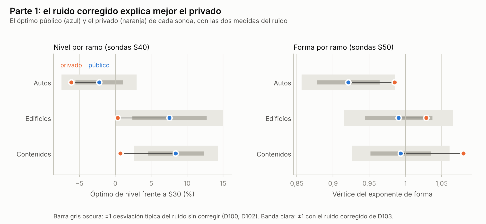
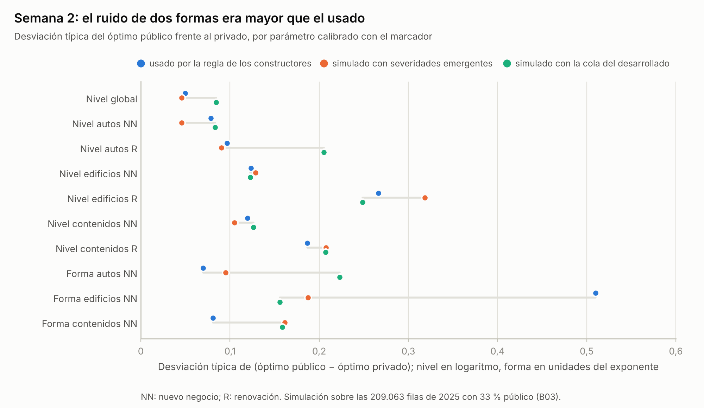
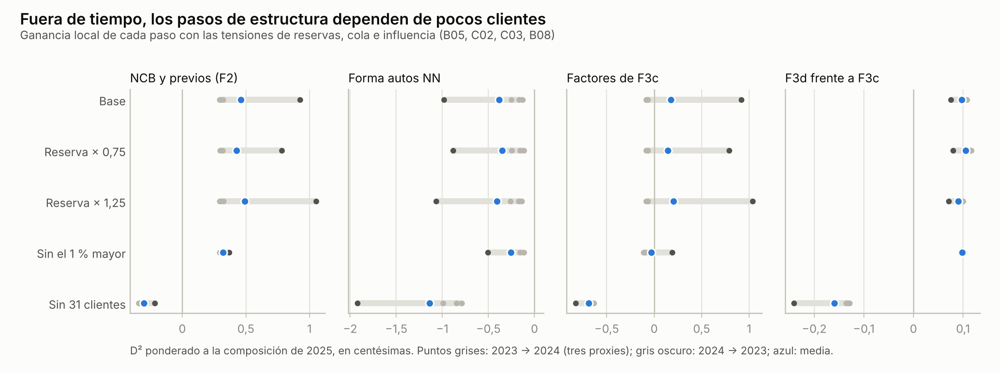
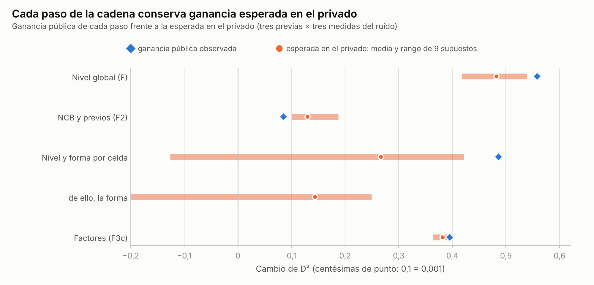
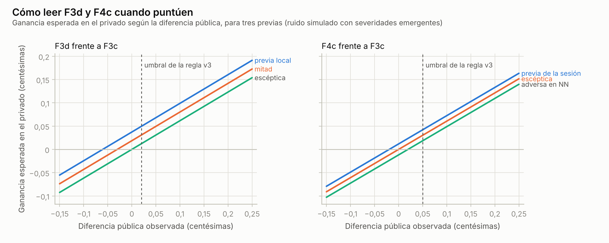
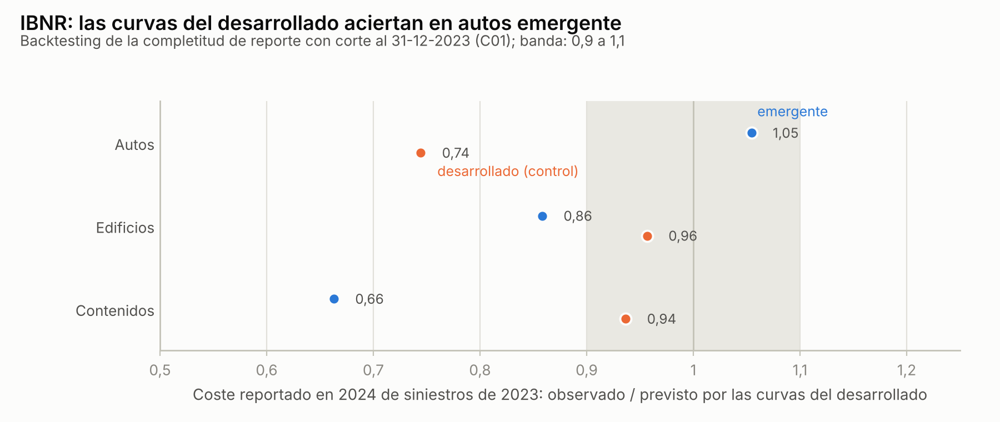

# Sensibilidad de la entrega de la semana 2: experimentos recalculados para F3c

Claude (Cowork, sesión de las baterías de sensibilidad), 26 de octubre de 2026. El participante pidió actualizar y recalcular «todos los experimentos (y los adicionales que sean necesarios)» al trabajo, el modelo y la información de la segunda semana, y eligió respaldar la cadena hasta F3c, autorizar los niveles de cálculo 1 a 3, empezar con una evaluación ex post de la parte 1 con los resultados privados y dejar informe, registro y aporte en el foro. El plan se escribió y se guardó en el equipo antes de calcular nada: `privado/corridas/sens_s2_20261026T135632Z_c88b9703/PLAN_PREREGISTRO.md`, SHA-256 c88b97038dbfffdd6497251ac73a0d63e84aa16c7822b5cc9f38af69f4e6959d. Lo que se añadió después de ver resultados va marcado como no preinscrito.

Este informe es verificación de IA, no revisión profesional humana. No hay envíos, entrenamiento de modelos de producción ni cambios en la marca.

## Resumen

La batería de la parte 1 acertó. Con los privados ya publicados, la forma cerrada reproduce el privado de S41, S42 y S43 con un error máximo de 0,000003, la alarma de D103 (S41 por encima de S43) se cumplió en dirección y en tamaño (0,00004 observado frente a 0,0000376 previsto) y el ruido corregido de D103 explica el privado mucho mejor que el de D100 y D102: la suma de desvíos al cuadrado baja de 7,80 a 3,44 en el nivel y de 7,12 a 2,90 en la forma. El método se puede usar en la semana 2.

En la semana 2, F3c se sostiene. Su ventaja pública sobre la mezcla enviada el 24 de octubre es de 0,01524 y la ganancia esperada en el privado, bajo nueve combinaciones de previas y de medidas del ruido, va de 0,0089 a 0,0145: se conserva entre el 58 % y el 95 % de lo ganado en el público (0,0113 a 0,0143 sin la medida de ruido de los pools, que exagera el de la forma de edificios). Todos los pasos conservan ganancia esperada positiva en los nueve supuestos salvo la forma por celda en uno, y ese caso nace de un artefacto del remuestreo (B03). La forma es aun así la pieza más incierta: con una cola de siniestros como la del mercado desarrollado su ganancia baja casi a cero. Los factores de F3c se apoyan sobre todo en la lectura pública: aprendidos en 2023, empeoran 2024 cuando se pondera a la composición de 2025.

Dos hallazgos piden acción antes del cupo de las 00:00 UTC del 27. El ruido usado para la forma de autos y de contenidos de nuevo negocio estaba subestimado (1,36 y 1,99 veces), y la regla preinscrita de esta batería avisa porque F3d supera a F3c en ganancia esperada en el privado en +0,00097 bajo los tres conjuntos de previas. Con el ruido medido, la regla v3 para leer F3d (entra si mejora en +0,0002) es más estricta de lo que conviene: con una previa intermedia, maximiza la esperanza adoptar F3d si su diferencia pública con F3c es de −0,0003 o más.

Un añadido no preinscrito lee el prototipo H1 que Codex preparó hoy y dejó diferido. Frente a F3c, H1 es casi solo un cambio de nivel por celda (sube el total un 1,76 %) y las sondas valoran ese nivel entre −0,00005 y +0,00009 en el privado esperado, una fracción pequeña de la mejora local que Codex midió frente a otra base.

## Qué se respalda

La cadena que llevó a la referencia pública actual de la parte 2. Cada archivo se reprodujo en la nube de Claude desde sus insumos guardados (B01).

| Paso | Qué hace | Público | Cambio público |
| --- | --- | --- | --- |
| B0 | Mezcla 50/50 de la designada A1fixF1b3n y de MLind, enviada el 24-10 | 0,15390 | |
| F | B0 × 1,18766 en todas las filas (sonda global) | 0,15948 | +0,00558 |
| F2 | Factores de NCB y de siniestros previos por celda, forma 0,9 en renovación de autos | 0,16033 | +0,00085 |
| final_creible | Nivel por celda (ramo × nuevo negocio) y forma de las tres celdas de nuevo negocio, con credibilidad | 0,16519 | +0,00486 |
| F3c | Factores de género (autos y contenidos), teletrabajo y segmento (contenidos) | 0,16914 | +0,00395 |

Pendientes de puntuar: F3d (F3c con credibilidad K = 60 en los factores de contenidos) y F4c (F3c con la mezcla FSp).

Un supuesto lo condiciona todo: que el público de la parte 2 sea el 33 % del test y el privado el 67 %, como en la parte 1. Al calcular no estaba confirmado, porque las páginas archivadas de la parte 2 no lo dicen y la del tablero no se pudo leer desde la nube. Después, el 26 de octubre a las 15:17 UTC, Claude lo leyó en el tablero con el navegador de la app: «This leaderboard is calculated with approximately 33% of the test data». Las cifras ya usaban ese reparto; B07 mide qué habría cambiado con 20 % y con 50 %.

## Primero, la parte 1 vista con los privados (bloque A)

La consulta de Kaggle que Codex guardó el 23 de octubre (`privado/resultados_privados_parte1_20261023/consulta_viva_envios.json`) trae el privado de los 29 envíos de la parte 1, incluidas las doce sondas. Eso permite repetir, ahora en el privado, la misma forma cerrada que se usó en el público.

### La forma cerrada funciona también en el privado (A01)

Con los privados de las seis sondas S40 se despejan los óptimos privados de nivel por ramo, y con las seis S50, los vértices privados de forma. Con ellos se predicen los privados de los tres candidatos:

| Candidato | Privado previsto | Observado | Diferencia |
| --- | --- | --- | --- |
| S41 | 0,138638 | 0,13864 | +0,000002 |
| S42 | 0,138631 | 0,13863 | −0,000001 |
| S43 | 0,138597 | 0,13860 | +0,000003 |

La métrica del privado se comporta como la desviación Tweedie 1,5 sin pesos, igual que el público.

### La alarma de D103 se cumplió (A02)

D103 avisó la noche del 22 de que S41 superaría a S43 en el privado por 0,0000376 de media. El privado dio 0,00004 (S41 0,13864, S43 0,13860), a 0,01 desviaciones típicas de la previsión del primer par de previas. La forma cerrada reparte esa diferencia: −0,0000076 viene del nivel (S42 frente a S41) y −0,0000333 de la forma de S43. La forma de autos que el público pedía era ruido, como advirtió D103.

### El ruido corregido explica el privado (A03 y A04)

Si D100 y D102 hubieran medido bien el ruido, la diferencia entre el óptimo público y el privado debería caer casi siempre dentro de una o dos desviaciones típicas. Medida con el ruido sin corregir, no cae; medida con el corregido de D103, sí:

| Parámetro | Óptimo público | Óptimo privado | Desvío con σ de D100/D102 | Desvío con σ corregido |
| --- | --- | --- | --- | --- |
| Nivel de autos | −2,3 % | −6,1 % | +1,20 | +0,76 |
| Nivel de edificios | +7,5 % | +0,3 % | +1,44 | +0,99 |
| Nivel de contenidos | +8,4 % | +0,7 % | +2,07 | +1,37 |
| Forma de autos | 0,921 | 0,985 | −1,48 | −0,99 |
| Forma de edificios | 0,990 | 1,029 | −0,82 | −0,51 |
| Forma de contenidos | 0,993 | 1,080 | −2,06 | −1,28 |

Los niveles están en cambio sobre S30 y las formas en el vértice del exponente. La suma de desvíos al cuadrado, que con tres ramos debería rondar 3, es 7,80 en el nivel con el ruido sin corregir y 3,44 con el corregido; en la forma, 7,12 y 2,90. El logaritmo de la razón de verosimilitudes favorece al ruido corregido por 0,94 en el nivel y 0,76 en la forma.

De las tres previas de nivel de sens42, la de Bayes empírico con el ruido corregido es la que mejor predijo el óptimo privado (suma de desvíos al cuadrado 2,29, frente a 3,38 de la de D100 y 3,46 de la actuarial). Ninguna llegó al nivel privado de autos: su óptimo privado (−6,1 % frente a S30) quedó a 1,18 desviaciones típicas de la previa que más se acercó. En las previsiones de ganancia frente a S30 de D103 (A05), el primer par fue el más preciso (error cuadrático medio 0,0000369, frente a 0,0000583 y 0,0000744).

### El nivel de D95 frente al privado (A06)

El privado dice que S30 tenía el nivel de autos un 6,5 % alto, y los de hogar casi exactos (edificios −0,3 %, contenidos −0,7 %). En edificios el nivel privado coincide con la media de f23 y f24 que usó S30, y en contenidos con f24. En autos toda la evidencia actuarial de D95 apuntaba en la dirección correcta (el IBNR de lesiones sobrestimado; las recuperaciones, −0,75 % de nivel; la acotación de reservas de D97, 2,2 % alto), pero se quedó en un tercio del tamaño.

La lección para la semana 2 tiene dos partes. El ruido de una sonda se mide frente a la parte no vista, y eso ya lo hacen las sondas de la semana 2. Las formas calibradas con el marcador fueron en la parte 1 casi todo ruido, así que la forma es lo primero que hay que mirar con lupa en la semana 2.

## La cadena de la semana 2, paso a paso (bloque B)

### Reproducción (B01)

En la nube de Claude, desde los Parquet originales (con su SHA-256 igual al manifiesto de descarga), la base de etiquetas (T0 = 27.997.991,57 CU, igual a la de todas las líneas) y los OOF guardados, los scripts de la sesión de consolidación reproducen byte a byte F2 (119627d9…), final_creible (1a003d86…) y final_pleno. F3c (5ab5e4e3…) y F3d (5103f6fd…) también salen idénticos, con una salvedad: su cabecera `f3_eval.py` no está en las copias del equipo, y esta batería la reconstruyó a partir de las bibliotecas de los revisores J y K (atributos del cliente leídos como texto). F = B0 × 1,18766 se cumple fila a fila dentro del redondeo a seis decimales (diferencia máxima 0,0000005 CU). F4c no se pudo reproducir porque necesita las predicciones FSp de producción, que no están en las copias del equipo que revisé.

### La forma cerrada en el público (B02)

Con B0 y las dos sondas globales, la fórmula da para F un público de 0,15948, y Kaggle dio 0,15948. Para final_creible, que combina nivel por celda y forma en las mismas celdas, la aproximación de esta batería (nivel por celda aplicado sobre el vector ya transformado) da 0,16534, a 0,00015 del observado; el revisor J había previsto un intervalo de 0,16511 a 0,16522 con su propia aproximación, y el observado cae dentro. La métrica pública de la parte 2 se comporta como la de la parte 1.

### El ruido de las sondas, medido otra vez (B03)

El plan preinscribía medir el ruido remuestreando los proxies de 2023 y 2024 al tamaño y la composición de 2025 (celda × banda de exposición). Esa medida resultó poco fiable en las celdas de nuevo negocio, porque en 2023 y 2024 casi no hay nuevo negocio de año completo, que es el 82 % al 88 % de esas celdas en 2025:

| Celda | Filas de año completo en 2024 | Siniestros | Filas en 2025 | Copias por fila |
| --- | --- | --- | --- | --- |
| Autos, nuevo negocio | 343 | 54 | 56.508 | 165 |
| Edificios, nuevo negocio | 203 | 3 | 35.021 | 173 |
| Contenidos, nuevo negocio | 246 | 11 | 43.113 | 175 |

Con tres siniestros repetidos 173 veces, el ruido del nivel de edificios de nuevo negocio sale en 0,274 (medido en absoluto, frente a 0,159 en la simulación, también en absoluto), y la regla preinscrita lo marca como hallazgo al compararlo con el σ usado (0,124, relativo al global). Es un artefacto del remuestreo, no del marcador. Por eso se añadió una segunda medida (no preinscrita): una simulación compuesta de Poisson sobre las 209.063 filas reales de 2025, con F3c como verdad, número de siniestros de Poisson y severidades extraídas de los siniestros emergentes aceptados del ramo, reescaladas a la media de cada celda; y una variante con las severidades del mercado desarrollado, que tiene una cola mucho más larga. Cada réplica parte el test al azar 33/67 y mide el óptimo en cada parte.

| Parámetro | σ usado | Pools (preinscrito) | Simulación, severidad emergente | Simulación, cola del desarrollado |
| --- | --- | --- | --- | --- |
| Nivel global | 0,050 | 0,047 | 0,046 | 0,085 |
| Nivel autos, nuevo negocio | 0,079 | 0,061 | 0,046 | 0,083 |
| Nivel autos, renovación | 0,097 | 0,107 | 0,090 | 0,205 |
| Nivel edificios, nuevo negocio | 0,124 | 0,274 | 0,129 | 0,123 |
| Nivel edificios, renovación | 0,267 | 0,325 | 0,318 | 0,249 |
| Nivel contenidos, nuevo negocio | 0,120 | 0,067 | 0,105 | 0,126 |
| Nivel contenidos, renovación | 0,187 | 0,200 | 0,207 | 0,207 |
| Forma autos, nuevo negocio | 0,070 | 0,063 | 0,095 | 0,223 |
| Forma edificios, nuevo negocio | 0,510 | 0,518 | 0,187 | 0,156 |
| Forma contenidos, nuevo negocio | 0,081 | 0,080 | 0,161 | 0,159 |

Los niveles se miden en logaritmo y relativos al global, como los usa la regla, salvo en la columna de pools, que los mide en absoluto porque el script preinscrito no separa el global; las formas, en unidades del exponente. Los niveles quedan bien medidos con la simulación emergente: ninguno supera 1,25 veces el usado, y el de autos de nuevo negocio era incluso prudente. Las formas no: la de autos de nuevo negocio tiene un ruido 1,36 veces el usado y la de contenidos 1,99 veces, las dos con Z por encima de 0,9, así que la credibilidad que recibieron era demasiado alta. Con la cola del desarrollado el ruido de autos se multiplica: 3,18 veces el usado en la forma y 2,12 en el nivel de renovación.

### Lo que se espera en el privado de los pasos de nivel y de forma (B04)

Con la forma cerrada se puede calcular, para cada paso calibrado con el marcador, cuánto gana en el privado según dónde esté de verdad el óptimo privado. El óptimo privado se estima con un posterior que combina la lectura pública, su ruido y una previa. Se usan tres previas: P1, las Z que usaron los constructores (0,854 en el global, las de la preinscripción en las celdas y las de `sigma_forma.json` en la forma); P2, Bayes empírico con el ruido de B03 (τ sale de la dispersión de las lecturas públicas); P3, sin marcador (centro en el nivel que pide la tarifa de E27 y en la forma óptima local, τ 0,25, y τ 0,15 en el global). Cada una se combina con las tres medidas del ruido, nueve supuestos en total. En la forma se usa la parábola medida en el público (vértice de autos de nuevo negocio 1,401), que incluye el cambio de nivel que trae cada exponente, y el nivel por celda se calcula sobre el vector ya transformado: es la combinación que mejor reproduce el público de final_creible en B02. Para el ruido de la forma se usa el de la forma pura de B03, una aproximación.

| Paso | Ganancia pública | Esperada en el privado, mínimo | Máximo |
| --- | --- | --- | --- |
| Nivel global (F frente a B0) | +0,00558 | +0,0042 | +0,0054 |
| Nivel por celda | +0,00486 (con la forma) | +0,0009 | +0,0018 |
| Forma por celda | | −0,0023 | +0,0025 |

El nivel global es la pieza más sólida: Z entre 0,82 y 0,97 con cualquier medida del ruido. El nivel por celda también gana en los nueve supuestos. La forma es la más incierta: con el ruido simulado con severidades emergentes gana entre +0,0020 y +0,0023, y con la cola del desarrollado y Bayes empírico baja a +0,0002. Con el ruido de los pools y Bayes empírico sale −0,0023, pero solo porque el ruido artefactual de la forma de edificios anula la credibilidad de las tres celdas a la vez: sin esa celda en el Bayes empírico sale +0,0025 (no preinscrito). El exponente de autos de nuevo negocio que se espera en el privado está entre 1,35 y 1,37 con el ruido emergente, junto al 1,37 aplicado.

### Los pasos de estructura, fuera de tiempo (B05, C02, C03 y B08)

F2 y los factores de F3c no se calibraron con el marcador: se estimaron con 2023 y 2024 y el público solo los leyó. Su ganancia fuera de tiempo se recalculó con código propio, entrenando los factores en un año y midiendo en el otro, con la composición de 2025 y el nivel de cada celda reajustado:

| Paso | Media de cuatro proxies | 2023 → 2024 (tres proxies) | 2024 → 2023 | Sin el 1 % de siniestros mayores | Sin los 31 clientes más favorables |
| --- | --- | --- | --- | --- | --- |
| NCB y previos (F2) | +0,00460 | +0,00292 a +0,00319 | +0,00926 | +0,00321 | −0,00301 |
| Forma de autos de nuevo negocio | −0,00381 | −0,00253 a −0,00127 | −0,00980 | −0,00257 | −0,01138 |
| Factores de F3c | +0,00174 | −0,00084 a −0,00066 | +0,00921 | −0,00030 | −0,00690 |
| F3d frente a F3c | +0,00097 | +0,00101 a +0,00108 | +0,00076 | +0,00099 | −0,00159 |

Tres lecturas. Los factores de F3c, aprendidos en 2023, empeoran 2024 cuando se pondera a la composición de 2025, y la causa más probable, según las pruebas de los revisores I y K, es que el efecto del género en el nuevo negocio de autos no se repite de un año al otro (K midió lo mismo con su código: −0,00052); solo en la dirección 2024 → 2023 ganan con claridad. La forma de autos de nuevo negocio (exponente 1,298) empeora el D² local en los cuatro proxies: la evidencia local y el marcador apuntan en direcciones opuestas. Y todas las ganancias de estructura dependen de pocos clientes: al retirar los 31 más favorables a cada paso, todas se vuelven negativas. Las reservas apenas cambian el resultado (con la reserva de caso × 0,75 los factores dan +0,00142 y con × 1,25, +0,00203, frente a +0,00174).

Que la evidencia local sea débil no quiere decir que el paso no valga en 2025. El público es una muestra directa de 2025, con su 77 % de nuevo negocio, y su ruido para un paso de este tamaño es pequeño (0,00074 de desviación típica para los factores). Combinando la previa local (media +0,00174, τ 0,0050) con la lectura pública (+0,00395), la ganancia esperada de los factores en el privado es +0,00390 con el ruido emergente y +0,00364 con la cola del desarrollado. Para F2, con lectura pública +0,00085 y previa local +0,00460, sale +0,00101 y +0,00187.

### Toda la cadena y los candidatos frente a F3c (B06)

Sumando los pasos, F3c gana a B0 en el privado entre 0,0089 y 0,0145 según el supuesto (0,0113 a 0,0143 sin la medida de pools), frente a 0,01524 en el público. Para los pasos de estructura, que los pools no miden, se usa el ruido de la simulación emergente.

| Candidato | Ganancia esperada en el privado frente a F3c, mínimo | Máximo |
| --- | --- | --- |
| final_creible | −0,0039 | −0,0036 |
| final_pleno (óptimos públicos sin credibilidad) | −0,0047 | −0,0037 |
| F2 | −0,0081 | −0,0026 |
| F | −0,0091 | −0,0036 |
| F3b (forma de autos 1,30, sin forma de hogar) | −0,00040 | +0,00059 |
| F3d (sin lectura pública todavía) | +0,00097 | +0,00097 |

Ninguno de los ya puntuados se acerca a F3c. F3b queda prácticamente empatado. F4b y F4c no tienen evaluación propia en esta batería: sin la mezcla FSp reproducida, su previa es la de la sesión que los construyó (+0,0003 sobre F3b y F3c). F3d es el único que lo supera con claridad en esperanza, y con eso se cumple la regla de alarma del plan: supera a F3c en más de 0,0003 bajo los tres conjuntos de previas. La alarma no cambia ninguna marca por sí sola, porque F3d todavía no tiene lectura pública y su ventaja local, aunque resiste la reserva y la cola, desaparece al retirar 31 clientes (−0,00159). Pide sobre todo no desperdiciar su envío con una regla de lectura demasiado estricta.

### Cómo leer F3d y F4c cuando puntúen (B09)

Escrito antes de que puntúen. La diferencia pública entre F3d y F3c tiene una desviación típica de 0,00039 (F4c, 0,00040; con la cola del desarrollado, 0,00068). Con una previa N(m, τ²) para la ganancia, la esperanza en el privado dada la diferencia pública d es m + Z (d − m), y adoptar compensa cuando eso es positivo:

| Candidato | Previa | Z | Adoptar si la diferencia pública con F3c es al menos |
| --- | --- | --- | --- |
| F3d | Local (m +0,00097, τ 0,0005) | 0,62 | −0,0006 |
| F3d | Mitad de la local | 0,62 | −0,0003 |
| F3d | Escéptica (m 0) | 0,62 | 0,0000 |
| F4c | La de la sesión (m +0,0003) | 0,61 | −0,0002 |
| F4c | Escéptica (m 0) | 0,61 | 0,0000 |
| F4c | Adversa en nuevo negocio (m −0,0003) | 0,61 | 0,0002 |

La regla v3 pedía +0,0002 a F3d y +0,0005 a F4c. Para F3d eso deja pasar ganancia esperada: con cualquiera de las tres previas el umbral que maximiza la esperanza está por debajo de +0,0002. La propuesta de esta batería es adoptar F3d si su diferencia pública es de −0,0003 o más (previa a mitad de camino, porque su ventaja local depende de pocos clientes). Para F4c, cuya ventaja local no pude reproducir y cuyas pruebas en nuevo negocio fueron adversas en la línea de Codex, la previa escéptica es la prudente: adoptarlo solo si no empeora a F3c en el público (umbral 0,0000). Si entran los dos, vale lo que ya decía v3: construir F4d con las recetas fijadas y medirlo antes de marcar.

### El nivel de H1 frente a F3c (H1N, no preinscrito)

Añadido después de cerrar la batería, al leer en DECISIONES.md que Codex construyó hoy un prototipo H1: F3c con la corrección de exposición por peril H1/G3, media de cinco miembros, CSV con huella d9cccc8d…, diferido por la prioridad privada. Las sondas no pueden juzgar la forma interna de H1, pero sí su nivel por celda, y en 2025 H1 es casi solo eso. Frente a F3c sube el total un 1,76 %, sobre todo en autos de nuevo negocio (2,39 %), autos de renovación (1,72 %) y edificios de nuevo negocio (0,96 %). Dentro de cada celda el logaritmo del cociente H1/F3c tiene una desviación típica de 0,0099 como mucho.

Con la forma cerrada de B02, el nivel de H1 vale +0,00006 en el público. La mayor parte viene de autos de nuevo negocio, donde F3c está en 1,339 veces el nivel de B0, H1 lo lleva a 1,370 y el óptimo público está en 1,384 (+0,00006); en edificios de renovación H1 se aleja del óptimo (−0,00003). En el privado, con los óptimos esperados de B04 bajo los tres repartos, las tres medidas del ruido y los tres conjuntos de previas, la ganancia esperada del nivel de H1 frente a F3c va de −0,00005 a +0,00009, con desviación típica entre 0,00021 y 0,00035. La forma cerrada con interacción se equivocó en −0,00015 al prever final_creible en B02, una cifra del mismo tamaño que todo ese rango, así que aquí solo se puede leer el orden de magnitud.

Codex registró para H1 una mejora local de +0,00104 frente a G3 sobre la base S2 de 2023 y 2024 (DECISIONES.md, entradas «H1 sola» y «Privada P2»). Esa base no tiene niveles ajustados con las sondas públicas. F3c sí: su nivel por celda se fijó con ellas y con credibilidad, y es razonable que buena parte de lo que H1 corrige en la base S2 ya esté corregido en F3c; las cifras de este apartado van en esa dirección. Con lo que miden estas sondas, el nivel de H1 mueve la esperanza privada en menos de una décima parte de esa mejora local. Si H1 llega a puntuar, la diferencia pública que se espera por su nivel es +0,00006; una diferencia mucho mayor tendría que venir de su forma interna, que esta batería no mide.

### El reparto público y privado (B07)

Si el público fuera el 20 % del test, F3c ganaría a B0 en el privado entre 0,0079 y 0,0141; si fuera el 50 %, entre 0,0122 y 0,0147. El umbral de F3d con la previa intermedia pasaría a −0,0005 y −0,0002. Ninguna conclusión cambia, y el tablero confirma el 33 %.

## Datos y etiquetas de la semana 2 (bloque C)

### Backtesting del IBNR (C01)

Se tomaron los siniestros ocurridos en 2023 y se preguntó cuánto coste faltaba por reportar al 31-12-2023 según las curvas de reporte del mercado desarrollado (las mismas que usan las etiquetas de la semana 2), frente a lo que de verdad llegó en 2024:

| Ramo | Emergente: completitud al corte observada / prevista | Coste tardío observado / previsto | Desarrollado (control): coste tardío observado / previsto |
| --- | --- | --- | --- |
| Autos | 0,799 / 0,809 | 1,05 | 0,74 |
| Edificios | 0,944 / 0,934 | 0,86 | 0,96 |
| Contenidos | 0,974 / 0,961 | 0,66 | 0,94 |

La completitud reportada cumple el criterio preinscrito (0,9 a 1,1) en los tres ramos. Mirado con más lupa, en el coste que llega tarde (lectura no preinscrita), las curvas aciertan en autos emergente, que reúne la mayor parte del coste tardío (82 %), y sobrestiman lo tardío en hogar emergente, donde hay poco dinero. En el propio mercado desarrollado, el coste tardío de autos de 2023 fue un 26 % menor que el previsto, en línea con el IBNR de lesiones alto que encontró D95. La completitud de 2024 que usan las etiquetas (0,8027 en autos) no tiene motivo para corregirse.

### Reservas (C02)

Con la reserva de caso de los 1.056 abiertos multiplicada por 0,75 o por 1,25, las ganancias fuera de tiempo de B05 apenas se mueven (tabla de B05). La reserva no explica ninguna conclusión.

### Capitales divididos entre mil (C04)

Las 239 filas de test con capital por encima de 5 millones (edificios) o 2 millones (contenidos), que CAPS2-01 divide entre mil, tienen en F3c una tasa parecida a la de las filas de su celda y decil de capital: el cociente mediano es 1,03 en edificios y 1,00 en contenidos (máximo 10,5). Algunas filas quedan altas, pero pesan poco: el 0,19 % del total de edificios y el 0,18 % de contenidos. La mediana no muestra ningún efecto ×1000.

### El género (C05)

F3c multiplica la prima de autos de los hombres por 1,109 de media y la de las mujeres por 0,885; en contenidos, al revés (1,077 mujeres, 0,910 hombres). El diccionario permite tarifar por género en este mercado sintético. Fuera de tiempo el género aporta poco y es inestable (+0,00062 de media, entre −0,00181 y +0,00775 según el proxy); casi todo lo que vale lo dice el público. Es información para el participante y para el informe al jurado, no una propuesta de cambio.

## Qué significa para la marca final

F3c es una buena marca: su ventaja sobre todo lo anterior se sostiene en el privado bajo todos los supuestos. Quedaban cuatro decisiones del participante, y el 26 de octubre hacia las 15:16 UTC Manuel adoptó las recomendaciones de este informe:

1. F3d se lee con el umbral de −0,0003 en lugar de +0,0002, y F4c con el de 0,0000 (no empeorar a F3c) en lugar de +0,0005. Primero F3d y después F4c; si entran los dos, F4d se construye con las recetas fijadas y se mide antes de marcar.
2. La forma de autos de nuevo negocio queda señalada como la pieza con más riesgo. Su ruido estaba subestimado y la evidencia local la contradice. Su ganancia esperada es positiva con las severidades emergentes y baja casi a cero con una cola como la del desarrollado.
3. H1 sigue como investigación, sin envío como candidato a final: su nivel por celda frente a F3c vale entre −0,00005 y +0,00009 en el privado esperado, y la razón para enviarlo tendría que estar en su forma interna, que no mide ninguna sonda.
4. El porcentaje del público quedó confirmado en el tablero (33 %), así que el umbral de F3d es −0,0003.

Como Kaggle califica una sola predicción por parte y, si no se elige ninguna, toma la de mejor público, un F3d que entre por la regla con un público algo menor que F3c tiene que marcarse a mano. La marca la decide el participante; Claude no envía ni cambia nada en Kaggle.

## Límites

- El reparto 33/67 de la parte 2 se confirmó en el tablero después de calcular; las cifras ya lo usaban.
- La simulación usa F3c como verdad y severidades de dos años de siniestros emergentes; la variante con la cola del desarrollado es una tensión, no una estimación.
- Las previas son una muestra de las razonables y la media de los supuestos es una convención.
- La ganancia esperada se calcula con la forma cerrada y una aproximación cuadrática en la forma; las interacciones entre pasos de la misma celda se tratan de forma aproximada (B02).
- La evidencia fuera de tiempo es de dos años, y 2024 ya se había consultado: es exploratoria.
- F4c no se reprodujo; su previa viene de la sesión que lo construyó.
- H1N no estaba en el plan y solo lee el nivel por celda de H1; su forma interna queda sin medir.
- Verificación de IA, sin revisión humana ni reproducción por otro operador.

## Cómo comprobar este informe

`privado/corridas/sens_s2_20261026T135632Z_c88b9703/resultados/verificar_sensibilidad_semana2.py --autoprueba` recalcula cada cifra de este informe desde los JSON de evidencia, comprueba que el informe es la plantilla con esas cifras, la huella del plan, las de las figuras y las del manifiesto, y que detecta 8 alteraciones de prueba. Los scripts que generaron la evidencia corrieron en la nube de Claude y están en la misma carpeta, con la lista de insumos y sus huellas en `insumos.json`. Las figuras que entrega la plataforma llevan un bloque C2PA que cambia su SHA-256; el verificador compara las huellas de los archivos entregados.
