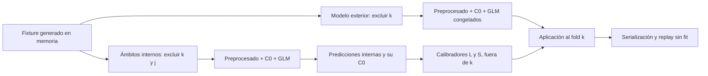

# G4: flujo completo comprobado con datos sintéticos

Codex, 24 de octubre de 2026. El segundo intento pasó las nueve pruebas de integración. La comprobación cubre preprocesado, C0, GLM, calibración anidada, aplicación y replay sin ajuste. No se leyeron filas ni se cargaron estimadores del concurso. El resultado prepara evidencia técnica para revisión local; no demuestra rendimiento, soporte estadístico o suficiencia actuarial.

## Qué se integró

La receta usa los siete efectos de edificios de B20, GLM Tweedie 1,5 con enlace log y alpha=1. La mediana, el escalado y las categorías se aprenden exclusivamente dentro del ámbito de ajuste. La respuesta es T0/C0 y el peso sqrt(C0), conforme a la equivalencia de devianza en unidades observadas. No se introduce otra búsqueda de parámetros.

El núcleo C0 existente aprende curvas, marcas, pesos, frecuencias y mezcla en el mismo ámbito. Se conserva rho=1, masa adicional de cola cero y valoración al 31-12-2024; esa fecha no implica leer filas de la cohorte 2024.

Para cada fold exterior k se generan cuatro predicciones internas. Cada modelo interno y todos sus ancestros excluyen k y el fold interior j. El calibrador sí aprende las etiquetas de las filas internas, que pertenecen al entrenamiento exterior. Ningún aprendizaje puede usar las etiquetas de k. Esta distinción evita pedir invariancia a información que el calibrador debe aprender legítimamente.

L conserva pendiente b=1 y estima el nivel. S acota b entre 0 y 1 y perfila el intercepto con la misma devianza. El centro logarítmico usa C0 de las predicciones internas. Se comprueban los extremos y el KKT proyectado, sin forzar A/E=1. En la verificación, los modelos exteriores también se ajustan con el fixture; nunca se cargan los modelos B20 del concurso.

## Evidencia del intento final

| Comprobación | Resultado |
| --- | --- |
| Pruebas nuevas de integración | 9 pasaron, 0 fallos, 0 errores |
| Alteración de etiquetas, predictores, exposición y fechas del fold exterior | 5 de 5: estado aprendido completo y objetos serializados idénticos; aplicación a consultas limpias idéntica |
| Pares ordenados exterior/interior | 20 de 20: ancestros completos invariantes al alterar ambos folds protegidos |
| Controles positivos de coste y predictor permitidos | Cambian los objetos que deben aprender de ellos |
| Ámbito/caché ajenos, objetos modificados, año 2024/test, duplicados y cruce de grupos | 8 casos rechazados |
| Predicción manual exp(Xβ+intercepto) | Diferencia máxima 0 en el caso comprobado |
| Perfil de calibración frente a optimización conjunta | Diferencia máxima de objetivo 5,96×10⁻¹⁹, inferior a 10⁻⁸ |
| Devianza y peso por exposición | Fórmula contrastada con API externa y equivalencia de unidades; tolerancia relativa 10⁻¹² |
| Serialización en memoria y replay desde disco | Sin nuevos ajustes; replay de 88 filas sintéticas con todos los puntos de entrada de fit bloqueados |
| Motor y contenidos | Paso directo sintético exactamente conservado |
| Lecturas de datos/modelos externos o red durante la prueba | 0 intentos inesperados; una sonda deliberada de lector sobre una ruta falsa fue bloqueada |

El fixture fijo contiene 400 periodos de edificios, 40 controles de otros ramos y 360 notificaciones artificiales, con semilla 20261024. No se extrajeron parámetros de la cartera. Las marcas y prefijos sintéticos reducen el riesgo de una conexión accidental, pero no son prueba criptográfica de procedencia de cualquier entrada futura.

El intento final hizo 72 ajustes sintéticos GLM y 72 flujos C0; sus 29 llamadas a calibración incluyen los casos que debían rechazarse. La línea base reutiliza diez ámbitos internos únicos y cinco exteriores. Las repeticiones restantes son las perturbaciones y controles registrados, no modelos candidatos adicionales o experimentos predictivos independientes.

## Fallos conservados y correcciones

El intento inicial tuvo tres fallos. Dos controles de invariancia detectaron una clave de contenido distinta, aunque los restantes valores aprendidos coincidían. La causa era la representación de fechas: pandas convertía una columna datetime64 en objetos al insertar el veneno, y astype(str) formateaba de manera distinta las fechas de ajuste que permanecían iguales. Se corrigió la normalización explícita de fechas ISO y centavos enteros antes de calcular la clave. La selección de entrenamiento y los criterios no se relajaron.

El otro fallo ocurrió en la optimización de referencia cerca de una solución exacta. La resta de términos grandes producía devianzas negativas del orden de 10⁻¹⁵. Se sustituyó la expresión por la identidad equivalente y estable:

    d₁․₅(y, μ) = 4 (√y − √μ)² / √μ

Se mantuvieron objetivo, fixture, semilla, modelos, solver y tolerancias. La reparación se preinscribió antes del segundo intento. El primer intento, sus fuentes, el análisis focal de dos ámbitos sintéticos y los recibos de la reparación quedan preservados.

En total se contabilizan 107 ajustes sintéticos GLM y 107 flujos C0, incluidos el intento fallido y la investigación. Son 642 ajustes de reporte por peril. Hubo 137 llamadas de ámbito, incluidas cachés y rechazos, y 47 llamadas a calibración, además de las referencias matemáticas identificadas en los registros. No incrementan los contadores de precios del concurso. El presupuesto acumulado de reparación se declaró antes de repetir la integración.

## Qué queda preparado y qué no se cierra

G4 tiene ahora verificación del flujo de software completo con fixtures, no solo del núcleo C0. Quedan pendientes las entradas y artefactos interiores reales de 2023 y su procedencia. El módulo actual exige una marca sintética y no dispone de un lector de datos del concurso: esta comprobación no lo conecta automáticamente a un ensayo real.

El mecanismo G1 y el soporte G2 conservan los estados del contraste anterior. Los datos artificiales no aportan componentes emergentes, no curan la concentración de pérdidas y no validan el último. No se declara promoción o retirada de alternativas. Las autorizaciones o resultados de otros trabajos no se adoptan como instrucciones de este flujo.

El paquete local incluye planes previos, código, entorno, fuentes congeladas, ambos intentos y replay. Está preparado como evidencia revisable, sin CSV de envío o ejecución externa. Se comprobó en Windows y las versiones indicadas; no se ha verificado ejecución alojada en Kaggle ni revisión profesional independiente. Una reproducción futura debe conservar estos cortes y escribir un nuevo recibo, sin sobrescribir la evidencia existente ni repetir trabajo sin una razón.

B00 y todas las alternativas siguen como estaban. T0/C0, exposición, folds, catálogo y contadores reales no se modifican por esta tarea. 2024/test/ledger/actas/SEL01 permanecen cerrados. Cero entrenamiento, inferencia o scores sobre datos del concurso. Ventana nocturna cerrada, sin mensajes externos, otros chats, delegación o nuevas automatizaciones. La exposición histórica de un asunto externo sigue declarada sin usar sus métricas o afirmar ceguera completa.

## Archivos de revisión

El [índice G4](../../../registro/semana2_g4_flujo_sintetico_actual.json) identifica el recibo final, el replay, el manifiesto y el paquete local. El código está en [flujo_g4_sintetico2023.py](../../../src/semana2/flujo_g4_sintetico2023.py), con [pruebas de integración](../../../herramientas/probar_flujo_g4_sintetico2023.py) y [replay sin ajuste](../../../herramientas/replay_g4_sintetico_sin_ajuste.py). Los [bloqueos y fuentes anteriores](CONSOLIDACION_F01_F05_Y_BLOQUEOS_B20_2023.md) se conservan con su fecha; este informe actualiza únicamente el avance de software de G4.
