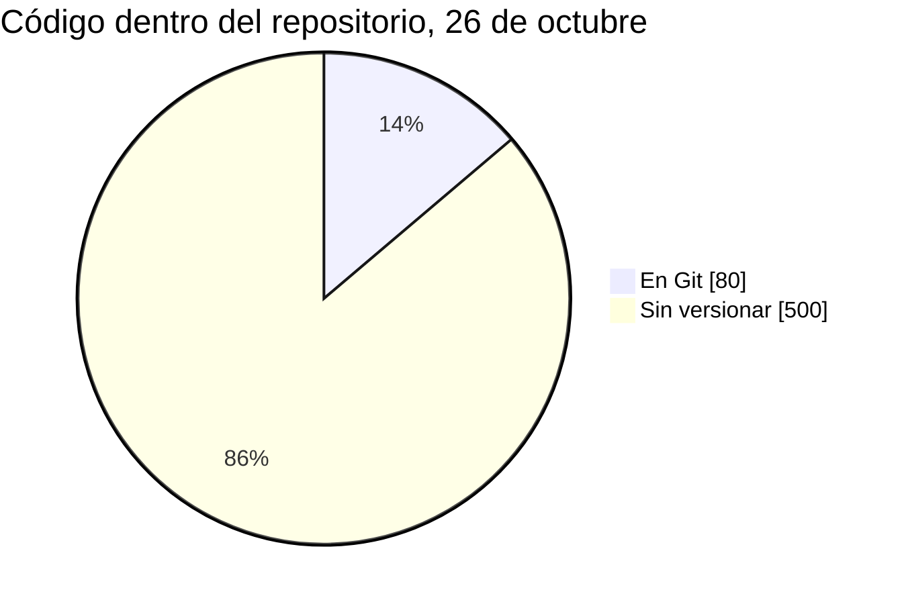
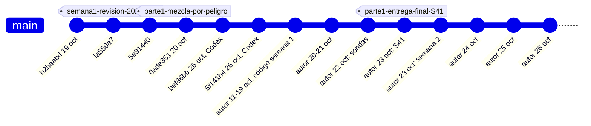
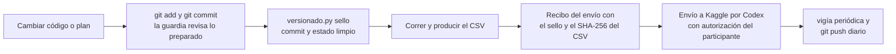

# Control de versiones: qué piden, cómo estamos y cómo lo vamos a entregar

Versión del 26 de octubre de 2026. Las reglas piden entregar el código "mantenido con control de versiones" y la rúbrica lo nombra en Comunicación y documentación. Esta guía explica por qué importa, qué encontró la auditoría del 26 de octubre, cómo poner al día el historial de forma progresiva sin falsearlo, qué regla y qué vigilancia periódica quedan para todas las líneas y cuál es la mejor manera de entregar el repositorio. La versión breve en inglés para el jurado es [VERSION_CONTROL.md](../../../VERSION_CONTROL.md); la herramienta que da soporte a todo es [`herramientas/versionado.py`](../../../../herramientas/versionado.py).

## Decisiones del participante, 26 de octubre

Manuel respondió a las cuatro preguntas abiertas: autoriza la reconstrucción cronológica del historial, con `-Simular` primero; se incorpora el código de las líneas de Claude de la semana 2, el de `Semana 2/Codex` y el del trabajo de la semana 1 (no el del laboratorio de `Preparación`); la vigía la corre Codex en su automatización horaria y hace los commits; después del cierre el repositorio se hace público con licencia MIT. Registro: `registro/versionado/decision_participante_versionado_20261026.json`.

## Qué dicen las reglas

Las citas vienen de las páginas oficiales de la parte 2 archivadas por Codex el 23 de octubre (`Hackaton/Semana 2/Codex/fuentes/pages_response.json`). La página de reglas de esa copia conserva el título y el enlace de la parte 1 y fechas sin rellenar; las reglas fundacionales se citan con la numeración que muestra esa página.

| Fuente | Texto | Qué implica para nosotros |
| --- | --- | --- |
| Página *Submissions*, entregables finales | "Your code, using scripts and/or notebooks, maintained using version control so that the development of the solution can be understood and reproduced." | No basta con el código final: la historia de Git tiene que contar cómo se llegó a él y permitir reconstruir cada entrega. |
| Página *Evaluation*, criterio 4 (15 %) | "Well-structured code repository with version control." | La estructura del repositorio y su historial se califican de forma explícita. |
| Página *Evaluation*, criterio 3 (20 %) | "Governance controls, reproducibility, and human review/escalation protocols." | No nombra el control de versiones, pero un historial con autoría, revisión humana declarada y controles automáticos es evidencia directa de gobierno y reproducibilidad. Es una inferencia nuestra. |
| Reglas específicas §2.4.b | "The final deliverables (a video demo, a written report and a version-controlled code repository) are submitted at the end of Part 2 and must cover both parts. Details of how to submit them will be published on the Part 2 Competition Website." | El repositorio debe cubrir la semana 1 y la semana 2. Cómo se entrega lo dirá la página de la parte 2. |
| Página *Submissions*, revisión | "AI-assisted review tools will be used as a first layer to screen videos, documentation, and code." | Un primer filtro automático leerá el repositorio: README claro, historial legible y estructura navegable pesan antes de que lo vea una persona. |
| Reglas específicas §2.5.b | No transmitir, publicar ni redistribuir los datos del concurso. | Los datos quedan fuera de Git, también en la historia. Predicciones por fila y modelos entrenados quedan fuera por política del proyecto. |
| Reglas fundacionales, apartado 6.a | Durante el periodo de la competición no se comparte código en privado fuera del equipo. | Entregar el código al patrocinador por el formulario oficial no es compartirlo con otros participantes. |
| Reglas fundacionales, apartado 6.b | Si se comparte código en público, debe ser en los foros o notebooks de Kaggle de la competición y con licencia OSI. | Abrir el repositorio en GitHub antes del cierre contradice este apartado. Abrirlo después del cierre es nuestra lectura: el apartado no fija una fecha. |
| Reglas específicas §2.6.b y §2.9 | El patrocinador puede pedir al ganador una descripción que incluya "a link to a code repository with complete and detailed instructions", y el ganador licencia su código con una licencia OSI. | Es una obligación posible del ganador, no del formulario. Conviene tener lista la licencia y las instrucciones de reproducción. |

La página *Submissions* decía todavía "in a final submission form - link to be provided" en la copia del 23 de octubre. Desde esta sesión no se pudo consultar una versión más reciente: la búsqueda web no está habilitada y la página de Kaggle se dibuja con JavaScript. Codex puede comprobarlo con su conexión MCP de solo lectura.

## Qué mira un revisor en un repositorio

Un revisor, sea una persona o una herramienta de IA, suele abrir el README para entender qué hay y cómo se reproduce, recorrer `git log` para ver cómo evolucionó la solución, buscar las etiquetas de las versiones entregadas, abrir algunos commits para ver qué cambió junto y por qué, y comprobar que el código de cada archivo enviado esté en el historial. Si el historial tiene siete commits del lunes 19 y el martes 20 de octubre y luego nada, la lectura es que Git se usó como archivo final y no como herramienta de trabajo, aunque el trabajo real haya sido ordenado. Nuestro proyecto tiene una trazabilidad rica (foro, decisiones, recibos con SHA-256), pero casi toda vive fuera de Git, y lo que no está en el historial el revisor no lo ve.

## Diagnóstico del 26 de octubre

Cifras de `registro/versionado/auditoria_20261026T153728Z.json`, producida a las 15:37 UTC por `versionado.py` 1.1 sobre `Hackaton/Repositorio_IAA2026`. La primera auditoría, de las 15:03 UTC con la versión 1.0, queda en la misma carpeta.

| Indicador | Valor |
| --- | --- |
| Commits en `main` | 7: seis del 19 de octubre y uno del 20 |
| Último commit | `0ade351`, 20 de octubre a las 16:32 UTC, hace 6 días |
| Commits sin subir | 1, según la copia local del remoto, que se actualizó por última vez el 19 de octubre a las 18:13 UTC; GitHub no se consultó |
| Etiquetas | 1, `semana1-revision-20261019` |
| Archivos con cambios sin registrar | 1.102: 87 modificados y 1.015 nuevos |
| Código dentro del repositorio | 580 archivos, de los que 80 están en Git y 500 no |
| Código con la versión en el nombre (`_v2`, `_v3`...) | 67 archivos |
| Código de la semana 2 fuera del repositorio | 251 scripts en `Semana 2/Claude` (235 distintos) y 48 en `Semana 2/Codex`, ninguno con copia dentro |
| Código de la semana 1 fuera del repositorio | 143 scripts de las carpetas de trabajo sin copia dentro (la receta final sí está), más 36 del laboratorio de `Preparación` |
| Contenido prohibido en lo pendiente | 0 bloqueos y 0 avisos; como nota informativa, tres scripts de Codex citan una ruta de la carpeta de usuario de Windows |
| Contenido prohibido en la historia | 0 bloqueos y 0 avisos en los 567 blobs revisados |



Fuera de Git están la decisión S41 y su evidencia, los entregables pasados a S41, todo el código de la semana 2 que Codex dejó en `src/semana2` y `herramientas`, sus informes y los planes, actas y recibos de `registro/`. El código de las líneas de Claude de la semana 2, incluido el linaje de F3c, ni siquiera está dentro de la carpeta del repositorio. Las reglas de la guardia no encontraron datos del concurso, credenciales ni tablas por fila en nada de eso; la guardia detecta los casos habituales, no es una garantía, y cada commit se revisa igual.

Los nombres con `_v2`, `_v3` son una forma de versionar a mano. Mientras el trabajo no se registraba en Git tenían sentido, porque cada recibo cita el archivo exacto que corrió. Desde hoy, una versión nueva de un script es un commit nuevo del mismo archivo; los nombres existentes no se cambian porque los recibos los citan por ruta y SHA-256.

## Poner al día el historial de forma progresiva, sin falsearlo

Git guarda dos fechas en cada commit: la de autor, que dice cuándo se escribió el cambio, y la de commit, que dice cuándo se registró. Cuando se aplica un parche antiguo, Git conserva la fecha de autor original y pone la de commit del momento; es su uso normal. La reconstrucción aprovecha eso:

- Cada archivo pendiente entra en el commit del día de su última modificación (hora de Bogotá), agrupado por tema. Con lo pendiente a las 15:37 UTC salían 28 commits, del 20 al 26 de octubre; con el código externo ya incorporado salen 35, del 11 al 26 de octubre (auditoría de las 19:27 UTC).
- La fecha de autor de cada commit es la última modificación del archivo más reciente del grupo. La fecha de commit es la real del día en que se aplica.
- Cada mensaje dice que es una reconstrucción, qué día cubre y que guarda la versión final de cada archivo; las versiones intermedias de un archivo que cambió varias veces no se recuperan.
- GitHub muestra las dos fechas cuando difieren ("authored 22 Oct, committed 26 Oct"), y `git log --format=fuller` también.

El esquema muestra la historia que quedaría, sin todos los commits; Codex ya registró sus unidades nuevas del 26 de octubre en tres commits con las líneas finales del protocolo, y la reconstrucción va después de ellos:



Lo que no se hace es falsear también la fecha de commit para que parezca registrado en su día. Hay tres razones. GitHub ya sabe que el remoto no se actualiza desde el 19 de octubre. Los recibos y el foro tienen sus propias horas UTC, así que una historia fabricada contradiría la evidencia que presentamos. Y el criterio de confianza, validación y controles pesa el 20 %: reconocer un hueco de seis días ya corregido cuesta poco, y una historia fabricada que el jurado o su herramienta detecten cuesta mucho más.

La reconstrucción se hace en Windows, desde `Hackaton/Repositorio_IAA2026`, y la ejecuta Codex cuando el participante la autorice:

```powershell
$py = '..\..\Preparación\.venv\Scripts\python.exe'
git config core.hooksPath herramientas/git_hooks
& $py herramientas\versionado.py auditar
& $py herramientas\versionado.py plan --cronologico --carpeta privado\plan_commits_20261026 --refs "CLA-S2-20261026-007"
powershell -ExecutionPolicy Bypass -File privado\plan_commits_20261026\aplicar_plan.ps1 -Simular
powershell -ExecutionPolicy Bypass -File privado\plan_commits_20261026\aplicar_plan.ps1
```

`aplicar_plan.ps1` comprueba que no haya nada preparado de antes, añade cada grupo con `git --literal-pathspecs add --pathspec-from-file`, activa el bit de ejecución del hook, hace el commit con la fecha de autor del grupo (el hook revisa cada uno con la guardia), guarda los SHA en `aplicado.json` y crea dos etiquetas: `parte1-mezcla-por-peligro` sobre `0ade351` y `parte1-entrega-final-S41` sobre el último commit con archivos de la parte 1, con un mensaje que dice que se etiquetaron el 26 de octubre. Con `-Subir` hace después `git fetch` y `git push origin HEAD --follow-tags`; sin él, deja la orden escrita para revisarla antes. Las órdenes de Git del script se probaron con un repositorio sintético en la nube (rutas con espacios, eñes, `*` y `[`); PowerShell no se pudo probar allí, por eso conviene el paso `-Simular`. Después de aplicarlo, conviene correr `herramientas/regenerar_s41.py` desde la etiqueta de S41 para comprobar que reproduce el SHA del archivo entregado.

Si el participante aprueba incorporar el código externo, ese paso va antes del plan: `incorporar` copia cada archivo con su fecha de modificación, así que entra en el día correcto de la reconstrucción.

## Qué hacemos desde hoy



Primero el código, después el resultado. Ningún archivo se envía a Kaggle si el código que lo produjo no está en un commit. El recibo del envío copia la salida de `python herramientas/versionado.py sello <rutas del código> --exigir-limpio`, que da el commit y la etiqueta más cercana y falla si alguna ruta no existe, está ignorada, no tiene archivos en Git o tiene cambios sin registrar. El sello solo lee: no toca el índice de Git, así que también puede correr desde la máquina virtual de las sesiones de Claude.

Commits pequeños, temáticos y frecuentes. Un commit agrupa lo que cambió por una misma razón, con un mensaje en imperativo que diga qué y por qué y tres líneas finales:

```text
Evaluar la media anidada H1 con aprendizaje completo

Plan preinscrito, código y acta del experimento P2; resultado adverso conservado.

Refs: COD-S2-20261026-PRIVADA-MEDIA-H1-RESULTADO
Asistido-por: Codex
Revision-humana: pendiente
```

`Refs:` enlaza el commit con el foro y las decisiones, `Asistido-por:` deja visible el uso de la IA y `Revision-humana:` distingue lo que el participante revisó de lo que no.

Un solo operador escribe en Git, desde Windows. Las sesiones de Claude trabajan sobre la carpeta conectada desde una máquina virtual que no puede borrar archivos, y Git necesita borrar sus propios bloqueos (`.git/index.lock`) al hacer un commit; además, las credenciales de GitHub están en Windows. Codex hace los commits y el push con autorización del participante; las sesiones de Claude preparan archivos, sellos y planes.

Guardia antes de cada commit. El hook `herramientas/git_hooks/pre-commit` detiene un commit que incluya archivos de datos o artefactos (Parquet, CSV no permitidos, modelos, comprimidos, binarios no reconocidos), archivos de más de 10 MB, credenciales con formato conocido o tablas con 200 o más identificadores distintos con la forma de los del concurso. El `.gitattributes` del repositorio (`* -text`) impide que Git para Windows convierta el hook a CRLF.

El código de cada línea, dentro del repositorio. Lo que corre fuera de `Repositorio_IAA2026` se copia sin cambios con `versionado.py incorporar`, que añade `ORIGEN.json` con la ruta, la fecha y el SHA-256 de cada archivo, omite datos, artefactos y lo que ya está en el repositorio con otro nombre, y no sobrescribe nada. Por decisión del participante se hizo el 26 de octubre: 10 carpetas de la semana 2 en `src/semana2/lineas/<carpeta>/` (las nueve de `Semana 2/Claude` y `Semana 2/Codex`; 778 archivos y 272 scripts de Python) y 29 carpetas de trabajo de la semana 1 en `src/semana1/<carpeta>/` (1.009 archivos y 208 scripts), con el mismo nombre que tenían, como se hizo con `src/modelos` y `src/linea_b`. `Semana 1/Modelado_codex` queda para Codex en Windows: guarda miles de copias instantáneas por corrida y en la máquina virtual la simulación no terminó. Las líneas que siguen activas se ponen al día con `incorporar --actualizar-todo`, que trae los archivos nuevos o cambiados y lo anota en cada `ORIGEN.json`; las versiones anteriores quedan en los commits anteriores.

Sin reescribir la historia. Nada de `rebase` ni `push --force` sobre `main`, ni commits con fecha de commit antigua.

## Vigilancia periódica

`versionado.py vigia` decide si hay cambios importantes sin registrar y termina con 0 si no hace falta nada, con 3 si conviene registrar y con 1 si la guardia encuentra algo prohibido. Los criterios por defecto, ajustables:

| Criterio | Umbral |
| --- | --- |
| Código pendiente | Algún archivo de código lleva 3 horas o más sin commit |
| Evidencia pendiente | Algún recibo de envío, acta, decisión o selección de `registro/` sin commit |
| Volumen | Más de 40 archivos pendientes |
| Subida | Commits sin subir y el último tiene 24 horas o más |

A las 15:37 UTC del 26 de octubre la vigía da "registrar ahora" por los cuatro motivos. La regla para todas las líneas quedó en el `AGENTS.md` del repositorio, que Codex lee al empezar cada tarea. Por decisión del participante la ejecuta Codex en su automatización horaria, junto con `incorporar --actualizar-todo`, y hace los commits cuando la vigía termina con 3.

## La mejor forma de entregarlo

| Opción | A favor | En contra | Uso |
| --- | --- | --- | --- |
| Enlace al repositorio de GitHub, con la etiqueta `entrega-final` y su SHA en el formulario | Es la forma natural de entregar "a version-controlled code repository"; el revisor y la herramienta de IA ven historial, etiquetas y README sin instalar nada | Si sigue privado, el revisor no puede abrirlo | Principal |
| Paquete de archivos: bundle de Git y ZIP del árbol con manifiesto | Conserva la historia completa en un solo archivo verificable (`git bundle verify`, `git clone`); sirve si el formulario pide subir archivos o si falla el acceso | Menos cómodo de revisar; una herramienta de IA leerá mejor el ZIP que el bundle | Respaldo |
| Abrir el repositorio antes del cierre | Ninguna ventaja para la nota | Contradice el apartado 6.b de las reglas fundacionales y lo verían los competidores | Descartada |
| Notebook o conjunto de datos público en Kaggle con el código | Cumple el apartado 6.b | Expone el código a los competidores antes del cierre y no conserva el historial | Descartada |

Hasta el cierre de la parte 2 (31 de octubre a las 03:59:59 UTC; 30 de octubre a las 22:59:59 de Bogotá) el repositorio sigue privado y se registra cada día. Con el último envío marcado se crea la etiqueta `entrega-final`, se sube y se genera el respaldo:

```powershell
git tag -a entrega-final -m "Código entregado en el formulario final; cubre las partes 1 y 2"
git fetch origin
git push origin HEAD --follow-tags
& $py herramientas\versionado.py empaquetar --ref entrega-final
```

`empaquetar` deja en `privado/entrega_codigo/` el bundle, el ZIP y un manifiesto con sus SHA-256, después de verificar el bundle y revisar el ZIP con las reglas de la guardia. El SHA del commit entregado va en el formulario; el informe cita la etiqueta `entrega-final`, porque un archivo que está dentro del commit no puede contener el SHA de ese mismo commit. Pasado el cierre, el repositorio se hace público con la licencia MIT que ya está en `LICENSE` (decisión del participante); `NOTICE.md` aclara que la licencia no cubre los datos del concurso, la fuente Inter ni los paquetes de terceros. Si el formulario pide además acceso para cuentas concretas, se añade. Si el formulario cierra a la misma hora que la competición, el enlace tiene que funcionar cuando lo abra el jurado, después del cierre.

Antes de la entrega faltan dos cosas: un README que cubra las dos partes (el actual solo describe la parte 1) y enlace a [VERSION_CONTROL.md](../../../VERSION_CONTROL.md) y a `LICENSE`; y que el código de la producción final de la semana 2 esté en un commit, con su incorporación actualizada si viene de una línea externa.

## Lista de comprobación hasta el cierre

| Cuándo | Qué | Quién |
| --- | --- | --- |
| 26 de octubre | Decisiones tomadas: reconstrucción autorizada, código externo incorporado, vigía en Codex, público con MIT tras el cierre | Participante (hecho) |
| 26 y 27 de octubre | Activar el hook, `incorporar --actualizar-todo`, `plan --cronologico`, `aplicar_plan.ps1 -Simular`, aplicarlo, subir y comprobar S41 desde su etiqueta | Codex |
| Cada envío | Commit del código, sello en el recibo, envío | Línea que propone y Codex |
| Cada hora | `incorporar --actualizar-todo` y `versionado.py vigia`; con código 3, commits temáticos | Codex |
| Cada día | `git push` y `versionado.py auditar` | Codex |
| Cuando se publique el formulario | Leer cómo pide el código y ajustar esta guía | Codex con MCP y el participante |
| 29 y 30 de octubre | README de las dos partes con enlace a `LICENSE` y `VERSION_CONTROL.md`, `requisitos.json` REQ08 al día, comprobar que `VERSION_CONTROL.md` describe lo que de verdad pasó | Sesión de entregables y participante |
| 30 de octubre, tras la marca final | Etiqueta `entrega-final`, push, `empaquetar` y verificación del manifiesto | Codex |
| Después de las 22:59:59 de Bogotá del 30 de octubre | Hacer público el repositorio y comprobar el enlace desde una sesión sin iniciar | Participante |

## Referencia de la herramienta

| Orden | Para qué |
| --- | --- |
| `auditar` | Historial, pendiente por área, código fuera de Git y del repositorio, guardia sobre lo pendiente y la historia, etiquetas citadas en `VERSION_CONTROL.md` que no existen, plan temático y cronológico; informe en `registro/versionado/` con el SHA de la herramienta |
| `vigia [--horas-codigo] [--max-pendientes] [--horas-push] [--registrar]` | Decide si conviene registrar ya |
| `guardia [--pendiente]` | Revisa lo preparado para el próximo commit; la usa el hook |
| `sello [rutas] [--exigir-limpio]` | Identifica la versión del código para un recibo |
| `plan [--cronologico] [--carpeta] [--refs] [--revision]` | Propone los commits y deja rutas, mensajes y `aplicar_plan.ps1` |
| `incorporar --origen --destino [--simular] [--actualizar] [--detalle]` o `incorporar --actualizar-todo` | Copia sin cambios el código de una carpeta externa, con su fecha y `ORIGEN.json`; `--actualizar` y `--actualizar-todo` traen después los archivos nuevos o cambiados |
| `empaquetar --ref` | Bundle con la historia completa, ZIP del árbol y manifiesto con SHA-256 |

Usa solo la biblioteca estándar de Python y `git`; no hace commits ni push, y sus órdenes de git son de lectura, salvo `empaquetar`, que escribe fuera de Git. Se probó en la nube con un repositorio sintético: commits bloqueados por un token, un Parquet, un texto UTF-16 con mil identificadores, una tabla de dos mil identificadores numéricos, un modelo LightGBM en texto, binarios `.dat` y sin extensión conocida, un `.csv.bak` y un cambio de tipo de enlace a tabla; sellos limpios y sucios, con rutas ignoradas, inexistentes o fuera del repositorio; renombres; plan cronológico aplicado con fechas de autor. Con `strace` se comprobó que `sello`, `auditar`, `vigia` y `plan` no crean `.git/index.lock`. En la máquina virtual del equipo, con Python 3.10 y git 2.34, corrieron `auditar`, `vigia`, `guardia`, `plan` y `empaquetar` sin dejar bloqueos en `.git`. El hook y el script de PowerShell no se probaron en Windows.


## Formulario final publicado y consultado el 27 de octubre

El [formulario final](https://docs.google.com/forms/d/e/1FAIpQLScygWJ4HR6CofbDoOFhGGYQ6vBN7wLj7115DT_iiz-y9KS7bA/viewform) pide `Code Repository Link (Version Control URL)`, un campo obligatorio de URL. No ofrece campo separado para SHA ni carga del código como ZIP o bundle. Dejar la etiqueta final y el commit identificados en README o en la documentación enlazada; conservar el paquete como respaldo local. El cierre del formulario coincide con el de parte 2: 30 de octubre, 22:59:59 Bogotá. Continúa la política de mantener el repositorio privado hasta ese cierre y hacerlo público después; falta comprobar el acceso que tendrá el jurado. Esta consulta no modifica permisos ni crea etiquetas, commits o publicaciones. [Campos y preparación de la entrega](../../../entrega/FORMULARIO_FINAL.md); evidencia en `registro/formulario_final_actual.json`.
