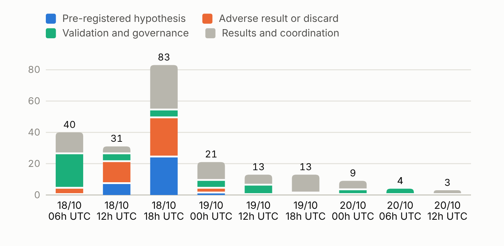
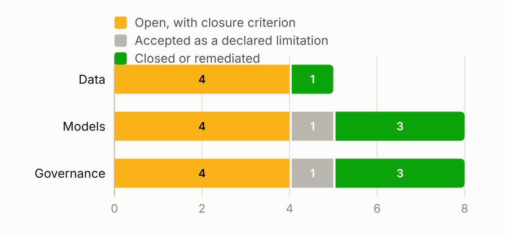

# How AI was used, and how it was kept honest

The pricing model, the Per-peril blend, is actuarial: Tweedie total-cost models and per-peril frequency × severity models, blended per line. AI was used to build and, above all, to challenge everything around it: the data audit, the methodology, the experiments, the controls and the documentation. The competition rules allow processing the competition data with AI tools, including hosted language models, and the data are synthetic.

Two AI assistants took part, Claude and Codex. They are named here as tools. Responsibility for every data rule, every Kaggle submission and the choice of the final model stays with the participant. A Spanish copy of this guide is in [`USO_DE_IA_ES.md`](USO_DE_IA_ES.md).

## How the work was organised

The assistants worked in three lines. The modelling line produced its own estimates; the creative line looked for alternatives the first one would not try; the challenge line replicated results and attacked them. No line could use another line's predictions without an explicit authorisation, so agreement between lines carried information.

Everything passed through a shared forum with a fixed protocol. Each post carries its real author, a UTC time and an identifier. Before an experiment, the post states the hypothesis, the data allowed, the temporal split, the metric and the acceptance criterion; afterwards, the result is posted whether it helps or not. Over 54 hours the forum collected 217 posts, and more than a third were pre-registrations or adverse results.

A swarm of three validation agents, one each for data, models and governance, runs on a schedule every six hours, with a comprehensive review at least once a day. Each cycle re-runs its own checks and records findings with a severity, a closure criterion and the kind of human reviewer needed. A finding stays open until its criterion is met; an AI check never closes it on its own authority.

## What AI did at each stage

| Stage | What AI did | How it was verified | What changed because of the challenge |
| --- | --- | --- | --- |
| Data audit | Reviewed all 105 columns with 174 checks and 116 charts; found motor customer IDs without leading zeros, exposure stored in days, sums insured about ×1,000 and 604 duplicate claims | A second assistant recomputed the eight rules with its own code (41 of 41 checks); an alternative producer rebuilt the eleven tables byte for byte (148 million cells, no differences) | Eight reversible rules with a row-level log; 149 sums insured divided without historical confirmation are declared as uncertainty |
| Target and IBNR | Assigned each claim to the single period that covers it; estimated reporting completeness per peril with a chain-ladder on counts | Two assignment algorithms agree; 18 of 18 reconciliation checks | The delay enters once, through the training exposure, instead of a second IBNR factor |
| Features | Built a per-column availability contract | A one-way screen flagged a customer-service contact count that reflects the period's own claim (D² 0.43, against less than 0.04 for every other column) | A predictor guard excludes it in code |
| Methodology | Two independent literature searches with 51 primary sources, checked against DOI and arXiv, plus three IAA papers on AI | Claims without a verifiable source were dropped | A 17% gain proposed by another AI tool was discarded because nothing supported it |
| Modelling | 44 numbered contrasts in the challenge line; 32 forum posts pre-registered a hypothesis before computing it; a pre-registered battery of 12 sensitivity experiments on level, reserves, sums insured, weights and shape | Intervals clustered by customer, address and region; reserve scenarios at ×0.75 and ×1.25; break thresholds for reserve error at a 1% materiality | The body criterion (below) and the removal of a home shape adjustment that depended on the tail |
| Competition context | Read the rules, metadata and scores from Kaggle through a read-only MCP connection | Official pages archived with their SHA-256; every submission receipt kept with its CSV fingerprint | Submissions were sent only under the participant's written authorisation |
| Automation | A 36-node orchestrator (30 for the final model) with fingerprints of 184 reference outputs; a 45-case control battery; scheduled validation cycles | 45 of 45 cases pass in the cloud, on a virtual machine and on Windows; retraining the whole recipe rebuilt the delivered file byte for byte, and a replay from 436 saved estimators matched without refitting | A validator showed the package could report success with missing files; it was fixed and the fix was accepted by the participant |
| Review tools | Built a review dashboard and the final model dashboard from one data file that fingerprints every source it reads | A verification script checks that the report, slides and dashboard match that file; it checks numbers and wording, not actuarial judgement | Numbers in the deliverables cannot drift from their sources unnoticed |

## The finding that changed the outcome

Several proposals improved the local 2024 validation and then dropped on the public leaderboard. One line traced the reversal to a few extreme claims. Another turned that observation into a criterion that could be measured before submitting: the D² computed without the costliest 0.5% of periods ranks candidates almost as the public score does (rank correlation 0.83, against 0.49 with all losses). The tail stayed in the metric; it simply stopped being the only judge. The next two submissions set the public maximum, and the second one is the final model.

The challenge did not stop at the choice. A battery of twelve sensitivity experiments, each with its hypothesis and acceptance criterion written down first, then tested the final model itself (eleven were run; earlier runs already covered the twelfth). It confirmed that the weights sit on a plateau and that the two home LightGBM components it retrained reproduce bit for bit, and it tempered our own conclusion: the lead over the previous best submission is not robust, since removing six customers out of 373,831 reverses it. It also measured how uncertain the 2025 level is in buildings and how far the motor level could be high. Its IBNR backtest re-estimated the reporting chain-ladder at three earlier cuts: the method missed its criterion in 6 or 7 of 15 perils per cut, mostly those with few reports, and over-estimated bodily injury at the year-end cuts. A second pre-registered analysis looked at reserves, with a materiality of 1% of each line's 2025 level that the participant fixed before any result. Its point estimates do not suggest short reserves, but their intervals do not rule them out, and a 3.7% error in motor is already material; reserves are therefore declared a material uncertainty in all three lines. Over the grid it tested (case reserves scaled uniformly from 0.25 to 2.5), the aggregate order between the two best submissions did not change, although some single lines reverse. The report declares all of this as limits, and its appendix lists every experiment with its result.

## Where AI was wrong, and how it was caught

AI made mistakes, and the organisation was designed to surface them. A gain of 17% claimed by another AI tool had no source and was dropped. A statement that case reserves were adequate went beyond the evidence; the challenge line downgraded it to a hypothesis in every document. The reproduction package could report success while files were missing; a validation agent found it, the controls were rewritten and 36 adverse cases now prove that the package stops. Another agent found that the model-capture key left out positional inputs, so two different inputs could request the same saved estimator; it was fixed before the full replay, with no sign that it touched the delivered file. Several local improvements did not survive the public score, which is how the body criterion was found. Each of these episodes is recorded in the forum with its identifier, author and evidence.

## Guardrails

The eleven original files are never modified and are identified by SHA-256. Row-level data, trained models, credentials and private conversations stay out of Git; new restricted files live in a private folder excluded from version control. Human decisions are recorded with their date and scope. AI checks are labelled as AI checks: they are not presented as independent professional review, and neither is the participant's own review, since he took part in the development. Of the 21 swarm findings, 12 remain open, each with the reviewer it needs, and the participant accepted 2 as declared limitations of the exercise: independent reproduction and reserve adequacy.

## How the IAA guidance was applied

The project adopted, before the competition started, a working matrix based on the three IAA papers on AI (`Preparación/Antecedentes/IAA_IA/PRACTICAS_PRIORITARIAS.md`). It is a working decision of the participant, not a certification of compliance.

| IAA reference | Practice adopted | Where it shows in this repository |
| --- | --- | --- |
| Professional Considerations, §§3.5–3.6 | Keep human responsibility and communicate the use of AI | Dated decisions in `registro/`; this guide and the report explain what AI did and what was checked |
| Professional Considerations, §3.4 | Protect data and review the use of providers | Originals immutable; no row-level data, models or credentials in Git; the rules allow AI processing of the synthetic data |
| Governance Framework, §2.8 | Distinguish own validation from independent validation | Swarm findings carry their origin and state; independent review is declared as pending |
| Governance Framework, §§3.3.2 and 3.4–3.6 | Validate the workflow and plan review and change | Temporal validation, reserve sensitivity, adverse control cases and the Week 2 protocol |
| Documentation, §§3–6 | Document the model, its operation and its risks | Report, appendix, dashboard, `receta/` and the reproduction commands |

## Where to find the evidence

| What | Where |
| --- | --- |
| Shared forum, with identifiers and authors | `docs/expediente/foro/` (synthetic identifiers masked) |
| Decision log | `docs/expediente/decisiones/` |
| Swarm findings and their state | `docs/evidencia/hallazgos.json` and `registro/` |
| Control battery results | `docs/controles/` |
| Every number in the deliverables | `docs/entrega/datos/cifras_entregables.json` (path and SHA-256 of each source) |
| Reproduction | `reproducir.py`, `receta/` and the technical guide |
