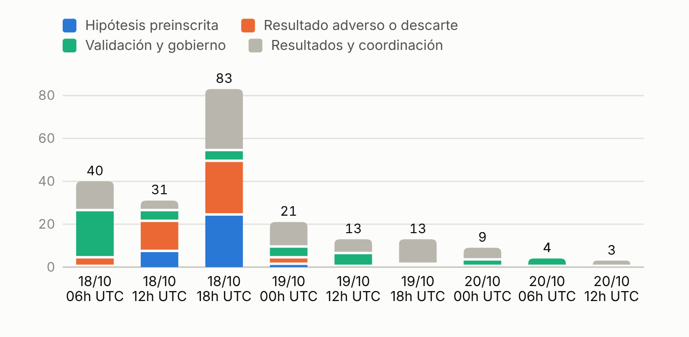
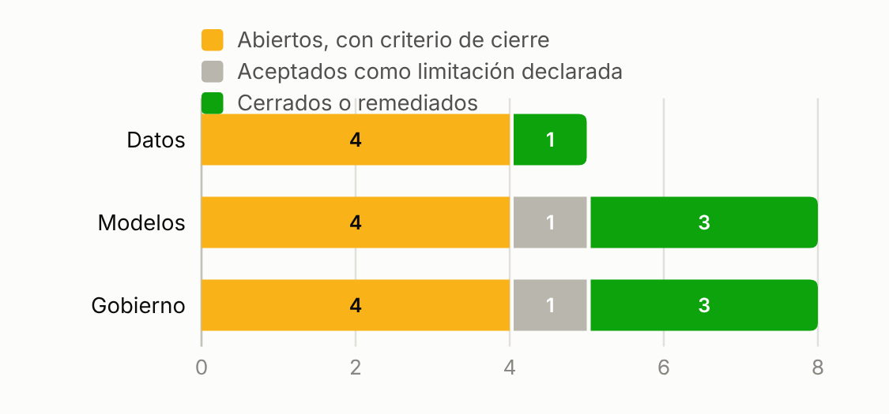

# Cómo se usó la IA y cómo se mantuvo bajo control

El modelo de tarificación, la Mezcla por peligro, es actuarial: modelos Tweedie del coste total y modelos de frecuencia × severidad por peligro, mezclados por ramo. La IA se usó para construir y, sobre todo, para poner a prueba todo lo que lo rodea: la auditoría de datos, la metodología, los experimentos, los controles y la documentación. Las reglas del concurso permiten procesar los datos con herramientas de IA, incluidos modelos de lenguaje alojados, y los datos son sintéticos.

Participaron dos asistentes de IA, Claude y Codex, que aquí se nombran como herramientas. La responsabilidad de cada regla de datos, de cada envío a Kaggle y de la elección del modelo final es del participante. La versión en inglés de esta guía está en [`AI_WORKFLOW_EN.md`](AI_WORKFLOW_EN.md).

## Cómo se organizó el trabajo

Los asistentes trabajaron en tres líneas. La de modelado produjo sus propias estimaciones; la creativa buscó alternativas que la primera no probaría; la de contraste replicó resultados y los atacó. Ninguna línea podía usar las predicciones de otra sin autorización expresa, de modo que el acuerdo entre líneas aportaba información.

Todo pasó por un foro común con un protocolo fijo. Cada aporte lleva su autor real, la hora UTC y un identificador. Antes de un experimento se publican la hipótesis, los datos permitidos, el corte temporal, la métrica y el criterio de aceptación; después se publica el resultado, ayude o no. En 54 horas el foro reunió 217 aportes, y más de un tercio fueron preinscripciones o resultados adversos.

Un enjambre de tres agentes de validación, uno para datos, otro para modelos y otro para gobierno, se ejecuta de forma programada cada seis horas, con una revisión completa al menos una vez al día. Cada ciclo vuelve a correr sus propias comprobaciones y registra los hallazgos con su severidad, un criterio de cierre y el tipo de revisor humano que necesitan. Un hallazgo sigue abierto hasta que se cumple su criterio; una comprobación de IA nunca lo cierra por sí sola.

## Qué hizo la IA en cada etapa

| Etapa | Qué hizo la IA | Cómo se verificó | Qué cambió por el contraste |
| --- | --- | --- | --- |
| Auditoría de datos | Revisó las 105 columnas con 174 comprobaciones y 116 gráficos; encontró claves de cliente de autos sin ceros iniciales, exposición guardada en días, capitales cerca de ×1000 y 604 siniestros duplicados | Un segundo asistente recalculó las ocho reglas con código propio (41 de 41 controles); un productor alternativo reconstruyó las once tablas byte a byte (148 millones de celdas, sin diferencias) | Ocho reglas reversibles con bitácora por fila; 149 capitales divididos sin confirmación histórica se declaran como incertidumbre |
| Objetivo e IBNR | Asignó cada siniestro al único periodo que lo cubre; estimó la completitud de reporte por peligro con un chain-ladder de conteos | Dos algoritmos de asignación coinciden; 18 de 18 controles de conciliación | El retraso entra una vez, por la exposición de entrenamiento, en lugar de un segundo factor de IBNR |
| Variables | Construyó un contrato de disponibilidad por columna | Un análisis univariante marcó un conteo de contactos con atención al cliente que refleja el propio siniestro del periodo (D² 0,43, frente a menos de 0,04 en todas las demás columnas) | Una guardia de predictores lo excluye en el código |
| Metodología | Dos búsquedas bibliográficas independientes con 51 fuentes primarias, cotejadas con DOI y arXiv, más tres papers de la IAA sobre IA | Se descartaron las afirmaciones sin fuente verificable | Se descartó una mejora del 17 % propuesta por otra herramienta de IA, porque nada la respaldaba |
| Modelado | 44 contrastes numerados en la línea de contraste; 32 aportes del foro preinscribieron su hipótesis antes de calcularla; una batería preinscrita de 12 experimentos de sensibilidad sobre nivel, reservas, capitales, pesos y forma | Intervalos por grupos de cliente, dirección y región; escenarios de reserva ×0,75 y ×1,25; umbrales de quiebre del error de reserva con una materialidad del 1 % | El criterio del cuerpo (abajo) y la retirada de un ajuste de forma en hogar que dependía de la cola |
| Contexto del concurso | Leyó reglas, metadatos y puntuaciones de Kaggle por una conexión MCP de solo lectura | Páginas oficiales archivadas con su SHA-256; cada recibo de envío guardado con la huella de su CSV | Los envíos se hicieron solo con la autorización escrita del participante |
| Automatización | Orquestador de 36 nodos (30 para el modelo final) con huellas de 184 salidas de referencia; batería de 45 casos de control; ciclos de validación programados | 45 de 45 casos pasan en la nube, en una máquina virtual y en Windows; reentrenar toda la receta reconstruyó byte a byte el archivo entregado, y una réplica desde 436 estimadores guardados coincidió sin reajustar | Un validador mostró que el paquete podía declarar éxito con archivos faltantes; se corrigió y el participante aceptó la corrección |
| Herramientas de revisión | Construyó un panel de revisión y el panel del modelo final a partir de un archivo de datos que registra la huella de cada fuente que lee | Un script de verificación comprueba que el informe, las láminas y el panel coinciden con ese archivo; revisa cifras y redacción, no el criterio actuarial | Las cifras de los entregables no pueden separarse de sus fuentes sin que se note |

## El hallazgo que cambió el resultado

Varias propuestas mejoraban la validación local de 2024 y después bajaban en la tabla pública. Una línea atribuyó la inversión a unos pocos siniestros extremos. Otra convirtió esa observación en un criterio medible antes de enviar: el D² calculado sin el 0,5 % de periodos más costosos ordena los candidatos casi como la puntuación pública (correlación de rangos 0,83, frente a 0,49 con todas las pérdidas). La cola siguió dentro de la métrica; solo dejó de ser el único juez. Los dos envíos siguientes marcaron el máximo público, y el segundo es el modelo final.

El contraste no terminó con la elección. Una batería de doce experimentos de sensibilidad, cada uno con su hipótesis y su criterio de aceptación escritos antes, puso después a prueba el propio modelo final (se corrieron once; corridas anteriores ya cubrían el duodécimo). Confirmó que los pesos están en una meseta y que los dos LightGBM de hogar que reentrenó se reproducen bit a bit, y moderó nuestra propia conclusión: la ventaja sobre el mejor envío anterior no es robusta, porque basta quitar seis clientes de 373.831 para invertirla. También midió cuán incierto es el nivel de 2025 en edificios y cuánto podría estar alto el de autos. Su backtesting del IBNR reestimó el chain-ladder de reporte en tres cortes anteriores: el método quedó fuera de su criterio en 6 o 7 de 15 peligros por corte, sobre todo en los de pocos avisos, y sobrestimó las lesiones corporales en los cierres de año. Un segundo análisis preinscrito estudió las reservas, con una materialidad del 1 % del nivel de 2025 de cada ramo que el participante fijó antes de ver resultados. Sus estimaciones puntuales no sugieren reservas cortas, pero sus intervalos no las descartan, y un error del 3,7 % en autos ya es material; por eso las reservas se declaran incertidumbre material en los tres ramos. En la rejilla probada (reservas de caso multiplicadas de forma uniforme entre 0,25 y 2,5), el orden agregado entre los dos mejores envíos no cambió, aunque algunos ramos por separado se invierten. El informe declara todo esto como límites, y su anexo detalla cada experimento con su resultado.

## Dónde se equivocó la IA y cómo se detectó

La IA cometió errores, y la organización estaba pensada para sacarlos a la luz. Una mejora del 17 % afirmada por otra herramienta de IA no tenía fuente y se descartó. Una afirmación sobre la suficiencia de las reservas de caso iba más allá de la evidencia; la línea de contraste la rebajó a hipótesis en todos los documentos. El paquete de reproducción podía declarar éxito con archivos faltantes; un agente de validación lo detectó, se reescribieron los controles y ahora 36 casos adversos demuestran que el paquete se detiene. Otro agente encontró que la clave de la captura de modelos omitía entradas posicionales, de modo que dos entradas distintas podían pedir el mismo estimador guardado; se corrigió antes de la réplica completa, sin indicio de que tocara el archivo entregado. Varias mejoras locales no sobrevivieron a la puntuación pública, y así se encontró el criterio del cuerpo. Cada episodio queda en el foro con su identificador, su autor y su evidencia.

## Controles

Los once archivos originales nunca se modifican y se identifican por SHA-256. Los datos por fila, los modelos entrenados, las credenciales y las conversaciones privadas quedan fuera de Git; los archivos restringidos nuevos viven en una carpeta privada excluida del control de versiones. Las decisiones humanas se registran con fecha y alcance. Las comprobaciones de IA se etiquetan como tales: no se presentan como revisión profesional independiente, y tampoco la revisión del participante, porque participó en el desarrollo. De los 21 hallazgos del enjambre, 12 siguen abiertos, cada uno con el revisor que necesita, y el participante aceptó 2 como limitaciones declaradas del ejercicio: la reproducción independiente y la suficiencia de las reservas.

## Cómo se aplicaron las referencias de la IAA

Antes de que empezara el concurso, el proyecto adoptó una matriz de trabajo basada en los tres papers de la IAA sobre IA (`Preparación/Antecedentes/IAA_IA/PRACTICAS_PRIORITARIAS.md`). Es una decisión de trabajo del participante, no una certificación de cumplimiento.

| Referencia IAA | Práctica adoptada | Dónde se ve en este repositorio |
| --- | --- | --- |
| Consideraciones profesionales, §§3.5–3.6 | Mantener la responsabilidad humana y comunicar el uso de IA | Decisiones fechadas en `registro/`; esta guía y el informe explican qué hizo la IA y qué se comprobó |
| Consideraciones profesionales, §3.4 | Proteger los datos y revisar el uso de proveedores | Originales inmutables; sin datos por fila, modelos ni credenciales en Git; las reglas permiten procesar con IA los datos sintéticos |
| Marco de gobernanza, §2.8 | Distinguir la validación propia de la independiente | Los hallazgos del enjambre conservan su origen y su estado; la revisión independiente se declara pendiente |
| Marco de gobernanza, §§3.3.2 y 3.4–3.6 | Validar el flujo y planear revisión y cambios | Validación temporal, sensibilidad a reservas, casos de control adversos y el protocolo de la semana 2 |
| Documentación, §§3–6 | Documentar el modelo, su operación y sus riesgos | Informe, anexo, panel, `receta/` y las órdenes de reproducción |

## Dónde está la evidencia

| Qué | Dónde |
| --- | --- |
| Foro común, con identificadores y autores | `docs/expediente/foro/` (identificadores sintéticos enmascarados) |
| Registro de decisiones | `docs/expediente/decisiones/` |
| Hallazgos del enjambre y su estado | `docs/evidencia/hallazgos.json` y `registro/` |
| Resultados de la batería de control | `docs/controles/` |
| Cada cifra de los entregables | `docs/entrega/datos/cifras_entregables.json` (ruta y SHA-256 de cada fuente) |
| Reproducción | `reproducir.py`, `receta/` y la guía técnica |
