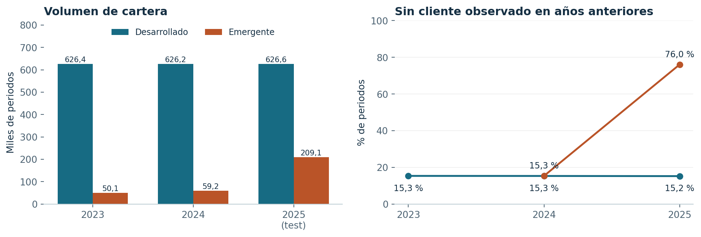
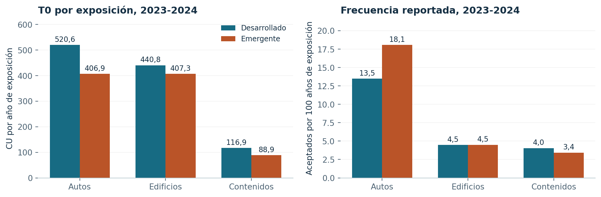
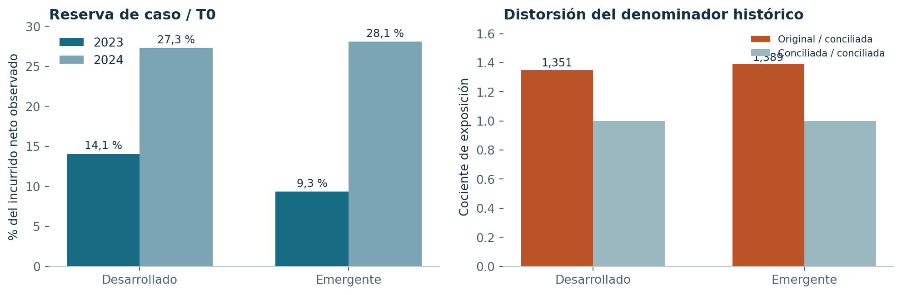

# Datos de ambas semanas: análisis para el informe

Codex, 26 de octubre de 2026. Análisis descriptivo local, sin entrenamiento ni inferencia. Valoración de los siniestros: cierre de 2024. Los importes se expresan en CU ficticias.

## Comparación que puede incorporarse al cuerpo del informe

El mercado emergente reduce la historia de entrenamiento a 2023-2024 y cambia la composición de la cartera a predecir. En 2025, el 76,04 % de sus periodos pertenece a clientes sin registro anterior en el mismo ramo, frente al 15,19 % del mercado desarrollado. Este cambio limita la transferencia de un modelo validado principalmente sobre renovaciones. La exposición se reconstruyó con días inclusivos / 365; los objetivos observados de ambas semanas coinciden por fila con sus bases preparadas. Los costes de 2025 siguen sin etiqueta y el incurrido neto histórico no se presenta como coste último.

| Mercado | Periodos de entrenamiento | Exposición histórica (años) | T0 observado (millones CU) | Test 2025 |
| --- | ---: | ---: | ---: | ---: |
| Desarrollado | 2.409.311 | 1.968.577,1 | 741,16 | 626.639 |
| Emergente | 109.296 | 91.494,5 | 28,00 | 209.063 |

El entrenamiento desarrollado abarca 2021-2024; el emergente, 2023-2024. Los totales de esa tabla describen volúmenes de distinta duración, no una comparación directa de riesgo.

## Comparación en años comunes

| Mercado | Ramo | Exposición 2023-2024 | T0 / exposición (CU/año) | Aceptados por 100 años | Severidad positiva (CU) | Reserva / T0 |
| --- | --- | ---: | ---: | ---: | ---: | ---: |
| Desarrollado | Autos | 399.467,5 | 520,63 | 13,48 | 3.861,90 | 24,4 % |
| Desarrollado | Edificios | 299.904,8 | 440,76 | 4,46 | 9.873,50 | 17,1 % |
| Desarrollado | Contenidos | 299.941,7 | 116,87 | 4,05 | 2.886,18 | 7,6 % |
| Emergente | Autos | 38.968,5 | 406,89 | 18,09 | 2.249,70 | 22,1 % |
| Emergente | Edificios | 23.468,0 | 407,31 | 4,50 | 9.051,85 | 13,6 % |
| Emergente | Contenidos | 29.058,0 | 88,90 | 3,43 | 2.588,53 | 7,5 % |

Frecuencia: siniestros aceptados reportados, incluidos los de coste cero. Severidad: coste total / número de siniestros de coste positivo. Para recuperar la identidad frecuencia × severidad debe usarse la frecuencia de positivos. Los porcentajes se obtienen de sumas, no de medias de tasas.

La primera cohorte emergente no tiene historia anterior observable. Su falta de antecedentes no demuestra que todos sus clientes sean nuevos en el mercado. El gráfico omite ese porcentaje para no equiparar el inicio del archivo con adquisición comercial.

Las diferencias de coste por exposición reúnen cobertura, composición y madurez. Las etiquetas proceden de una sola valoración y los reportes tardíos están truncados. No son estimaciones de un efecto causal ni tarifas últimas.

## Conciliación de siniestros y exposición

| Mercado | Originales | Copias excluidas | Anteriores a cobertura | Rechazados asignados | Aceptados asignados | Abiertos aceptados |
| --- | ---: | ---: | ---: | ---: | ---: | ---: |
| Desarrollado | 163.150 | 604 | 413 | 1.701 | 160.432 | 10.120 |
| Emergente | 9.258 | 0 | 36 | 120 | 9.102 | 1.055 |

Las exclusiones anteriores son disjuntas. En cada mercado, originales = copias + anteriores a cobertura + rechazados asignados + aceptados asignados. La condición anterior a cobertura describe la relación con el archivo disponible, sin afirmar su causa operativa.

La exposición original agregada supera la conciliada. Las tasas por exposición se calculan sobre la capa corregida. Los originales permanecen intactos. El cambio afecta 14.229 filas de entrenamiento desarrollado y 609 emergentes; el test de ambos mercados no cambia.

## Variables, faltantes y uso

El emergente sustituye edad exacta por bandas. Carece de kilometraje anual y variables de telemática de autos, y de fecha de nacimiento y banda crediticia del maestro de clientes; incorpora género. La existencia de género no acredita su conveniencia actuarial. Las columnas ausentes se separan de los nulos dentro de una columna. Los nulos de clientes y direcciones se ponderan por periodos enlazados, no por tamaño del maestro.

El clima se enlazó por dirección y año dentro de cada mercado, con cobertura comprobada en todas las cohortes. Sus nulos también se verificaron con conteos Arrow. Incluye 2025, pero su disponibilidad al inicio del periodo necesita un contrato temporal. No se usa para declarar una comparación retrospectiva prospectiva. El campo new_business es comercial y no equivale a ausencia de historia del cliente.

La semana 2 aporta veinte pólizas de referencia y ocho supuestos de gastos. La comisión emergente de comparison_site está vacía. El panel conserva el valor pendiente; no deduce una prima comercial desde T0 ni añade gastos a la predicción de coste último.

## Validación y trazabilidad

El productor verifica integridad de originales, claves, enlaces, orden del test, intervalos, estados y fechas. Reconstruye T0 en centavos y lo coteja por fila con los objetivos preparados de ambas semanas. La comprobación separada suma por escalares, vuelve al dinero original con Decimal y revisa la asignación mediante búsqueda binaria en intervalos. También recalcula los nulos desde sus fuentes. Las pruebas del navegador revisan filtros, exportación, tablas, diseño adaptable y ausencia de tráfico de red. Sus recuentos y recibos finales figuran en [VALIDACION_PANEL.md](VALIDACION_PANEL.md).

Las fuentes exactas, sus SHA-256 y el entorno están en [datos_panel.json](datos_panel.json). La carpeta privada del corte conserva las filas auditadas; el panel y este anexo solo incluyen agregados. Los datos se descargaron anteriormente: esta revisión no consulta reglas o puntuaciones en vivo.

La revisión es propia y asistida por IA. No equivale a validación profesional independiente. Los datos de 2024 ya se abrieron adaptativamente; este análisis no crea un nuevo conjunto confirmatorio ni modifica decisiones de modelos o entregas.

Las prácticas IAA priorizadas por el proyecto exigen propósito y límites claros (Consideraciones profesionales §3.1), ficha de datos (Documentación §2) y distinción de revisión propia e independiente (Gobernanza §2.8). Este anexo aporta evidencia para esos puntos sin certificar cumplimiento profesional.

## Integración en la entrega

El primer párrafo y la primera tabla son material para el cuerpo conjunto de cinco páginas. Este documento y el PDF son anexos de datos: no reemplazan el informe competitivo, ni afirman cubrir la selección final de la segunda semana. El panel anterior conserva el recorrido de S41 y enlaza este análisis de ambos mercados.
