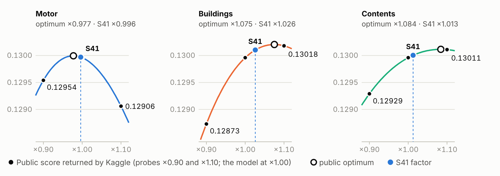

# A risk premium for every policy period, built and challenged with AI

IAA AI Hackathon 2026 · Part 1, established market · Manuel Rodríguez, individual team (Kaggle: manoloriveros) · Version of 23 October 2026 · A Spanish copy is kept in the repository

## The answer on one page

The challenge asks, for every 2025 policy period in private motor, home buildings and home contents, for the expected ultimate cost of the claims that occur in the period, net of excess and recoveries and excluding declined claims. That is the risk premium, before expenses and margins. The competition scores it with the Tweedie D² at power 1.5, the share of deviance the model explains compared with charging everyone the average cost. The data are synthetic and amounts are in a fictional currency unit (CU).

0.13016

public score of the final submission (the model alone scored 0.12996); the team ranked first of 43 teams on the public leaderboard on 22 October

0.138

out-of-sample D² of the model on 2024, against 0.071 for a constant rate per line

626,639

2025 policy periods predicted across three lines, with ten format and integrity checks

252

posts by three AI lines in a shared forum over 125 hours, with pre-registered hypotheses

We built the model in six stages (Figure 1). We rebuilt the data with eight reversible rules and assigned every claim to the single period that covers it. We then brought the observed cost to ultimate: we estimated how much of each 2024 peril was still unreported and folded it into the training exposure, so the adjustment for incurred-but-not-reported claims (IBNR) enters exactly once. The final model, which we call the Per-peril blend, combines in each line total-cost models with per-peril frequency-times-severity models, and sets the 2025 level using 2023 and 2024 as out-of-sample checks. The final submission keeps that model and recalibrates only its 2025 level, with one factor per line read from six probe submissions and applied with a credibility rule fixed before they were scored (page 4).

AI took part in every stage, and its most valuable role was to challenge positions. Three work lines, supported by two AI assistants, posted their hypotheses before computing them and shared their failures too; a swarm of validation agents audited the project every six hours. Data rules and Kaggle submissions required my authorisation; I approved the final model and chose the final submission.

<figure class="fig" data-fig="flujo" data-opts='{"filas": 2}'>

<figcaption>Figure 1The actuarial pipeline. Stage 3 moves the reporting delay into the training exposure; stages 4 to 6 are validated on full out-of-sample years, and every step leaves verifiable SHA-256 fingerprints.</figcaption>
</figure>

| Rubric criterion | Where this report answers it |
| --- | --- |
| Pricing performance and adaptation (40%) | Public and local scores, data treatment, the 2025 level calibration and its hypotheses, limitations; plan for the new market |
| Effective use of AI (25%) | Stage by stage: what AI did, how it was verified and what changed because of the challenge |
| Trust, validation and guardrails (20%) | Temporal validation, 12 pre-registered experiments with an IBNR backtest, level probes with a rule fixed in advance and a battery that tested it, 45 control cases, byte-for-byte rebuilds of the delivered files |
| Communication and documentation (15%) | This report, the video, the version-controlled repository and an offline dashboard with the same numbers, in English or Spanish (`docs/entrega/panel_modelo.html`) |

## Data: what we fixed and what we kept as uncertainty {: .pagina }

The eleven original Parquet files (7.8 million rows) are kept untouched. Every change lives in a derived layer, with a row-level change log, and can be reverted. The initial audit reviewed all 105 columns and found problems that would have distorted the rates:

| Problem found | Rows | Treatment |
| --- | --- | --- |
| Motor customer identifiers had lost their leading zeros | 123,664 | Padded to eight digits; the join to the customer master is restored |
| Part of the exposure was stored in days or on a 360-day basis instead of years | 14,229 | Covered days divided by 365, the convention used throughout 2025 |
| Sums insured jumping about a thousandfold within a policy | 2,073 + 1,454 | Divided by 1,000 when the policy history or a premium test supports it; 149 rest on the premium test alone and stay declared as uncertainty |
| Mixed capitalisation in categories, and age measured at different dates | 700,210 · 2,936 | Harmonised; age is computed at the period start (a change of convention, not a correction of errors) |
| Duplicate claims, identical except for the identifier | 604 | The copy is excluded |
| Declined renewals with a successor, and claims before the policy history | 12,041 · 413 | Flagged for audit only; never used as predictors |

Two independent implementations confirm the prepared layer: a second assistant recomputed the eight rules from the originals with its own code (41 of 41 checks), and an alternative producer rebuilt the eleven tables byte for byte, comparing 148 million cells with no differences.

## From observed cost to ultimate cost

Learning needs one label per period. We assigned each claim by policy, line and loss date within the covered period, never by report date. After excluding exact copies, declined claims and claims that predate their policy history (reconciled separately), 160,432 of the 163,150 records remain as accepted claims, each in exactly one period; none is ambiguous. The T0 label adds up the incurred amount of those claims minus recoveries; payments are already net of excess, so the excess is not deducted twice.

T0 is not yet the ultimate cost, because at the end of 2024 some claims are still unreported. A chain-ladder on claim counts by peril estimates how much of the 2024 exposure is already "seen": only 56% for motor bodily injury and 66% for building subsidence, against 94–98% for the other perils (Figure 2). We train with this effective exposure as an offset and predict 2025 with the nominal exposure. The model therefore learns rates at ultimate level without applying IBNR twice.

Figure 3 shows why this matters. Observed motor cost in 2024 (454 CU per exposure year) looks like a sharp drop; with the estimated IBNR it rises to 584, in line with 2021–2023, and the final 2025 prediction (592) holds that level. Case reserves on open claims are taken at their year-end value; with a single valuation their adequacy cannot be proven, so we measure the sensitivity below.

<figure class="fig" data-fig="completitud">

<figcaption>Figure 2Share of the 2024 exposure whose claims have already been reported, by peril.</figcaption>
</figure>

<figure class="fig" data-fig="prima_anual" data-opts='{"alto": 172}'>

<figcaption>Figure 3Risk premium per exposure year, in CU. Grey: observed cost (T0). Colour: with the estimated IBNR. Hollow circle: the final submission's 2025 prediction.</figcaption>
</figure>

## The Per-peril blend: a final model with ten components {: .pagina }

No single model won in all three lines. Total-cost models with a Tweedie distribution (LightGBM and CatBoost) capture interactions between rating factors well; per-peril frequency models multiplied by severity separate different mechanisms (a fire behaves nothing like an escape of water) and make it possible to project each peril's severity trend. The final model weights both kinds by line (appendix, Figure A1). Changes were judged with criteria written before computing them, on 2023 and on 2024, with all losses and without the most extreme ones; the criteria varied between work lines, and the final model was a trial I authorised even though it did not pass every internal filter.

The blend sets the 2025 level per line with the factor that minimises the Tweedie deviance, f = Σ(y/√μ) / Σ√μ, averaged over the 2023 and 2024 cuts; the appendix lists the factors. Components whose level is unstable across cuts contribute to how risk is spread, but do not set the level. In motor and buildings each peril's severity is projected one year ahead with its trend, capped at ±15%. The blend's 2025 total is 212.0 million CU, with the highest rate per exposure year in motor (594.6 CU); after the calibration of page 4, the final submission totals 213.7 million CU.

## How we validated it

We validated the model the way a tariff would be used: fit on past years and score a later full year (Figure 4). No 2025 cost enters the model's fit; the level rule and the rate normalisation use the 2025 portfolio's covariates and predictions, and only the final calibration uses the public score.

<figure class="fig" data-fig="validacion_diseno">

<figcaption>Figure 4Three temporal cuts. Production refits on 2021–2024 and predicts 2025.</figcaption>
</figure>
<figure class="fig" data-fig="d2_ramo" data-opts='{"cfg": {"alto": 190, "ancho": 330, "margen": {"t": 34, "r": 38, "b": 22, "l": 74}}}'>

<figcaption>Figure 52024 D² by line: the final model against a constant rate per line.</figcaption>
</figure>

On 2024 the final model explains almost twice the deviance of the constant rate per line (0.138 against 0.071) and improves every line on its own. It also ranks risk well: the 10% of periods with the highest predicted cost hold between 29% and 34% of the observed cost, and every decile follows the prediction (Figure A3).

## Validation experiments and the limits they leave

After the choice, eleven pre-registered experiments, an IBNR backtest among them, and a separate reserve analysis put the final model to the test; the appendix lists each one with its result. They reuse the 2023 and 2024 cuts, so they measure stability rather than independent performance, and every adverse result stays as a declared limit. Case reserves at ×0.75 and ×1.25 move D² only from 0.1379 to 0.1372, but in the blend a 3.7% error in motor case reserves (4.0% in buildings) moves the 2025 level by 1% and those scenarios move it up to 6.8%; S41 keeps most of that sensitivity (4.4% in motor), and case reserves remain a material uncertainty in all three lines. The IBNR backtest missed its criterion in 6 or 7 of 15 perils per cut, mostly those with few reports, and over-estimated bodily injury IBNR for the year just closed (+20.1% in 2022, +7.9% in 2023); with the recoveries missing from open claims, a scenario puts the blend's motor level 1.5% to 2.5% high. Removing 6 of 373,831 customers reverses the lead over the previous best submission, so equivalence is not claimed; seeds move D² by at most 0.00003, and 0 of 40 neighbouring weight sets improve both cuts. Two limits need no experiment: those cuts chose the model, and feature dates at quotation await the data owner's confirmation.

## Controls and reproducibility

Automated controls pass at every layer: 18 of 18 and 25 of 25 reconciliation checks for target, exposure and features, 45 of 45 nominal and adverse package cases in three environments, and 10 of 10 delivery checks for the blend's file and for S41. `python reproducir.py mezcla --objetivo=S30` regenerates the blend's CSV from the saved components with the SHA-256 that Kaggle received, and `python herramientas/regenerar_s41.py` rebuilds S41 from it byte for byte. Retraining the whole recipe from the eleven originals rebuilt the blend's file byte for byte (162 of 181 intermediate fingerprints equal, the rest within 3.9e-15); a replay from the 436 saved estimators, with refitting blocked, gave 194 of 194 identical outputs; and the level step, rerun from both, gave the six probes and S41 with their registered SHA-256. The same workflow ran all three, so this is not an independent reproduction.

## The final submission: the 2025 level, calibrated with three parameters {: .pagina }

The file I selected in Kaggle, S41, is the Per-peril blend with each line multiplied by one factor: 0.9962 in motor, 1.0260 in buildings and 1.0126 in contents. It is a three-parameter calibration of the 2025 level: nothing was retrained, and within each line every period keeps its rank and relativities. Each factor weighs two estimates of the line's level, the blend's own from 2023 and 2024 (page 3) and the one implied by the public leaderboard, computed on about a third of the test, the only measure of 2025 experience.

With the Tweedie deviance at power 1.5, scaling a line by a factor c changes the public D² in closed form:

D²(c) − D²(1) = −4 · [ S1 · (c−½ − 1) + S2 · (c½ − 1) ] / N

with S1 = Σ y/√μ and S2 = Σ √μ over the line's public rows and N the public null deviance. Its maximum, c\* = S1/S2, is the level rule of page 3 applied to those rows. Six probes, the blend with one line ×0.90 or ×1.10, identify S1/N and S2/N (Figure 6); they were diagnostic and excluded in advance from the final selection.

<figure class="fig" data-fig="calibracion" data-opts='{"alto": 162}'>

<figcaption>Figure 6Level probes: each panel scales one line's 2025 level, the other two unchanged. Dots: public scores returned by Kaggle; curve: the closed form through them; hollow circle: public optimum; filled circle and dashed line: the S41 factor.</figcaption>
</figure>

The public optimum is noisy: on 300 random thirds of 2024 its standard deviation was 3.4%, 4.8% and 3.6%, and applying it in full gained 0.00043 on the third used but lost 0.00014 on average on the other two. Before the probes were scored we therefore fixed a credibility rule, c = 1 + Z·(c\* − 1) with Z = τ²/(τ² + σ²), where σ is that noise and τ the uncertainty of our own level: 3.5% in buildings, about half the gap between its 2023 and 2024 factors, and 1.5% in motor and contents, widened with the reserve analysis. S41 is that rule applied without changes, and it scored 0.13016, the value the closed form had predicted (0.130158).

| What S41 assumes | How it was checked | If it fails |
| --- | --- | --- |
| The blend ranks and spreads risk well in 2025 | D² 0.138 out of sample on 2024, and every decile of predicted cost follows the observed one | The factors only correct the level |
| The public score is the deviance on a random third | Scores fit the closed form to five decimals, which does not identify the scorer | Only 15% to 35% of the public deviation is applied |
| A third of 2024 sizes the noise of the public optimum | Later measured 1.5 times larger against the unseen two thirds | S41 applies slightly more than it should; its expected gain stays positive |
| Our level is right within τ | The deviations were wider than τ allowed (p ≈ 0.08) | S41 stays closer to the blend's level than the leaderboard asks |
| Case reserves at 31-12-2024 are adequate | One valuation cannot prove it | A 4.4% error in motor reserves moves S41's level by 1%; material in all three lines |

Why S41. A sensitivity battery, pre-registered once the scores were known, recomputed with the corrected noise the expected private-set gain over the blend under three pairs of priors: +0.000019, +0.000062 and +0.000083 for S41, which is the only calibrated file ahead of the blend under all three. Two later calibrations of the same leaderboard, a revised credibility and a shape exponent per line, scored more in public (0.13033 and 0.13048) but lean further on it: with the corrected noise their expectations are lower on average, and the alarm rules of the battery's plans fired in favour of S41 against both (mean leads 0.0000325 and 0.0000376, threshold 0.00003). I selected S41 in Kaggle on 23 October, before the close of part 1. The lead is small against the noise, since the shape calibration still beats S41 with probability 0.39 to 0.45, and it rests on that correction.

| Line | Public optimum | Credibility Z, rule fixed before | S41 factor | Evidence without the leaderboard | Reading |
| --- | --- | --- | --- | --- | --- |
| Motor | ×0.977 | 0.17 | ×0.996 | Label effects (−1.55%) agree; last year (+0.92%) and the 2024 loss ratio (+0.95%) do not | Partial |
| Buildings | ×1.075 | 0.35 | ×1.026 | Last year (+3.44%) and the 2024 loss ratio (+3.23%) agree, size within | Supported |
| Contents | ×1.084 | 0.15 | ×1.013 | All three agree (+0.68%, +0.03%, +1.94%), size within | Supported |

The evidence criterion comes from the battery's plan, written before computing, and is applied here, after the fact, to S41's adjustments; the indicators are independent of the leaderboard, not of the project's data and assumptions, and no substitute for professional validation. The private score will show whether the calibration generalises.

## How AI worked, and how we put it to the test {: .pagina }

We organised the work so that a result from one AI line had to survive another line's challenge and the automated controls before it was used (Figure A4). Two AI assistants, Claude and Codex, worked in three lines: modelling, creative alternatives and challenge. No line could use another's predictions without explicit authorisation; hypotheses were posted with their acceptance criterion before they were computed, and adverse results were recorded like favourable ones. In 125 hours the forum collected 252 posts; nearly a third were pre-registrations or adverse results.

| Stage | What AI did | How we verified it |
| --- | --- | --- |
| Data and target | Audited 105 columns; found identifiers missing leading zeros, exposure in days, sums insured ×1,000 and 604 duplicates; assigned claims and estimated IBNR | Independent recomputation (41/41), byte-identical rebuild, two assignment algorithms that agree |
| Features | Per-column availability contract; flagged a variable that measures the period's own claim (one-way D² 0.43; all others below 0.04) | Excluded in code by a predictor guard |
| Methodology | Two searches with 51 primary sources checked against DOI and arXiv, plus three IAA papers | Unsupported claims dropped, such as a 17% gain proposed by another AI tool |
| Modelling and diagnostics | 44 numbered tests, pre-registrations and a pre-registered battery of 12 sensitivity experiments | Intervals clustered by customer, address and region; reserve, level and sum-insured scenarios |
| Level calibration | Derived the closed form of the public score in the level factor, sized its noise by bootstrap and wrote the credibility rule before the probes | Kaggle returned the predicted score to the fifth decimal; a later battery found the noise understated and favoured the rule's file (page 4) |
| Testing and governance | 30-node orchestrator with fingerprints of 184 outputs; validation swarm with 22 findings | A validator found the package could report success with missing files: fixed and tested with 36 adverse cases |

The finding that changed the outcome most is shown in Figure 7. Several proposals improved the local 2024 validation yet dropped on the public leaderboard. One line traced the reversal to a few extreme claims and another turned it into a measurable criterion: the D² without the largest 0.5% of losses ranks candidates almost as the public score does (rank correlation 0.83, against 0.49 with all losses). We then removed a home shape adjustment that depended on the tail and required the "body" to improve too, while keeping the tail in the metric. The next two submissions set the public maximum of the model search; the second is the Per-peril blend.

<figure class="fig" data-fig="curva" data-opts='{"cfg": {"alto": 166}}'>

<figcaption>Figure 7Path to the final submission: the 29 scored submissions, in order. The first shaded area marks proposals with a better local score and a worse public score; the second, the six level probes, followed by S41 and by later calibrations that were tested and not selected.</figcaption>
</figure>

Responsibility is human. I am an actuary with 13 years of experience in actuarial work and supervision. I authorised the data rules and every submission, set the design priority (a workflow another actuary can understand, reproduce and adapt), approved the Per-peril blend on 18 October and confirmed it as definitive on 20 October; on 22 October I authorised the probes, and on 23 October, after the sensitivity battery, I selected S41 in Kaggle. I accepted the technical fixes of the package and of the model capture, within that scope only, and declared independent reproduction and reserve adequacy as limitations, the latter again for S41. Neither the AI checks nor mine are independent professional review, since I took part in the development: each of the 13 open findings states which reviewer it needs.

## Week 2: how we will adapt the model

In the new market we will freeze the final submission as a reference and keep the protocol of pre-registration, forum and controls; this section will be replaced by what we observe.

| If this changes | Planned response |
| --- | --- |
| Contract, units or exposure (currency, day count, target) | Rebuild the prepared layer without carrying over rules that lack new evidence |
| Peril mix or tails | Refit per-peril severities; review the body criterion and the level rule |
| Reporting pattern of claims | Re-estimate the per-peril chain-ladder before training |
| Available features or their capture date | Update the per-column contract and the predictor guard |
| Frozen model performance (lower D² or miscalibration by decile) | Recalibrate the level first, with probes, a prior fixed in advance and noise measured on the unseen part; rebuild only if that is not enough |

<!-- FIN-CALIFICABLE -->

## Appendix, outside the five graded pages {: .pagina }

### Final model components and parameters

| Line | Component | Type | Weight |
| --- | --- | --- | --- |
| Motor | CatBoost Tweedie on total cost, four seeds | Total cost | 0.2 |
| Motor | CatBoost Poisson per peril × trended GLM gamma severity | Frequency × severity | 0.6 |
| Motor | LightGBM Tweedie with features F0 to F4 | Total cost | 0.1 |
| Motor | LightGBM Tweedie with a reduced feature set | Total cost | 0.1 |
| Buildings | LightGBM Tweedie with seven customer features | Total cost | 0.4 |
| Buildings | CatBoost Poisson per peril × trended sum-insured severity | Frequency × severity | 0.3 |
| Buildings | Additive per-peril frequency × trended sum-insured severity | Frequency × severity | 0.3 |
| Contents | LightGBM Tweedie | Total cost | 0.3 |
| Contents | Additive per-peril frequency × LightGBM gamma severity | Frequency × severity | 0.3 |
| Contents | Additive per-peril frequency × GLM severity with physical covariates | Frequency × severity | 0.4 |

Rate shape: in motor, exponent 1.09 on the spread of rates and exposure elasticity 0.95; in contents, elasticity 0.95; no shape in buildings. Level factors f (2023 / 2024 / mean): motor 0.986 / 1.005 / 0.996; buildings 1.059 / 1.134 / 1.097; contents 1.078 / 1.092 / 1.085. Validation: training uses the offset log(effective exposure); V23 trains on 2021–2022 and stops boosting on the 2023 calibration half; V24 trains on 2021–2023 with the V23 rounds × 1.15; production trains on 2021–2024 with × 1.3. D² recomputed from the saved predictions: V23 0.14542 and V24 0.13788 (motor 0.09168, buildings 0.11580, contents 0.09665). The blend's file (identifier S30): 626,639 rows, SHA-256 fd9528e0b1ee4b674dea63834a97523fd4ddc743d1495a422ce31a2eb76e3bc5, Kaggle submission 57371361, public score 0.12996.

<figure class="fig" data-fig="composicion" data-opts='{"cfg": {"alto": 110}}'>

<figcaption>Figure A1Composition of the final model. Blue: per-peril frequency × severity. Orange: total cost with Tweedie.</figcaption>
</figure>

### The level calibration of the final submission

| Quantity | Motor | Buildings | Contents |
| --- | --- | --- | --- |
| Public score of the probes, ×0.90 / ×1.10 (the blend: 0.12996) | 0.12954 / 0.12906 | 0.12873 / 0.13018 | 0.12929 / 0.13011 |
| S1/N and S2/N solved from the two probes | 0.066143 / 0.067674 | 0.048349 / 0.044972 | 0.024801 / 0.022879 |
| Public optimum c\* = S1/S2 | 0.9774 | 1.0751 | 1.0840 |
| Noise σ of c\* on a third of 2024 (300 bootstrap samples), then against the unseen two thirds | 3.4% · 4.4% | 4.8% · 5.7% | 3.6% · 4.4% |
| Prior τ fixed before the probes, credibility Z and S41 factor | 1.5% · 0.166 · 0.9962 | 3.5% · 0.346 · 1.0260 | 1.5% · 0.150 · 1.0126 |
| Credibility with the corrected noise (same τ) | 0.106 | 0.273 | 0.104 |
| Final level factor, f × c | 0.9918 | 1.1251 | 1.0987 |
| 2025 rate per exposure year, blend and S41 (CU) | 594.6 · 592.3 | 495.0 · 507.8 | 124.5 · 126.1 |
| Rate change against the 2024 ultimate, blend and S41 | +1.74% · +1.36% | +2.05% · +4.70% | +3.34% · +4.65% |
| Loss ratio, 2024 and 2025 with S41 (estimated ultimate over written premium) | 0.784 · 0.774 | 1.137 · 1.130 | 0.658 · 0.654 |

Public score of S41, expected and returned: 0.130158 and 0.13016 (submission 57531719). Under the prior, the squared standardised deviations of c\* from 1 add up to 6.68 with 3 degrees of freedom (p = 0.083): the leaderboard asks for larger corrections than τ allows, and S41 applies only the credible part. Final submission (S41): 626,639 rows, SHA-256 d8661c2874e9112bd3dd62ea4470a465ee309832dee53fd9dcaa4144dac643a5, total 213.7 million CU; `herramientas/regenerar_s41.py` rebuilds it byte for byte from the blend's file and passes the 10 delivery checks (`docs/evidencia/entrega_final_S41.json`), and the level step rerun from the refit and from the frozen replica gave the same SHA-256. Records: `registro/sonda_nivel_D100_preinscripcion.json` (rule fixed before the probes), `sonda_nivel_D100_resolucion.json`, `decision_marca_final_S41_20261023.json` (the selection) and `docs/archivo/semana1/SENSIBILIDAD_S43.md` (the sensitivity battery).

| Expected private-set gain over the blend | Rules fixed before the probes | Corrected empirical Bayes | Priors without the leaderboard |
| --- | --- | --- | --- |
| S41, the final submission | +0.000019 | +0.000062 | +0.000083 |
| Revised credibility, tested and not selected | −0.000063 | +0.000075 | +0.000055 |
| Shape exponent per line, tested and not selected | −0.000023 | +0.000014 | +0.000061 |

The sensitivity battery measured the noise of the public optimum against the two thirds of 2024 that each sample leaves out, with ratios of 1.49 to 1.50 to the earlier measure, as the 1/0.67 = 1.49 of a two-thirds sample predicts, and recomputed the expectations under three pairs of priors. The standard deviation of S41's expectation is about 0.00012, against 0.00021 to 0.00027 for the other two files. Its alarm rule, written in the plan, fires when a submitted file beats the mark in expectation under at least two pairs, with a mean of at least 0.00003, and loses to the blend under none. S41 fired it against the revised credibility (mean 0.0000325) and against the shape calibration (0.0000376), which was then marked; the second survives 99.9% of 20,000 draws of the rounding of the fourteen scores and a joint posterior for level and shape (0.0000477), and disappears without the noise correction (0.0000128 the other way). The revised credibility (D101) re-estimated τ at 5.3% from the same scores it then applied. The shape calibration (D102) raised each line's relativities to an exponent read from six more probes, 0.955 in motor; outside the leaderboard, the 2023 and 2024 optima ask instead for widening motor by 2.3% and 1.7%, and applying the three exponents to the blend loses 0.000127 and 0.000111 of D² in those years.

| Level indicator without the leaderboard | Motor | Buildings | Contents |
| --- | --- | --- | --- |
| Adjustment of S41, c − 1 | −0.38% | +2.60% | +1.26% |
| (a) Last year, f24/f − 1 | +0.92% | +3.44% | +0.68% |
| (b) Label effects of the reserve analysis (IBNR backtest; recoveries in motor) | −1.55% | −0.18% | +0.03% |
| (c) Keeping the 2024 loss ratio: premium growth over the blend's cost growth (premium read as an annual rate) | +0.95% (+0.88%) | +3.23% (+3.38%) | +1.94% (+2.02%) |
| Size limit: largest agreeing indicator plus τ | 3.05% | 6.94% | 3.44% |
| Reading | Partial | Supported | Supported |

The criterion was written before computing, in the pre-registration of the level battery: a line is supported when at least two indicators agree in sign with the adjustment and the adjustment stays within the largest of them plus the τ of D100; partial with one, or with two or more and the size outside; unsupported with none. The battery applied it to the revised credibility; this table applies the same rule to S41's adjustments, which have the same signs and are smaller, and that application was not pre-registered. Indicator (c) assumes that the 2024 loss ratio, estimated ultimate cost over written premium, holds in 2025, so it rests on our reserve estimates and on a pricing assumption, not on observed cost. The data dictionary only calls the field the premium charged under the tariff in force, without its unit (finding DATA-006, open): the battery divides the summed premium by the exposure (growth of +2.71%, +5.35% and +5.35%), and reading it as an annual rate gives +2.64%, +5.50% and +5.43% and the figures in brackets. Every line keeps its reading under both.

Reserves and rounding. Our reserves do not move the public optimum, so a reserve error moves S41's level by about (1 − Z)/c of what it moves the blend's: 84%, 64% and 84%. The case-reserve multiplier that moves S41's level by 1% ranges from 0.956 to 1.044 in motor, 0.938 to 1.062 in buildings and 0.893 to 1.107 in contents (blend: 0.963 to 1.037, 0.960 to 1.040 and 0.910 to 1.090). The 90% intervals of the estimated multiplier cross those bounds in all three lines, so case reserves remain a material uncertainty, a limitation I kept for S41 on 23 October. Under the bodily injury severity check (S3 in the reserve analysis, computed before the probes and not adopted), S41's motor level would be 1.86% high (1.10% to 2.61%), against 2.2% for the blend. Repeated in the three roots of the reproduction, the step from the blend to S41 gives its SHA-256, with notes that differ only in the last bit. The scores have five decimals: moving each of a line's three scores by ±0.000005 keeps c\* within 0.97688 to 0.97785 in motor, 1.07335 to 1.07691 in buildings and 1.08031 to 1.08809 in contents. Sources: `privado/corridas/reservas_20261019T225357Z_99b45271/`, `privado/corridas/repro_s42_20261022T170245Z_c9ea2fc3/`, `privado/corridas/repro_s41_20261023T145808Z_c8055dfc/` and `docs/archivo/semana1/RESERVAS_ACOTACION.md`.

### Experiments after the choice of the final model

Eleven experiments were written down with their hypothesis and acceptance criterion before computing; the IBNR backtest was added at the participant's request with its own pre-registration. They compare the final model with the previous best submission on the 2023 selection half and on the full 2024 year, with the full and the body D², and treat any difference below the seed floor as a tie. A separate pre-registered analysis bounded case reserves with the 1% materiality the participant fixed before any result.

| Experiment | Question | Result against the criterion set in advance |
| --- | --- | --- |
| Customer influence | Does the lead depend on a few customers? | Yes: removing 6 of 373,831 customers reverses it in 2024, and 1 in 2023. Rejected |
| Level by line | Is the 2025 level stable between the two cuts? | Not in buildings (1.059 against 1.134); motor sits 0.9% and contents 0.7% from their mean. Rejected in buildings |
| Reserves and recoveries | Do the order and the level hold? | The lead holds with reserves ×0.75, ×1 and ×1.25; the recoveries missing from open motor claims would lower the motor level by 0.75% |
| Neighbouring weights | Are better weights nearby? | 0 of 40 neighbours improve both cuts and both criteria. Plateau confirmed |
| Unconfirmed sums insured | Is the division by 1,000 immaterial? | Not per row: undivided, the 149 unconfirmed sums insured make their rows 35 to 89 times larger, although together they carry 0.01% of the blend's predicted total (24,668 CU). Rejected |
| Cohorts and segments | Is the lead homogeneous? | Adverse segments do not repeat between cuts; regional A/E in buildings correlates 0.22 between years. Partly rejected |
| Seed noise | Is the seed floor below 0.0001? | Yes: seeds move D² by at most 0.00003. Confirmed |
| Severity trend | Does the lead hold under other trend scenarios? | Yes, in every scenario tested, with attribution caveats. Confirmed |
| Shape and elasticity | Do they sit on a plateau? | No: D² moves 0.0002 to 0.0015 within ±0.02, but no point improves all four criteria |
| Reproduction | Do retrained components reproduce? | Two home LightGBM components: 1,111,301 saved predictions, bit for bit. Confirmed |
| New seed | How much does a new seed move? | Not run: an earlier five-seed run and the reproduction already cover it |
| IBNR backtest | Does the chain-ladder predict later reports? | Not in several perils: 6 or 7 of 15 outside the criterion per cut (Figure A2). Bodily injury: the IBNR of the year just closed was over-estimated by 20.1% (2022) and 7.9% (2023); in June 2024 the projection fell 7.5% short. Rejected, with bounded effect |
| Reserve bounding | How much reserve error would matter? | 3.7% in motor, 4.0% in buildings and 9.0% in contents move the blend's level by 1% (4.4%, 6.2% and 10.7% for S41); point estimates do not suggest short reserves, but their intervals do not rule them out. Material uncertainty |

<figure class="fig" data-fig="backtest">

<figcaption>Figure A2IBNR backtest. The reporting chain-ladder was re-estimated with the data available at three earlier cuts; each cell compares the claims it projected to be reported after the cut with those reported by December 2024. The year-just-closed figures in the text compare that year's IBNR with its re-estimate on all the data.</figcaption>
</figure>

<figure class="fig" data-fig="deciles" data-opts='{"alto": 158}'>

<figcaption>Figure A3Mean cost per period in 2024 by decile of predicted cost (log scale). Line: predicted. Circles: observed.</figcaption>
</figure>

<figure class="fig estrecha" data-fig="flujo_ia">

<figcaption>Figure A4How AI was organised. The participant assigns work and authorises; the lines post to the forum; a swarm of three agents audits every six hours; nothing reaches the delivery without passing the automated controls.</figcaption>
</figure>

### Short glossary

| Term | Meaning |
| --- | --- |
| Tweedie D² | 1 minus the ratio between the model's Tweedie deviance and that of predicting the mean; 0 means knowing nothing and 1 means getting every period right |
| T0 | Observed net incurred cost at 31-12-2024 of the period's accepted claims |
| IBNR | Claims that have occurred but are not yet reported |
| Effective exposure | Nominal exposure multiplied, month by month, by the share of that peril's claims that would already be reported |
| Body | The distribution without the costliest 0.5% of periods, used only as a diagnostic |
| Pre-registration | Hypothesis, data and acceptance criterion written down before computing |
| Level probe | A submission identical to the blend except for one line multiplied by a fixed factor; it only reads how the public score responds to that line's level |
| Credibility | The weight Z = τ²/(τ² + σ²) given to a noisy estimate against the level already held |

### Main references

- Smyth and Jørgensen (2002). Fitting Tweedie's compound Poisson model to insurance claims data. ASTIN Bulletin 32(1).
- Delong, Lindholm and Wüthrich (2021). Making Tweedie's compound Poisson model more accessible. European Actuarial Journal.
- Denuit, Charpentier and Trufin (2021). Autocalibration and Tweedie-dominance for insurance pricing with machine learning. Insurance: Mathematics and Economics.
- Henckaerts, Côté, Antonio and Verbelen (2021). Boosting insights in insurance tariff plans with tree-based machine learning methods. North American Actuarial Journal.
- Yang, Qian and Zou (2018). Insurance premium prediction via gradient tree-boosted Tweedie compound Poisson models. arXiv:1508.06378.
- Fissler, Lorentzen and Mayer (2023). Model comparison and calibration assessment. arXiv:2202.12780.
- Denuit, Sznajder and Trufin (2019). Model selection based on Lorenz and concentration curves, Gini indices and convex order. Insurance: Mathematics and Economics 89.
- Lindholm and Nazar (2024). On duration effects in non-life insurance pricing. European Actuarial Journal.
- Verbelen, Antonio, Claeskens and Crevecoeur (2022). Modeling the occurrence of events subject to a reporting delay via an EM algorithm. Statistical Science.
- Lindholm, Richman, Tsanakas and Wüthrich (2022). Discrimination-free insurance pricing. ASTIN Bulletin.
- Wüthrich and Merz (2023). Statistical Foundations of Actuarial Learning and its Applications. Springer.
- Goldburd, Khare, Tevet and Guller. Generalized Linear Models for Insurance Rating. CAS Monograph 5.
- Bühlmann and Gisler (2005). A Course in Credibility Theory and its Applications. Springer.
- IAA AI Task Force: Professional Considerations for Actuaries Interacting with Artificial Intelligence (2026); Artificial Intelligence Governance Framework (2025); Documentation of Artificial Intelligence Models or Systems (2025).

### Where the numbers come from

Every number in this report comes from `docs/entrega/datos/cifras_entregables.json`, which stores the path and SHA-256 of every source it reads and is regenerated with `herramientas/cifras_entregables.py`; `herramientas/verificar_entregables.py` checks that the text matches that file. Forum figures count the posts up to the record of the final selection (CLA-20261023-002, 23 October, 14:51 UTC); the later ones, on these documents, are in the same record. The full forum (with synthetic identifiers masked), the decision log and the receipt of every submission are kept as the working record in `docs/expediente/` and `registro/`.

