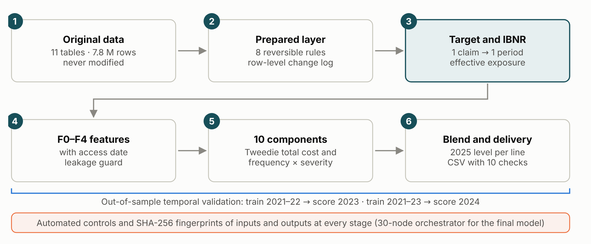
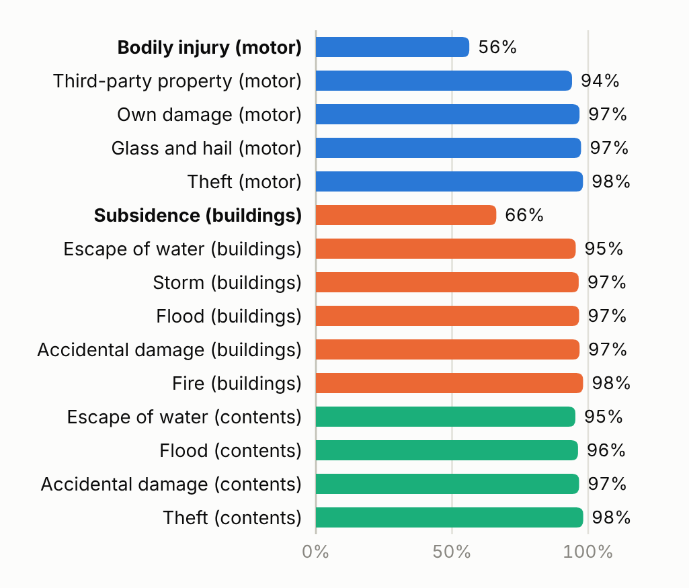
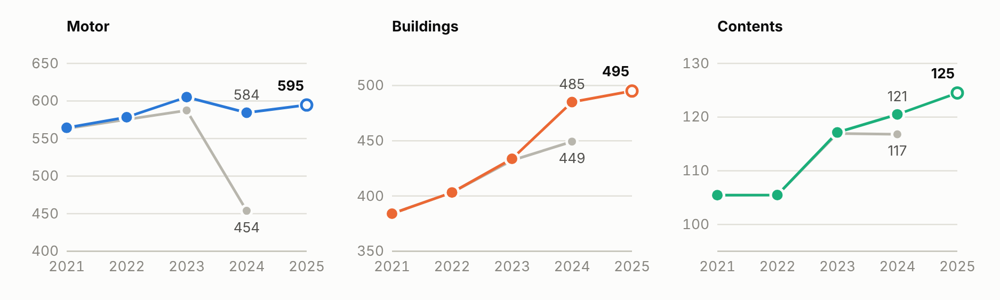
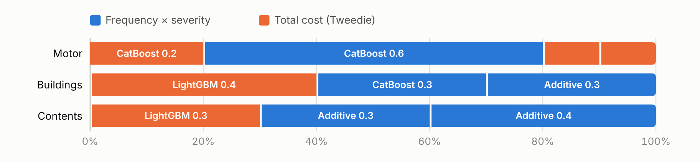
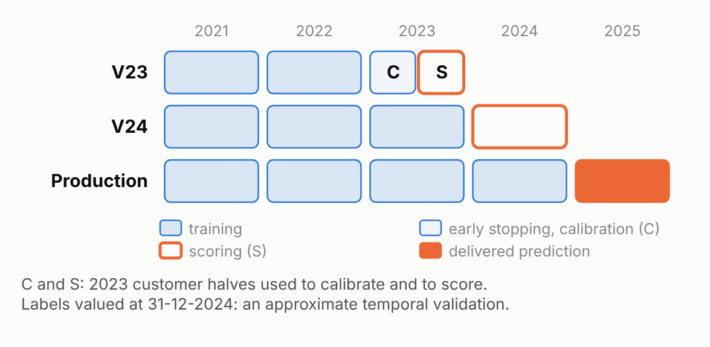
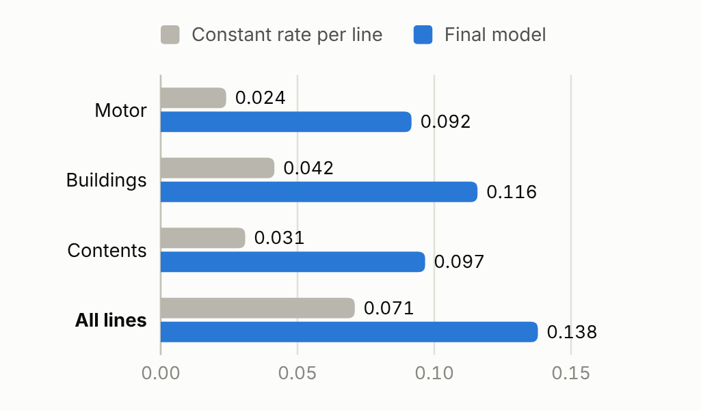
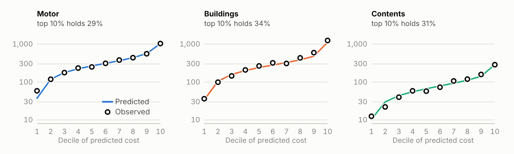
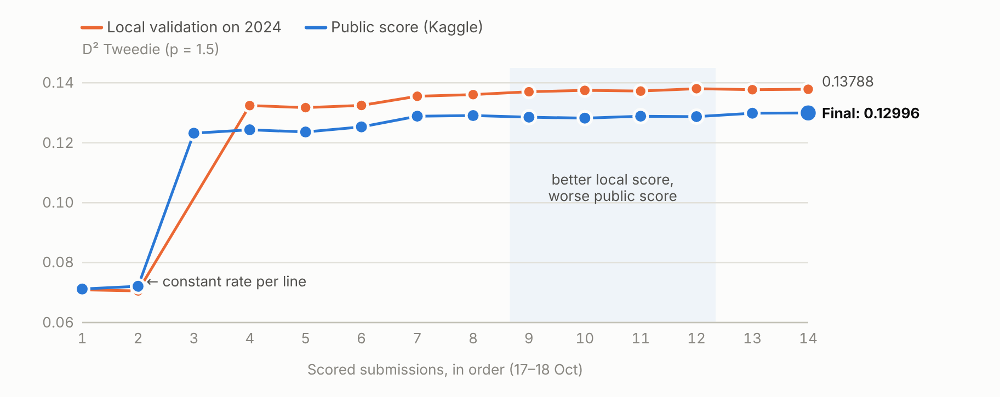
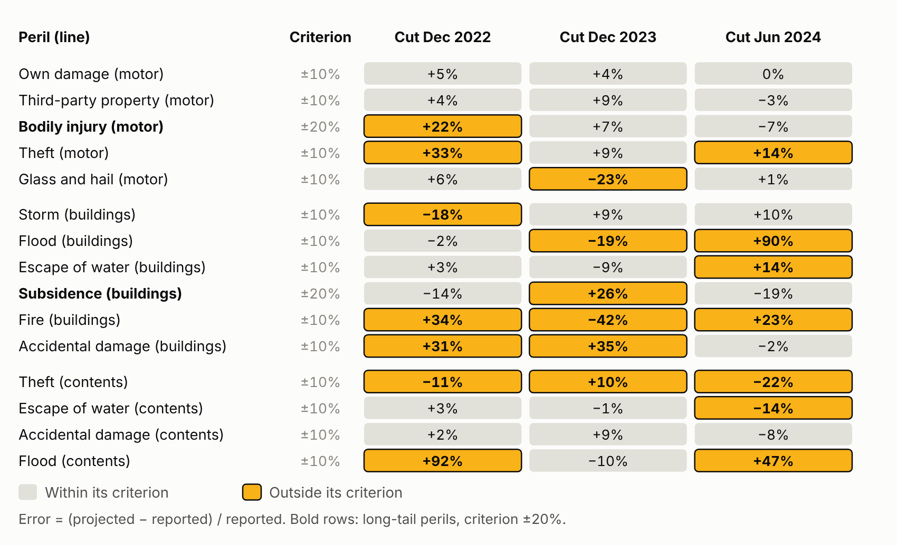

# A risk premium for every policy period, built and challenged with AI

IAA AI Hackathon 2026 · Part 1, established market · Manuel Rodríguez, individual team (Kaggle: manoloriveros) · Version of 20 October 2026 · A Spanish copy is kept in the repository

## The answer on one page

The challenge asks, for every 2025 policy period in private motor, home buildings and home contents, for the expected ultimate cost of the claims that occur in the period, net of excess and recoveries and excluding declined claims. That is the risk premium, before expenses and margins. The competition scores it with the Tweedie D² at power 1.5, the share of deviance the model explains compared with charging everyone the average cost. Because more than 90% of periods have no claims, values between 0.10 and 0.15 already separate risks well. The data are synthetic and amounts are in a fictional currency unit (CU).

0.12996

public score of the final model; first place on the public leaderboard among 19 teams (checked on 19 October)

0.138

out-of-sample D² on 2024, against 0.071 for a constant rate per line

626,639

2025 policy periods predicted across three lines, with ten format and integrity checks

217

posts by three AI lines in a shared forum over 54 hours, with pre-registered hypotheses

We built the model in six stages (Figure 1). We rebuilt the data with eight reversible rules and assigned every claim to the single period that covers it. We then brought the observed cost to ultimate: we estimated how much of each 2024 peril was still unreported and folded it into the training exposure, so the adjustment for incurred-but-not-reported claims (IBNR) enters exactly once. The final model, which we call the Per-peril blend, combines in each line total-cost models with per-peril frequency-times-severity models, and sets the 2025 level using 2023 and 2024 as out-of-sample checks.

AI took part in every stage, and its most valuable role was to challenge positions. Three independent work lines, supported by two AI assistants, posted their hypotheses before computing them and shared their failures too; a swarm of validation agents audited the project every six hours. Data rules and Kaggle submissions required my authorisation, and I approved the final model.

<figure class="fig" data-fig="flujo" data-opts='{"filas": 2}'>

<figcaption>Figure 1The actuarial pipeline. Stage 3 moves the reporting delay into the training exposure; stages 4 to 6 are validated on full out-of-sample years, and every step leaves verifiable SHA-256 fingerprints.</figcaption>
</figure>

| Rubric criterion | Where this report answers it |
| --- | --- |
| Pricing performance and adaptation (40%) | Public and local scores, data treatment, limitations; plan for the new market |
| Effective use of AI (25%) | Stage by stage: what AI did, how it was verified and what changed because of the challenge |
| Trust, validation and guardrails (20%) | Temporal validation, 12 pre-registered experiments with an IBNR backtest, 45 control cases, a full retraining that rebuilds the delivered file byte for byte |
| Communication and documentation (15%) | This report, the video, the version-controlled repository and an offline dashboard with the same numbers, in English or Spanish (`docs/entrega/panel_modelo.html`) |

## Data: what we fixed and what we kept as uncertainty {: .pagina }

The eleven original Parquet files (7.8 million rows) are kept untouched. Every change lives in a derived layer, with a row-level change log, and can be reverted. The initial audit reviewed all 105 columns and found problems that would have distorted the rates:

| Problem found | Rows | Treatment |
| --- | --- | --- |
| Motor customer identifiers had lost their leading zeros | 123,664 | Padded to eight digits; the join to the customer master is restored |
| Part of the exposure was stored in days or on a 360-day basis instead of years | 14,229 | Covered days divided by 365, the convention used throughout 2025 |
| Sums insured jumping about a thousandfold within a policy | 2,073 + 1,454 | Divided by 1,000 when the policy history or a premium test supports it; 149 rest on the premium test alone and stay declared as uncertainty |
| Mixed capitalisation in categories, and age measured at different dates | 700,210 · 2,936 | Harmonised; age is computed at the period start (a change of convention, not a correction of errors) |
| Duplicate claims, identical except for the identifier | 604 | The copy is excluded |
| Declined renewals with a successor, and claims before the policy history | 12,041 · 413 | Flagged for audit only; never used as predictors |

Two independent implementations confirm the prepared layer: a second assistant recomputed the eight rules from the originals with its own code (41 of 41 checks), and an alternative producer rebuilt the eleven tables byte for byte, comparing 148 million cells with no differences.

## From observed cost to ultimate cost

Learning needs one label per period. We assigned each claim by policy, line and loss date within the covered period, never by report date. After excluding exact copies, declined claims and claims that predate their policy history (reconciled separately), 160,432 of the 163,150 records remain as accepted claims, each in exactly one period; none is ambiguous. The T0 label adds up the incurred amount of those claims minus recoveries; payments are already net of excess, so the excess is not deducted twice.

T0 is not yet the ultimate cost, because at the end of 2024 some claims are still unreported. A chain-ladder on claim counts by peril estimates how much of the 2024 exposure is already "seen": only 56% for motor bodily injury and 66% for building subsidence, against 94–98% for the other perils (Figure 2). We train with this effective exposure as an offset and predict 2025 with the nominal exposure. The model therefore learns rates at ultimate level without applying IBNR twice.

Figure 3 shows why this matters. Observed motor cost in 2024 (454 CU per exposure year) looks like a sharp drop; with the estimated IBNR it rises to 584, in line with 2021–2023, and the 2025 prediction (595) continues that trend. Case reserves on open claims are taken at their year-end value; with a single valuation their adequacy cannot be proven, so we measure the sensitivity below.

<figure class="fig" data-fig="completitud">

<figcaption>Figure 2Share of the 2024 exposure whose claims have already been reported, by peril.</figcaption>
</figure>

<figure class="fig" data-fig="prima_anual" data-opts='{"alto": 172}'>

<figcaption>Figure 3Risk premium per exposure year, in CU. Grey: observed cost (T0). Colour: with the estimated IBNR. Hollow circle: the final model's 2025 prediction.</figcaption>
</figure>

## The Per-peril blend: a final model with ten components {: .pagina }

No single model won in all three lines. Total-cost models with a Tweedie distribution (LightGBM and CatBoost) capture interactions between rating factors well; per-peril frequency models multiplied by severity separate different mechanisms (a fire behaves nothing like an escape of water) and make it possible to project each peril's severity trend. The final model weights both kinds by line (Figure 4). Changes were judged with criteria written before computing them, on 2023 and on 2024, with all losses and without the most extreme ones; the criteria varied between work lines, and the final model was a trial I authorised even though it did not pass every internal filter.

<figure class="fig" data-fig="composicion" data-opts='{"cfg": {"alto": 124}}'>

<figcaption>Figure 4Composition of the final model. Blue: per-peril frequency × severity. Orange: total cost with Tweedie. The appendix lists every component.</figcaption>
</figure>

The 2025 level is set per line with the factor that minimises the Tweedie deviance, f = Σ(y/√μ) / Σ√μ, averaged over the 2023 and 2024 cuts; the appendix lists the factors. Components whose level is unstable across cuts contribute to how risk is spread, but do not set the level. In motor and buildings each peril's severity is projected one year ahead with its trend, capped at ±15%. The 2025 total is 212.0 million CU, and motor carries the highest rate per exposure year (594.6 CU).

## How we validated it

We validated the model the way a tariff would be used: fit on past years and score a later full year (Figure 5). No 2025 cost enters the fit; the level rule and the rate normalisation do use the 2025 portfolio's covariates and predictions.

<figure class="fig" data-fig="validacion_diseno">

<figcaption>Figure 5Three temporal cuts. Production refits on 2021–2024 and predicts 2025.</figcaption>
</figure>
<figure class="fig" data-fig="d2_ramo" data-opts='{"cfg": {"alto": 196, "ancho": 330, "margen": {"t": 34, "r": 38, "b": 22, "l": 74}}}'>

<figcaption>Figure 62024 D² by line: the final model against a constant rate per line.</figcaption>
</figure>

On 2024 the final model explains almost twice the deviance of the constant rate per line (0.138 against 0.071) and improves every line on its own. It also ranks risk well: the 10% of periods with the highest predicted cost hold between 29% and 34% of the observed cost, and in every decile the observed cost follows the prediction (Figure 7).

<figure class="fig" data-fig="deciles" data-opts='{"alto": 158}'>

<figcaption>Figure 7Mean cost per period in 2024 by decile of predicted cost (log scale). Line: predicted. Circles: observed.</figcaption>
</figure>

With the case reserves of open claims multiplied by 0.75 or by 1.25, the 2024 D² moves from 0.1379 to 0.1372 and the model keeps its lead over the alternatives, but the same scenarios move the 2025 level by up to 6.8%. In buildings, 2024 cost exceeded the prediction made with the 2023 factor by 10%, so the 2025 level averages the 2023 and 2024 factors. Page 5 summarises the experiments that tested these results after the choice.

## How AI worked, and how we put it to the test {: .pagina }

We organised the work so that AI never validated itself (Figure 8). Two AI assistants, Claude and Codex, worked in three lines: modelling, creative alternatives and challenge. No line could use another's predictions without explicit authorisation; hypotheses were posted with their acceptance criterion before they were computed, and adverse results were recorded like favourable ones. In 54 hours the forum collected 217 posts; more than a third were pre-registrations or adverse results.

<figure class="fig estrecha" data-fig="flujo_ia">

<figcaption>Figure 8How AI was organised. The participant assigns work and authorises; the lines post to the forum; a swarm of three agents audits every six hours; nothing reaches the delivery without passing the automated controls.</figcaption>
</figure>

| Stage | What AI did | How we verified it |
| --- | --- | --- |
| Data and target | Audited 105 columns; found identifiers missing leading zeros, exposure in days, sums insured ×1,000 and 604 duplicates; assigned claims and estimated IBNR | Independent recomputation (41/41), byte-identical rebuild, two assignment algorithms that agree |
| Features | Per-column availability contract; flagged a variable that measures the period's own claim (one-way D² 0.43; all others below 0.04) | Excluded in code by a predictor guard |
| Methodology | Two searches with 51 primary sources checked against DOI and arXiv, plus three IAA papers | Unsupported claims dropped, such as a 17% gain proposed by another AI tool |
| Modelling and diagnostics | 44 numbered tests, pre-registrations and a pre-registered battery of 12 sensitivity experiments | Intervals clustered by customer, address and region; reserve, level and sum-insured scenarios |
| Testing and governance | 30-node orchestrator with fingerprints of 184 outputs; validation swarm with 21 findings | A validator found the package could report success with missing files: fixed and tested with 36 adverse cases |

The finding that changed the outcome most is shown in Figure 9. Several proposals improved the local 2024 validation yet dropped on the public leaderboard. One line traced the reversal to a few extreme claims and another turned it into a measurable criterion: the D² without the largest 0.5% of losses ranks candidates almost as the public score does (rank correlation 0.83, against 0.49 with all losses). We then removed a home shape adjustment that depended on the tail and required the "body" to improve too, while keeping the tail in the metric. The next two submissions set the public maximum; the second is the final model. The same challenge downgraded an overstated claim about reserves to a hypothesis.

<figure class="fig" data-fig="curva" data-opts='{"cfg": {"alto": 184}}'>

<figcaption>Figure 9Path to the final model: the 14 scored submissions, in order. The shaded area marks proposals with a better local score and a worse public score.</figcaption>
</figure>

## Controls, reproducibility and human responsibility {: .pagina }

| Layer | Control | Result |
| --- | --- | --- |
| Original data | SHA-256 fingerprints of the eleven Parquet files and an independent rebuild | 11 of 11 identical; 0 differences in 148 million cells |
| Target, exposure and features | Reconciliation of assignment, T0, reserves and exposure; availability contract per column | 18 of 18 and 25 of 25 checks |
| Package | 9 nominal and 36 adverse cases launched from the command line | 45 of 45 in the cloud, on a virtual machine and on Windows |
| Delivery | Columns, rows, order, identifiers, positive values and receipt SHA-256 | 10 of 10 checks |

`python reproducir.py mezcla --objetivo=S30` regenerates the final CSV from the saved components with the SHA-256 that Kaggle received (S30 is the model's identifier in code and receipts). Retraining the whole recipe from the eleven originals rebuilt that file byte for byte, with 162 of 181 intermediate fingerprints equal and the rest within 3.9e-15 in relative terms; a replay from the 436 saved estimators, with refitting blocked, gave 194 of 194 identical outputs. The same workflow ran both, so this is not an independent reproduction.

Responsibility is human. I am an actuary with 13 years of experience in actuarial work and supervision. I authorised the data rules and the submissions, set the design priority (a workflow another actuary can understand, reproduce and adapt), approved the final model on 18 October and confirmed it as definitive on 20 October, closing the search for Part 1 candidates; the manual selection in Kaggle is still mine to make. I accepted the technical fixes of the package and of the model capture, within that scope only, and declared independent reproduction and reserve adequacy as limitations of the exercise. Neither the AI checks nor mine are independent professional review, since I took part in the development: each of the 12 open findings states which reviewer it needs.

## Validation experiments and the limits they leave

After the choice, eleven pre-registered experiments, an IBNR backtest among them, and a separate reserve analysis put the final model to the test; the appendix lists them, with a twelfth that did not need running. They reuse the 2023 and 2024 cuts, so they measure stability rather than independent performance, and every adverse result stays as a declared limit. Two limits need no experiment: those cuts chose the model, and feature dates at quotation still need the data owner's confirmation.

| Experiment | Result | What we do |
| --- | --- | --- |
| Case reserves ×0.75 and ×1.25; reserve bounding at a 1% materiality | D² moves only from 0.1379 to 0.1372, but a 3.7% error in motor case reserves (4.0% in buildings) already moves the 2025 level by 1% | A material uncertainty in all three lines, declared as a limitation; successive valuations are needed |
| IBNR backtest from three earlier cuts | Outside its criterion in 6 or 7 of 15 perils per cut, mostly those with few reports; bodily injury IBNR for the year just closed over-estimated in 2022 and 2023 (+20.1% and +7.9%) | With the recoveries missing from open claims, a scenario puts motor 1.5% to 2.5% high; declared as a scenario, not an identified bias, and not applied |
| 2025 level from two cuts | The buildings factors (1.059 and 1.134) sit 3.4% from their mean | Both cuts averaged; recalibrate first in Week 2 |
| Customer influence, seeds and weights | Removing 6 of 373,831 customers reverses the lead over the previous best submission; seeds move D² by at most 0.00003; 0 of 40 neighbouring weight sets improve both cuts | The lead is not robust and equivalence is not claimed; the weights sit on a plateau |
| The 149 unconfirmed sums insured, recomputed undivided | Their rows become 35 to 89 times larger; together they carry 0.01% of the predicted total (24,668 CU) | Keep the division; confirm it with a home actuary |

## Week 2: how we will adapt the model

In the new market we will first freeze the final model as a reference and apply the same protocol of pre-registration, forum and controls; each observed difference will decide the response, and this section will be replaced by what we observe:

| What we will compare | Signal of change | Planned response |
| --- | --- | --- |
| Contract, units and exposure | Another currency, day-count convention or target definition | Rebuild the prepared layer without carrying over rules that lack new evidence |
| Peril mix and tails | New perils or heavier tails | Refit per-peril severities; review the body criterion and the level rule |
| Claims development | A different reporting pattern | Re-estimate the per-peril chain-ladder before training |
| Available features | New, missing or differently dated columns | Update the per-column contract and the predictor guard |
| Frozen model performance | Lower D² or miscalibration by decile | Recalibrate first; rebuild only if recalibration is not enough |

<!-- FIN-CALIFICABLE -->

## Appendix, outside the five graded pages {: .pagina }

### Final model components and parameters

| Line | Component | Type | Weight |
| --- | --- | --- | --- |
| Motor | CatBoost Tweedie on total cost, four seeds | Total cost | 0.2 |
| Motor | CatBoost Poisson per peril × trended GLM gamma severity | Frequency × severity | 0.6 |
| Motor | LightGBM Tweedie with features F0 to F4 | Total cost | 0.1 |
| Motor | LightGBM Tweedie with a reduced feature set | Total cost | 0.1 |
| Buildings | LightGBM Tweedie with seven customer features | Total cost | 0.4 |
| Buildings | CatBoost Poisson per peril × trended sum-insured severity | Frequency × severity | 0.3 |
| Buildings | Additive per-peril frequency × trended sum-insured severity | Frequency × severity | 0.3 |
| Contents | LightGBM Tweedie | Total cost | 0.3 |
| Contents | Additive per-peril frequency × LightGBM gamma severity | Frequency × severity | 0.3 |
| Contents | Additive per-peril frequency × GLM severity with physical covariates | Frequency × severity | 0.4 |

Rate shape: in motor, exponent 1.09 on the spread of rates and exposure elasticity 0.95; in contents, elasticity 0.95; no shape in buildings. Level factors f (2023 / 2024 / mean): motor 0.986 / 1.005 / 0.996; buildings 1.059 / 1.134 / 1.097; contents 1.078 / 1.092 / 1.085. Validation: training uses the offset log(effective exposure); V23 trains on 2021–2022 and stops boosting on the 2023 calibration half; V24 trains on 2021–2023 with the V23 rounds × 1.15; production trains on 2021–2024 with × 1.3. D² recomputed from the saved predictions: V23 0.14542 and V24 0.13788 (motor 0.09168, buildings 0.11580, contents 0.09665). Delivered file (identifier S30): 626,639 rows, SHA-256 fd9528e0b1ee4b674dea63834a97523fd4ddc743d1495a422ce31a2eb76e3bc5, Kaggle submission 57371361.

### Experiments after the choice of the final model

Eleven experiments were written down with their hypothesis and acceptance criterion before computing; the IBNR backtest was added at the participant's request with its own pre-registration. They compare the final model with the previous best submission on the 2023 selection half and on the full 2024 year, with the full and the body D², and treat any difference below the seed floor as a tie. A separate pre-registered analysis bounded case reserves with the 1% materiality the participant fixed before any result.

| Experiment | Question | Result against the criterion set in advance |
| --- | --- | --- |
| Customer influence | Does the lead depend on a few customers? | Yes: removing 6 of 373,831 customers reverses it in 2024, and 1 in 2023. Rejected |
| Level by line | Is the 2025 level stable between the two cuts? | Not in buildings (1.059 against 1.134); motor sits 0.9% and contents 0.7% from their mean. Rejected in buildings |
| Reserves and recoveries | Do the order and the level hold? | The lead holds with reserves ×0.75, ×1 and ×1.25; the recoveries missing from open motor claims would lower the motor level by 0.75% |
| Neighbouring weights | Are better weights nearby? | 0 of 40 neighbours improve both cuts and both criteria. Plateau confirmed |
| Unconfirmed sums insured | Is the division by 1,000 immaterial? | Not per row: undivided, those rows are 35 to 89 times larger. Rejected |
| Cohorts and segments | Is the lead homogeneous? | Adverse segments do not repeat between cuts; regional A/E in buildings correlates 0.22 between years. Partly rejected |
| Seed noise | Is the seed floor below 0.0001? | Yes: seeds move D² by at most 0.00003. Confirmed |
| Severity trend | Does the lead hold under other trend scenarios? | Yes, in every scenario tested, with attribution caveats. Confirmed |
| Shape and elasticity | Do they sit on a plateau? | No: D² moves 0.0002 to 0.0015 within ±0.02, but no point improves all four criteria |
| Reproduction | Do retrained components reproduce? | Two home LightGBM components: 1,111,301 saved predictions, bit for bit. Confirmed |
| New seed | How much does a new seed move? | Not run: an earlier five-seed run and the reproduction already cover it |
| IBNR backtest | Does the chain-ladder predict later reports? | Not in several perils: 6 or 7 of 15 outside the criterion per cut (Figure A1). Bodily injury: the IBNR of the year just closed was over-estimated by 20.1% (2022) and 7.9% (2023); in June 2024 the projection fell 7.5% short. Rejected, with bounded effect |
| Reserve bounding | How much reserve error would matter? | 3.7% in motor, 4.0% in buildings and 9.0% in contents move the level by 1%; point estimates do not suggest short reserves, but their intervals do not rule them out. Material uncertainty |

<figure class="fig" data-fig="backtest">

<figcaption>Figure A1IBNR backtest. The reporting chain-ladder was re-estimated with the data available at three earlier cuts; each cell compares the claims it projected to be reported after the cut with those reported by December 2024. The year-just-closed figures in the text compare that year's IBNR with its re-estimate on all the data.</figcaption>
</figure>

### Short glossary

| Term | Meaning |
| --- | --- |
| Tweedie D² | 1 minus the ratio between the model's Tweedie deviance and that of predicting the mean; 0 means knowing nothing and 1 means getting every period right |
| T0 | Observed net incurred cost at 31-12-2024 of the period's accepted claims |
| IBNR | Claims that have occurred but are not yet reported |
| Effective exposure | Nominal exposure multiplied, month by month, by the share of that peril's claims that would already be reported |
| Body | The distribution without the costliest 0.5% of periods, used only as a diagnostic |
| Pre-registration | Hypothesis, data and acceptance criterion written down before computing |

### Main references

- Smyth and Jørgensen (2002). Fitting Tweedie's compound Poisson model to insurance claims data. ASTIN Bulletin 32(1).
- Delong, Lindholm and Wüthrich (2021). Making Tweedie's compound Poisson model more accessible. European Actuarial Journal.
- Denuit, Charpentier and Trufin (2021). Autocalibration and Tweedie-dominance for insurance pricing with machine learning. Insurance: Mathematics and Economics.
- Henckaerts, Côté, Antonio and Verbelen (2021). Boosting insights in insurance tariff plans with tree-based machine learning methods. North American Actuarial Journal.
- Yang, Qian and Zou (2018). Insurance premium prediction via gradient tree-boosted Tweedie compound Poisson models. arXiv:1508.06378.
- Fissler, Lorentzen and Mayer (2023). Model comparison and calibration assessment. arXiv:2202.12780.
- Denuit, Sznajder and Trufin (2019). Model selection based on Lorenz and concentration curves, Gini indices and convex order. Insurance: Mathematics and Economics 89.
- Lindholm and Nazar (2024). On duration effects in non-life insurance pricing. European Actuarial Journal.
- Verbelen, Antonio, Claeskens and Crevecoeur (2022). Modeling the occurrence of events subject to a reporting delay via an EM algorithm. Statistical Science.
- Lindholm, Richman, Tsanakas and Wüthrich (2022). Discrimination-free insurance pricing. ASTIN Bulletin.
- Wüthrich and Merz (2023). Statistical Foundations of Actuarial Learning and its Applications. Springer.
- Goldburd, Khare, Tevet and Guller. Generalized Linear Models for Insurance Rating. CAS Monograph 5.
- IAA AI Task Force: Professional Considerations for Actuaries Interacting with Artificial Intelligence (2026); Artificial Intelligence Governance Framework (2025); Documentation of Artificial Intelligence Models or Systems (2025).

### Where the numbers come from

Every number in this report comes from `docs/entrega/datos/cifras_entregables.json`, which stores the path and SHA-256 of every source it reads and is regenerated with `herramientas/cifras_entregables.py`; `herramientas/verificar_entregables.py` checks that the text matches that file. The full forum (with synthetic identifiers masked), the decision log and the receipt of every submission are kept as the working record in `docs/expediente/` and `registro/`.

