# Una prima de riesgo para cada periodo de póliza, construida y contrastada con IA

AI Hackathon IAA 2026 · Parte 1, mercado establecido · Manuel Rodríguez, equipo individual (Kaggle: manoloriveros) · Versión del 23 de octubre de 2026 · Copia en español del informe que se entrega en inglés

## La respuesta en una página

El reto pide estimar, para cada periodo de póliza de 2025 en autos particulares, edificios y contenidos del hogar, el coste último esperado de los siniestros ocurridos en el periodo, neto de franquicias y recobros y sin siniestros rechazados. Es la prima de riesgo, antes de gastos y márgenes. El concurso la mide con el D² Tweedie de potencia 1,5, que indica qué fracción de la desviación explica el modelo frente a cobrar a todos el coste medio. Los datos son sintéticos y los importes van en una unidad ficticia (CU).

0,13016

puntuación pública de la entrega final (el modelo solo, 0,12996); equipo primero entre 43 equipos del tablero público el 22 de octubre

0,138

D² del modelo en 2024, fuera de muestra, frente a 0,071 de una tasa constante por ramo

626.639

periodos de 2025 predichos en tres ramos, con diez controles de formato e integridad

252

aportes de tres líneas de IA en un foro común durante 125 horas, con hipótesis preinscritas

Construimos el modelo en seis etapas (Figura 1). Reconstruimos los datos con ocho reglas reversibles y asignamos cada siniestro al único periodo que lo cubre. Después llevamos el coste observado a nivel último: estimamos qué parte de cada peligro de 2024 seguía sin reportarse y la incorporamos a la exposición de entrenamiento, de modo que el ajuste por siniestros no reportados (IBNR) entra una sola vez. El modelo final, que llamamos Mezcla por peligro, combina en cada ramo modelos del coste total con modelos de frecuencia por severidad por peligro, y fija el nivel de 2025 con los años 2023 y 2024 como contraste fuera de muestra. La entrega final conserva ese modelo y solo recalibra su nivel de 2025, con un factor por ramo leído de seis sondas y una regla de credibilidad fijada antes (página 4).

La IA intervino en todas las etapas, sobre todo para confrontar posturas. Tres líneas de trabajo, apoyadas en dos asistentes de IA, publicaban sus hipótesis antes de calcularlas y también sus fracasos; un enjambre de agentes de validación auditaba el proyecto cada seis horas. Autoricé las reglas de datos y los envíos a Kaggle, aprobé el modelo final y elegí la entrega final.

<figure class="fig" data-fig="flujo" data-opts='{"filas": 2}'>
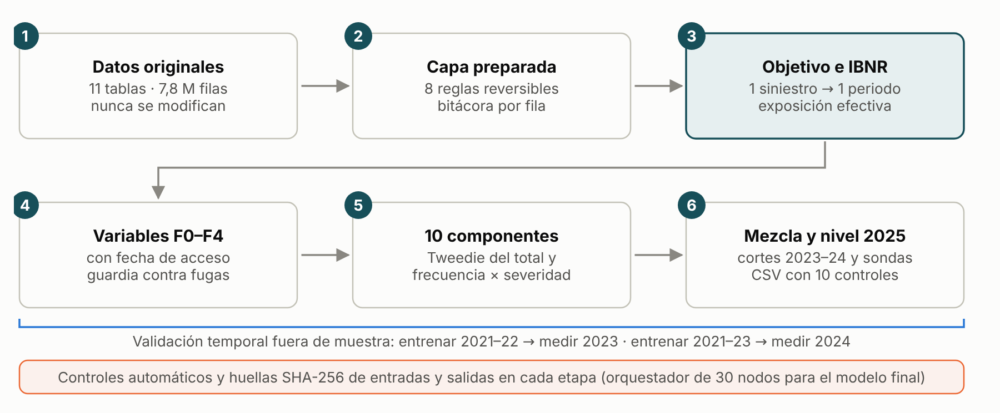
<figcaption>Figura 1El flujo actuarial. La etapa 3 traslada el retraso de reporte a la exposición de entrenamiento; las etapas 4 a 6 se validan con años completos fuera de muestra y cada paso deja huellas SHA-256 comprobables.</figcaption>
</figure>

| Criterio de la rúbrica | Dónde se responde |
| --- | --- |
| Rendimiento y adaptación (40 %) | Puntuación pública y local, tratamiento de datos, calibración del nivel de 2025 y sus hipótesis, límites; plan para el mercado nuevo |
| Uso eficaz de la IA (25 %) | Etapa por etapa: qué hizo la IA, cómo se verificó y qué cambió gracias a la confrontación |
| Confianza, validación y controles (20 %) | Validación temporal, 12 experimentos preinscritos con backtesting del IBNR, sondas de nivel con regla fijada antes y luego contrastada, 45 casos de control, reconstrucciones byte a byte de los archivos entregados |
| Comunicación y documentación (15 %) | Este informe, el video, el repositorio versionado y un panel sin conexión con las mismas cifras, en español o inglés (`docs/entrega/panel_modelo.html`) |

## Datos: qué corregimos y qué dejamos como incertidumbre {: .pagina }

Los once Parquet originales (7,8 millones de filas) se conservan intactos. Todo cambio vive en una capa derivada, con bitácora por fila y posibilidad de revertirlo. La auditoría inicial revisó las 105 columnas y encontró problemas que habrían distorsionado las tasas:

| Problema encontrado | Filas | Tratamiento |
| --- | --- | --- |
| Los identificadores de cliente de autos perdieron los ceros iniciales | 123.664 | Relleno a ocho dígitos; se recupera el cruce con el maestro |
| Parte de la exposición estaba en días o en base 360, no en años | 14.229 | Días cubiertos entre 365, la convención de todo 2025 |
| Capitales asegurados con saltos de unas mil veces dentro de una póliza | 2.073 + 1.454 | División entre mil cuando la historia de la póliza o una prueba de prima lo respalda; 149 se apoyan solo en la prueba de prima y quedan como incertidumbre declarada |
| Mayúsculas mezcladas en categorías y edad medida en fechas distintas | 700.210 · 2.936 | Unificación; la edad se calcula al inicio del periodo (cambio de convención, no corrección de errores) |
| Siniestros duplicados, idénticos salvo el identificador | 604 | Se excluye la copia |
| Rechazos de renovación con sucesor y siniestros previos al historial | 12.041 · 413 | Solo se marcan para auditoría; nunca entran como predictores |

Dos implementaciones independientes confirman la capa preparada: un segundo asistente recalculó las ocho reglas desde los originales con código propio (41 de 41 comprobaciones) y un productor alternativo reconstruyó las once tablas byte a byte, con 148 millones de celdas comparadas y ninguna diferencia.

## Del coste observado al coste último

Para aprender hace falta una etiqueta por periodo. Asignamos cada siniestro por póliza, ramo y fecha de ocurrencia dentro del periodo cubierto, sin usar la fecha de reporte. Tras excluir las copias exactas, los rechazados y los siniestros anteriores al historial de su póliza (que se concilian aparte), quedan 160.432 de los 163.150 registros como siniestros aceptados, cada uno en un solo periodo; ninguno queda ambiguo. La etiqueta T0 suma el incurrido de esos siniestros menos los recobros; los pagos ya vienen netos de franquicia, así que no se descuenta dos veces.

T0 aún no es el coste último, porque al cierre de 2024 faltan siniestros por reportar. Un chain-ladder de conteos por peligro estima qué parte de la exposición de 2024 ya está «vista»: solo el 56 % en lesiones corporales de autos y el 66 % en hundimiento de edificios, frente a 94–98 % en los demás peligros (Figura 2). Entrenamos con esa exposición efectiva como offset y predecimos 2025 con la exposición nominal. El modelo aprende así tasas a nivel último sin aplicar el IBNR dos veces.

La Figura 3 muestra por qué importa. El coste observado de autos en 2024 (454 CU por año-exposición) parece una caída brusca; con el IBNR estimado sube a 584, en línea con 2021–2023, y la predicción final de 2025 (592) mantiene ese nivel. Las reservas de caso de los siniestros abiertos se toman a su valor del cierre; con una única valoración no se puede demostrar que sean suficientes, por eso medimos su sensibilidad más abajo.

<figure class="fig" data-fig="completitud">
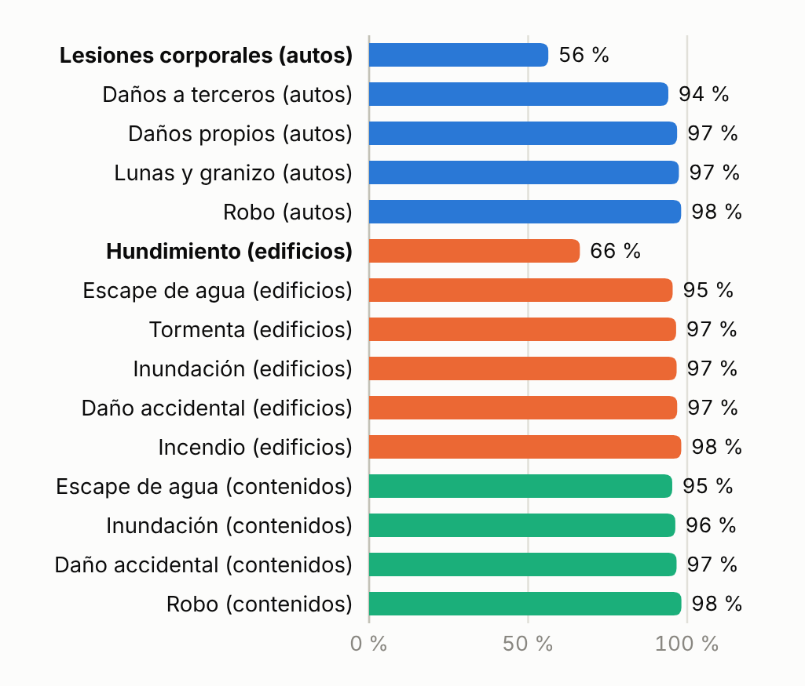
<figcaption>Figura 2Parte de la exposición de 2024 cuyos siniestros ya se han reportado, por peligro.</figcaption>
</figure>

<figure class="fig" data-fig="prima_anual" data-opts='{"alto": 172}'>
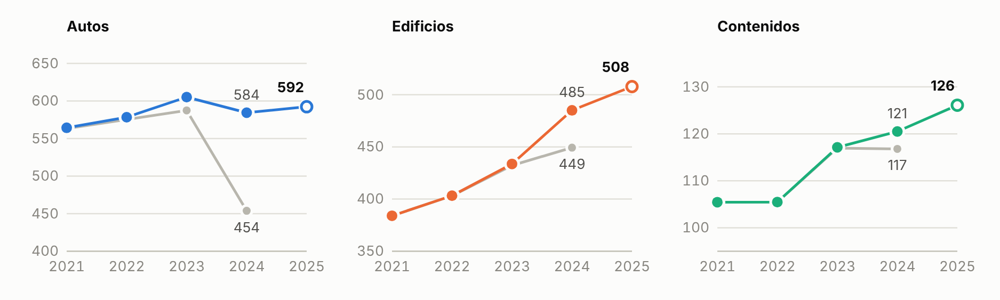
<figcaption>Figura 3Prima de riesgo por año-exposición, en CU. Gris: coste observado (T0). Color: con el IBNR estimado. Círculo hueco: predicción de la entrega final para 2025.</figcaption>
</figure>

## La Mezcla por peligro: un modelo final con diez componentes {: .pagina }

Ningún modelo único dominó en los tres ramos. Los modelos del coste total con distribución Tweedie (LightGBM y CatBoost) captan bien las interacciones entre variables; los de frecuencia por peligro multiplicada por la severidad separan mecanismos distintos (un incendio no se parece a una fuga de agua) y permiten proyectar la tendencia de severidad de cada peligro. El modelo final pondera ambos tipos por ramo (anexo, Figura A1). Los cambios se juzgaron con criterios escritos antes de calcularlos, en 2023 y en 2024, con todas las pérdidas y sin las más extremas; los criterios variaron entre líneas de trabajo, y el modelo final fue un ensayo que autoricé sin que pasara todos los filtros internos.

La mezcla fija el nivel de 2025 por ramo con el factor que minimiza la desviación Tweedie, f = Σ(y/√μ) / Σ√μ, promediado entre los cortes de 2023 y 2024; el anexo detalla los factores. Los componentes cuyo nivel es inestable entre cortes aportan el reparto del riesgo, pero no fijan el nivel. En autos y edificios la severidad de cada peligro se proyecta un año con su tendencia, acotada a ±15 %. El total de 2025 de la mezcla es de 212,0 millones de CU, con la tasa más alta por año-exposición en autos (594,6 CU); tras la calibración de la página 4, la entrega final suma 213,7 millones de CU.

## Cómo lo validamos

Validamos como se usaría la tarifa: ajustar con años pasados y medir en un año completo posterior (Figura 4). Ningún coste de 2025 entra en el ajuste del modelo; la regla de nivel y la normalización de tasas usan las covariables y las predicciones de la cartera de 2025, y solo la calibración final usa la puntuación pública.

<figure class="fig" data-fig="validacion_diseno">
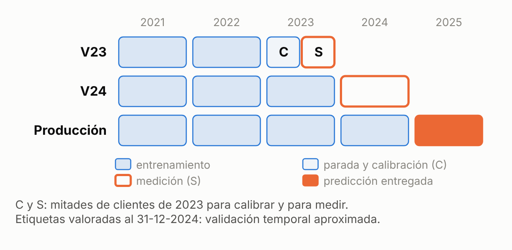
<figcaption>Figura 4Tres cortes temporales. Producción reentrena con 2021–2024 y predice 2025.</figcaption>
</figure>
<figure class="fig" data-fig="d2_ramo" data-opts='{"cfg": {"alto": 190, "ancho": 330, "margen": {"t": 34, "r": 38, "b": 22, "l": 74}}}'>
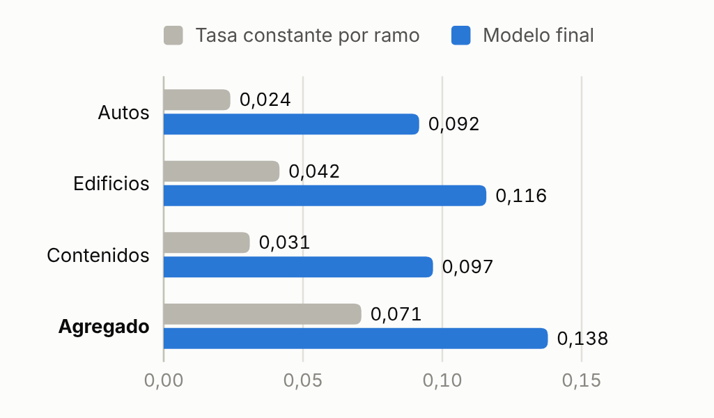
<figcaption>Figura 5D² de 2024 por ramo: el modelo final frente a una tasa constante por ramo.</figcaption>
</figure>

En 2024 el modelo final explica casi el doble de desviación que la tasa constante por ramo (0,138 frente a 0,071) y mejora cada ramo por separado. También ordena bien el riesgo: el 10 % de periodos con mayor coste predicho reúne entre el 29 % y el 34 % del coste observado, y en cada decil lo observado sigue a lo predicho (Figura A3).

## Experimentos de validación y límites que dejan

Tras la elección, once experimentos preinscritos, entre ellos un backtesting del IBNR, y un análisis de reservas pusieron a prueba el modelo final (detalle en el anexo). Reutilizan los cortes de 2023 y 2024, así que miden estabilidad y no rendimiento independiente; cada resultado adverso queda como límite declarado. Con reservas de caso ×0,75 y ×1,25 el D² solo pasa de 0,1379 a 0,1372, pero en la mezcla un error del 3,7 % en las reservas de caso de autos (4,0 % en edificios) mueve el nivel de 2025 un 1 % y esos escenarios lo mueven hasta un 6,8 %; S41 conserva casi toda esa sensibilidad (4,4 % en autos), y las reservas de caso siguen como incertidumbre material en los tres ramos. El backtesting del IBNR quedó fuera de su criterio en 6 o 7 de 15 peligros por corte y sobrestimó el IBNR de lesiones del año recién cerrado (+20,1 % en 2022, +7,9 % en 2023); con los recobros ausentes, un escenario sitúa el nivel de autos de la mezcla alto entre un 1,5 % y un 2,5 %. Quitar 6 de 373.831 clientes invierte la ventaja sobre el mejor envío anterior, así que no se afirma equivalencia; las semillas mueven el D² como mucho 0,00003 y 0 de 40 conjuntos de pesos vecinos mejoran los dos cortes. Dos límites no necesitan experimento: esos cortes eligieron el modelo, y las fechas de las variables al cotizar esperan la confirmación del dueño de los datos.

## Controles y reproducibilidad

Los controles automáticos pasan en todas las capas: 18 de 18 y 25 de 25 controles de conciliación de objetivo, exposición y variables, 45 de 45 casos nominales y adversos del paquete en tres entornos y 10 de 10 controles de entrega en el archivo de la mezcla y en S41. Con `python reproducir.py mezcla --objetivo=S30` el CSV de la mezcla se regenera desde los componentes guardados con el SHA-256 que recibió Kaggle, y `python herramientas/regenerar_s41.py` reconstruye S41 a partir de él, byte a byte. Reentrenar toda la receta desde los originales reconstruyó byte a byte el archivo de la mezcla (162 de 181 huellas intermedias iguales, el resto a menos de 3,9e-15); una réplica desde los 436 estimadores guardados, sin reajustes, dio 194 de 194 salidas idénticas, y el paso de nivel, repetido desde ambas, dio las seis sondas y S41 con su SHA-256 registrado. Lo hizo el mismo flujo, así que no es una reproducción independiente.

## La entrega final: el nivel de 2025, calibrado con tres parámetros {: .pagina }

El archivo que seleccioné en Kaggle, S41, es la Mezcla por peligro con cada ramo multiplicado por un factor: 0,9962 en autos, 1,0260 en edificios y 1,0126 en contenidos. Es una calibración del nivel de 2025 con tres parámetros: no se reentrenó nada, y dentro de cada ramo cada periodo conserva su orden y sus relatividades. Cada factor pondera dos estimaciones del nivel del ramo, la propia de la mezcla con 2023 y 2024 (página 3) y la que implica el tablero público, calculado con cerca de un tercio del test, la única medida de la experiencia de 2025.

Con la desviación Tweedie de potencia 1,5, escalar un ramo por un factor c cambia el D² público en forma cerrada:

D²(c) − D²(1) = −4 · [ S1 · (c−½ − 1) + S2 · (c½ − 1) ] / N

con S1 = Σ y/√μ y S2 = Σ √μ sobre las filas públicas del ramo y N la desviación nula del público. Su máximo, c\* = S1/S2, es la regla de nivel de la página 3 aplicada a esas filas. Seis sondas, la mezcla con un solo ramo ×0,90 o ×1,10, identifican S1/N y S2/N (Figura 6); eran diagnósticas y quedaron excluidas de antemano de la selección final.

<figure class="fig" data-fig="calibracion" data-opts='{"alto": 162}'>
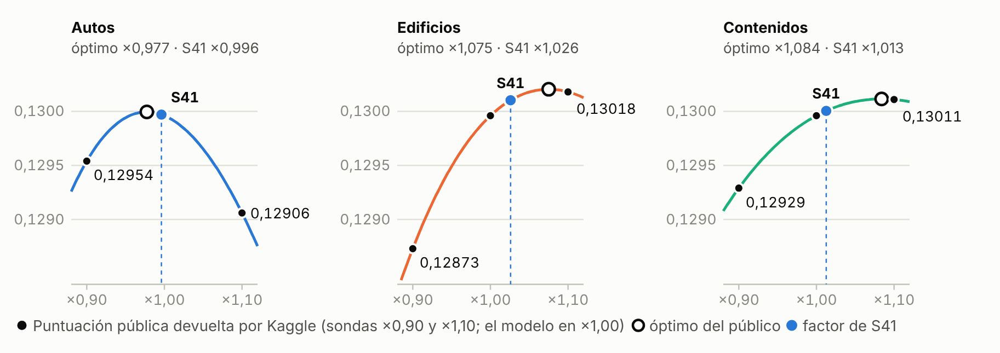
<figcaption>Figura 6Sondas de nivel: cada panel escala un ramo, con los otros dos sin cambios. Puntos: puntuaciones públicas de Kaggle; curva: la forma cerrada que pasa por ellas; círculo hueco: óptimo del público; círculo lleno y línea discontinua: el factor de S41.</figcaption>
</figure>

El óptimo del público tiene ruido: en 300 tercios al azar de 2024 su desviación típica fue del 3,4 %, 4,8 % y 3,6 %, y aplicarlo entero ganaba 0,00043 en ese tercio pero perdía 0,00014 de media en los otros dos. Por eso, antes de conocer las sondas, fijamos una regla de credibilidad, c = 1 + Z·(c\* − 1) con Z = τ²/(τ² + σ²), σ ese ruido y τ la incertidumbre de nuestro nivel: 3,5 % en edificios, cerca de la mitad de la distancia entre sus factores de 2023 y 2024, y 1,5 % en autos y contenidos, ampliada con el análisis de reservas. S41 es esa regla aplicada sin cambios, y puntuó 0,13016, lo que la forma cerrada preveía (0,130158).

| Qué supone S41 | Cómo se comprobó | Si falla |
| --- | --- | --- |
| La mezcla ordena y reparte bien el riesgo en 2025 | D² de 0,138 fuera de muestra en 2024, y cada decil de coste predicho sigue al observado | Los factores solo corrigen el nivel |
| El público es la desviación sobre un tercio al azar | Las puntuaciones encajan con la forma cerrada al quinto decimal, lo que no identifica al evaluador | Solo se aplica del 15 % al 35 % del desvío del público |
| Un tercio de 2024 mide el ruido del óptimo público | Medido después, es 1,5 veces mayor frente a los dos tercios no vistos | S41 aplica algo más de lo debido; su ganancia esperada sigue positiva |
| Nuestro nivel es correcto dentro de τ | Los desvíos fueron mayores de lo que τ admitía (p ≈ 0,08) | S41 queda más cerca del nivel de la mezcla de lo que pide el tablero |
| Las reservas de caso al 31-12-2024 son suficientes | Una sola valoración no lo puede probar | Un error del 4,4 % en las reservas de autos mueve el nivel de S41 un 1 %; material en los tres ramos |

Por qué S41. Una batería de sensibilidad, preinscrita ya conocidas las puntuaciones, recalculó con el ruido corregido la ganancia esperada en el privado frente a la mezcla bajo tres pares de previas: +0,000019, +0,000062 y +0,000083 para S41, el único archivo calibrado que supera a la mezcla con los tres. Dos calibraciones posteriores del mismo tablero, una credibilidad revisada y un exponente de forma por ramo, puntuaron más en público (0,13033 y 0,13048) pero se apoyan más en él: con el ruido corregido sus esperanzas son menores en promedio, y las reglas de alarma de los planes de la batería se cumplieron a favor de S41 frente a las dos (ventajas medias de 0,0000325 y 0,0000376, umbral 0,00003). Seleccioné S41 en Kaggle el 23 de octubre, antes del cierre de la parte 1. La ventaja es pequeña frente al ruido, pues la calibración de forma aún supera a S41 con probabilidad de 0,39 a 0,45, y depende de esa corrección.

| Ramo | Óptimo público | Credibilidad Z, regla fijada antes | Factor de S41 | Evidencia sin el tablero | Lectura |
| --- | --- | --- | --- | --- | --- |
| Autos | ×0,977 | 0,17 | ×0,996 | Coinciden los efectos de etiqueta (−1,55 %), no el último año (+0,92 %) ni la siniestralidad (+0,95 %) | Parcial |
| Edificios | ×1,075 | 0,35 | ×1,026 | Coinciden el último año (+3,44 %) y la siniestralidad de 2024 (+3,23 %), con tamaño dentro | Apoyado |
| Contenidos | ×1,084 | 0,15 | ×1,013 | Coinciden los tres (+0,68 %, +0,03 %, +1,94 %), con tamaño dentro | Apoyado |

El criterio de evidencia sale del plan de la batería, escrito antes de calcular, y aquí se aplica, a posteriori, a los ajustes de S41; los indicadores son independientes del tablero, no de los datos ni de los supuestos del proyecto, y no sustituyen una validación profesional. El privado dirá si la calibración generaliza.

## Cómo trabajó la IA y cómo la pusimos a prueba {: .pagina }

Organizamos el trabajo para que el resultado de una línea de IA tuviera que resistir la confrontación de otra y los controles automáticos antes de usarse (Figura A4). Dos asistentes de IA, Claude y Codex, trabajaron en tres líneas: modelado, alternativas creativas y contraste. Ninguna podía usar predicciones de otra sin autorización expresa, las hipótesis se publicaban con su criterio de aceptación antes de calcularse y los resultados adversos se registraban como los favorables. En 125 horas el foro reunió 252 aportes; casi un tercio fueron preinscripciones o resultados adversos.

| Etapa | Qué hizo la IA | Cómo lo verificamos |
| --- | --- | --- |
| Datos y objetivo | Auditó 105 columnas; halló claves sin ceros, exposición en días, capitales ×1000 y 604 duplicados; asignó siniestros y estimó el IBNR | Recálculo independiente (41/41), reconstrucción byte a byte y dos asignaciones que coinciden |
| Variables | Contrato de disponibilidad por columna; detectó una variable que mide el siniestro del propio periodo (D² individual 0,43; las demás, menos de 0,04) | Exclusión por código con una guardia de predictores |
| Metodología | Dos búsquedas con 51 fuentes primarias cotejadas con DOI y arXiv, más tres papers de la IAA | Se descartó, por falta de evidencia, una mejora del 17 % propuesta por otra IA |
| Modelado y diagnóstico | 44 contrastes numerados, preinscripciones y una batería preinscrita de 12 experimentos de sensibilidad | Intervalos por cliente, dirección y región; escenarios de reserva, nivel y capital |
| Calibración del nivel | Derivó la forma cerrada de la puntuación pública en el factor de nivel, midió su ruido por bootstrap y escribió la regla de credibilidad antes de las sondas | Kaggle devolvió la puntuación prevista al quinto decimal; una batería posterior halló el ruido subestimado y favoreció el archivo de la regla (página 4) |
| Pruebas y gobierno | Orquestador de 30 nodos con huellas de 184 salidas; enjambre de validación con 22 hallazgos | Un validador detectó que el paquete daba «éxito» con archivos faltantes: corregido y probado con 36 casos adversos |

El hallazgo que más cambió el resultado se ve en la Figura 7. Varias propuestas mejoraban la validación local de 2024 y aun así bajaban en el tablero público. Una línea mostró que la inversión venía de unos pocos siniestros extremos y otra lo convirtió en un criterio medible: el D² sin el 0,5 % de pérdidas mayores ordena a los candidatos casi igual que el público (correlación de rangos 0,83, frente a 0,49 con todas las pérdidas). Con esa lectura se retiró una forma de hogar que dependía de la cola y se exigió mejorar también el «cuerpo», sin quitar la cola de la métrica. Los dos envíos siguientes marcaron el máximo público de la búsqueda de modelos; el segundo es la Mezcla por peligro.

<figure class="fig" data-fig="curva" data-opts='{"cfg": {"alto": 166}}'>
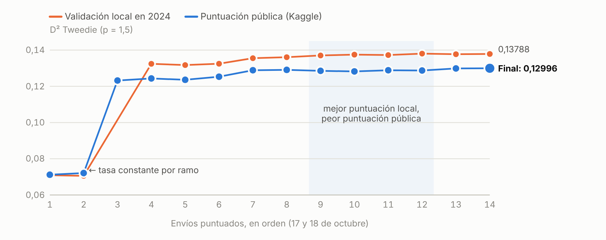
<figcaption>Figura 7Camino hasta la entrega final: los 29 envíos puntuados, en orden. La primera zona sombreada marca propuestas con mejor puntuación local y peor pública; la segunda, las seis sondas de nivel, seguidas de S41 y de calibraciones posteriores que no se eligieron.</figcaption>
</figure>

La responsabilidad es humana. Soy actuario, con 13 años de experiencia en actuaría y supervisión. Autoricé las reglas de datos y cada envío, fijé la prioridad de diseño (un flujo que otro actuario pueda entender, reproducir y adaptar), aprobé la Mezcla por peligro el 18 de octubre y el 20 la confirmé como definitiva; el 22 autoricé las sondas y el 23, tras la batería de sensibilidad, seleccioné S41 en Kaggle. Acepté las correcciones técnicas del paquete y de la captura solo en ese alcance, y declaré como limitaciones la reproducción independiente y la suficiencia de las reservas, esta última también para S41. Ninguna verificación, de la IA o mía, es revisión independiente, porque participé en el desarrollo: cada uno de los 13 hallazgos abiertos indica qué revisor necesita.

## Semana 2: cómo adaptaremos el modelo

En el mercado nuevo la entrega final será la referencia congelada, con el mismo protocolo de preinscripción, foro y controles; esta sección se reemplazará con lo observado.

| Si cambia | Respuesta prevista |
| --- | --- |
| El contrato, las unidades o la exposición (moneda, convención de días, objetivo) | Reconstruir la capa preparada sin trasladar reglas que no tengan evidencia nueva |
| La mezcla de peligros o las colas | Reentrenar severidades por peligro; revisar el criterio de cuerpo y la regla de nivel |
| El patrón de reporte de los siniestros | Reestimar el chain-ladder por peligro antes de entrenar |
| Las variables disponibles o su fecha de captura | Actualizar el contrato por columna y la guardia de predictores |
| El rendimiento del modelo congelado (caída del D² o descalibración por decil) | Recalibrar primero el nivel, con sondas, una previa fijada antes y el ruido medido en la parte no vista; reconstruir solo si no basta |

<!-- FIN-CALIFICABLE -->

## Anexo, fuera de las cinco páginas calificables {: .pagina }

### Componentes y parámetros del modelo final

| Ramo | Componente | Tipo | Peso |
| --- | --- | --- | --- |
| Autos | CatBoost Tweedie del coste total, cuatro semillas | Coste total | 0,2 |
| Autos | CatBoost Poisson por peligro × severidad GLM gamma con tendencia | Frecuencia × severidad | 0,6 |
| Autos | LightGBM Tweedie con variables F0 a F4 | Coste total | 0,1 |
| Autos | LightGBM Tweedie con variables reducidas | Coste total | 0,1 |
| Edificios | LightGBM Tweedie con siete variables de cliente | Coste total | 0,4 |
| Edificios | CatBoost Poisson por peligro × severidad por capital con tendencia | Frecuencia × severidad | 0,3 |
| Edificios | Frecuencia aditiva por peligro × severidad por capital con tendencia | Frecuencia × severidad | 0,3 |
| Contenidos | LightGBM Tweedie | Coste total | 0,3 |
| Contenidos | Frecuencia aditiva por peligro × severidad LightGBM gamma | Frecuencia × severidad | 0,3 |
| Contenidos | Frecuencia aditiva por peligro × severidad GLM con covariables físicas | Frecuencia × severidad | 0,4 |

Forma de la tasa: en autos exponente 1,09 sobre la dispersión de tasas y elasticidad de exposición 0,95; en contenidos elasticidad 0,95; edificios sin forma. Factores de nivel f (2023 / 2024 / media): autos 0,986 / 1,005 / 0,996; edificios 1,059 / 1,134 / 1,097; contenidos 1,078 / 1,092 / 1,085. Validación: entrenamiento con offset log(exposición efectiva); V23 entrena 2021–2022 y para el boosting en la mitad de calibración de 2023; V24 entrena 2021–2023 con las rondas de V23 × 1,15; producción entrena 2021–2024 con × 1,3. D² recalculado desde las predicciones guardadas: V23 0,14542 y V24 0,13788 (autos 0,09168; edificios 0,11580; contenidos 0,09665). Archivo de la mezcla (identificador S30): 626.639 filas, SHA-256 fd9528e0b1ee4b674dea63834a97523fd4ddc743d1495a422ce31a2eb76e3bc5, envío Kaggle 57371361, puntuación pública 0,12996.

<figure class="fig" data-fig="composicion" data-opts='{"cfg": {"alto": 110}}'>
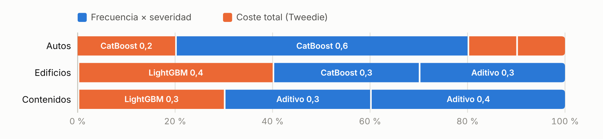
<figcaption>Figura A1Composición del modelo final. Azul: frecuencia por peligro × severidad. Naranja: coste total con Tweedie.</figcaption>
</figure>

### La calibración del nivel de la entrega final

| Magnitud | Autos | Edificios | Contenidos |
| --- | --- | --- | --- |
| Puntuación pública de las sondas, ×0,90 / ×1,10 (la mezcla: 0,12996) | 0,12954 / 0,12906 | 0,12873 / 0,13018 | 0,12929 / 0,13011 |
| S1/N y S2/N despejados de las dos sondas | 0,066143 / 0,067674 | 0,048349 / 0,044972 | 0,024801 / 0,022879 |
| Óptimo del público c\* = S1/S2 | 0,9774 | 1,0751 | 1,0840 |
| Ruido σ de c\* en un tercio de 2024 (300 remuestreos) y frente a los dos tercios no vistos | 3,4 % · 4,4 % | 4,8 % · 5,7 % | 3,6 % · 4,4 % |
| τ previa fijada antes de las sondas, credibilidad Z y factor de S41 | 1,5 % · 0,166 · 0,9962 | 3,5 % · 0,346 · 1,0260 | 1,5 % · 0,150 · 1,0126 |
| Credibilidad con el ruido corregido (la misma τ) | 0,106 | 0,273 | 0,104 |
| Factor de nivel final, f × c | 0,9918 | 1,1251 | 1,0987 |
| Tasa de 2025 por año-exposición, mezcla y S41 (CU) | 594,6 · 592,3 | 495,0 · 507,8 | 124,5 · 126,1 |
| Cambio de la tasa frente al último de 2024, mezcla y S41 | +1,74 % · +1,36 % | +2,05 % · +4,70 % | +3,34 % · +4,65 % |
| Siniestralidad de 2024 y de 2025 con S41 (último estimado entre prima escrita) | 0,784 · 0,774 | 1,137 · 1,130 | 0,658 · 0,654 |

Puntuación pública de S41, esperada y devuelta: 0,130158 y 0,13016 (envío 57531719). Con la previa, los desvíos estandarizados al cuadrado de c\* respecto de 1 suman 6,68 con 3 grados de libertad (p = 0,083): el tablero pide correcciones mayores de lo que admite τ, y S41 aplica solo la parte creíble. Entrega final (S41): 626.639 filas, SHA-256 d8661c2874e9112bd3dd62ea4470a465ee309832dee53fd9dcaa4144dac643a5, total 213,7 millones de CU; `herramientas/regenerar_s41.py` la reconstruye byte a byte desde el archivo de la mezcla y pasa los 10 controles de entrega (`docs/evidencia/entrega_final_S41.json`), y el paso de nivel repetido desde el reajuste y desde la réplica congelada dio el mismo SHA-256. Registros: `registro/sonda_nivel_D100_preinscripcion.json` (regla fijada antes de las sondas), `sonda_nivel_D100_resolucion.json`, `decision_marca_final_S41_20261023.json` (la selección) y `docs/archivo/semana1/SENSIBILIDAD_S43.md` (la batería de sensibilidad).

| Ganancia esperada en el privado frente a la mezcla | Reglas fijadas antes de las sondas | Bayes empírico corregido | Previas sin el tablero |
| --- | --- | --- | --- |
| S41, la entrega final | +0,000019 | +0,000062 | +0,000083 |
| Credibilidad revisada, probada y no elegida | −0,000063 | +0,000075 | +0,000055 |
| Exponente de forma por ramo, probado y no elegido | −0,000023 | +0,000014 | +0,000061 |

La batería de sensibilidad midió el ruido del óptimo del público frente a los dos tercios de 2024 que deja fuera cada muestra, con cocientes de 1,49 a 1,50 respecto de la medida anterior, lo que predice el 1/0,67 = 1,49 de una muestra de dos tercios, y recalculó las esperanzas con tres pares de previas. La desviación típica de la esperanza de S41 ronda 0,00012, frente a 0,00021 a 0,00027 en los otros dos archivos. Su regla de alarma, escrita en el plan, se cumple si un archivo enviado supera a la marca en esperanza con al menos dos pares, con una media de al menos 0,00003, y no pierde frente a la mezcla con ninguno. S41 la cumplió frente a la credibilidad revisada (media de 0,0000325) y frente a la calibración de forma (0,0000376), que entonces estaba marcada; la segunda resiste el 99,9 % de 20.000 extracciones del redondeo de las catorce puntuaciones y una posterior conjunta de nivel y forma (0,0000477), y desaparece sin corregir el ruido (0,0000128 en sentido contrario). La credibilidad revisada (D101) reestimó τ en 5,3 % con las mismas puntuaciones que después aplicó. La calibración de forma (D102) elevó las relatividades de cada ramo a un exponente leído de seis sondas más, 0,955 en autos; fuera del tablero, los óptimos de 2023 y 2024 piden en cambio ampliar autos un 2,3 % y un 1,7 %, y aplicar los tres exponentes a la mezcla resta 0,000127 y 0,000111 de D² en esos años.

| Indicador del nivel sin el tablero | Autos | Edificios | Contenidos |
| --- | --- | --- | --- |
| Ajuste de S41, c − 1 | −0,38 % | +2,60 % | +1,26 % |
| (a) Último año, f24/f − 1 | +0,92 % | +3,44 % | +0,68 % |
| (b) Efectos de etiqueta del análisis de reservas (backtesting del IBNR; recobros en autos) | −1,55 % | −0,18 % | +0,03 % |
| (c) Mantener la siniestralidad de 2024: crecimiento de la prima sobre el del coste de la mezcla (prima leída como tarifa anual) | +0,95 % (+0,88 %) | +3,23 % (+3,38 %) | +1,94 % (+2,02 %) |
| Tope de tamaño: el mayor indicador que coincide más τ | 3,05 % | 6,94 % | 3,44 % |
| Lectura | Parcial | Apoyado | Apoyado |

El criterio se escribió antes de calcular, en la preinscripción de la batería del nivel: un ramo queda apoyado si al menos dos indicadores coinciden en signo con el ajuste y el ajuste no supera el mayor de ellos más la τ de D100; parcial con uno, o con dos o más y el tamaño fuera; sin apoyo con ninguno. La batería lo aplicó a la credibilidad revisada; esta tabla aplica la misma regla a los ajustes de S41, que tienen los mismos signos y son menores, y esa aplicación no se preinscribió. El indicador (c) supone que la siniestralidad de 2024, coste último estimado entre prima escrita, se mantiene en 2025: descansa en nuestras estimaciones de reservas y en un supuesto de tarificación, no en un coste observado. El diccionario de datos solo define el campo como la prima cobrada con la tarifa vigente, sin su unidad (hallazgo DATA-006, abierto): la batería divide la prima sumada entre la exposición (crecimientos de +2,71 %, +5,35 % y +5,35 %), y leerla como tarifa anual da +2,64 %, +5,50 % y +5,43 % y las cifras entre paréntesis. Cada ramo conserva su lectura con las dos.

Reservas y redondeo. Nuestras reservas no mueven el óptimo del público, así que un error de reserva mueve el nivel de S41 cerca de (1 − Z)/c de lo que mueve el de la mezcla: un 84 %, un 64 % y un 84 %. El multiplicador de las reservas de caso que mueve un 1 % el nivel de S41 va de 0,956 a 1,044 en autos, de 0,938 a 1,062 en edificios y de 0,893 a 1,107 en contenidos (mezcla: 0,963 a 1,037, 0,960 a 1,040 y 0,910 a 1,090). Los intervalos al 90 % del multiplicador estimado cruzan esos umbrales en los tres ramos, así que las reservas de caso siguen como incertidumbre material, una limitación que mantuve para S41 el 23 de octubre. Con la comprobación de la severidad de lesiones (S3 del análisis de reservas, calculada antes de las sondas y no adoptada), el nivel de autos de S41 quedaría un 1,86 % alto (de 1,10 % a 2,61 %), frente al 2,2 % de la mezcla. Repetido en las tres raíces de la reproducción, el paso de la mezcla a S41 da su SHA-256, con notas que solo difieren en el último bit. Las puntuaciones tienen cinco decimales: mover cada una de las tres de un ramo ±0,000005 deja c\* entre 0,97688 y 0,97785 en autos, entre 1,07335 y 1,07691 en edificios y entre 1,08031 y 1,08809 en contenidos. Fuentes: `privado/corridas/reservas_20261019T225357Z_99b45271/`, `privado/corridas/repro_s42_20261022T170245Z_c9ea2fc3/`, `privado/corridas/repro_s41_20261023T145808Z_c8055dfc/` y `docs/archivo/semana1/RESERVAS_ACOTACION.md`.

### Experimentos tras la elección del modelo final

Once experimentos se escribieron con su hipótesis y su criterio de aceptación antes de calcular; el backtesting del IBNR se añadió a pedido del participante, con su propia preinscripción. Comparan el modelo final con el mejor envío anterior en la mitad de selección de 2023 y en el año 2024 completo, con el D² completo y el del cuerpo, y tratan como empate cualquier diferencia por debajo del piso de semillas. Un análisis preinscrito aparte acotó las reservas de caso con la materialidad del 1 % que el participante fijó antes de ver resultados.

| Experimento | Pregunta | Resultado frente al criterio fijado |
| --- | --- | --- |
| Influencia de clientes | ¿Depende la ventaja de pocos clientes? | Sí: quitar 6 de 373.831 clientes la invierte en 2024, y 1 en 2023. Rechazada |
| Nivel por ramo | ¿Es estable el nivel de 2025 entre los dos cortes? | No en edificios (1,059 frente a 1,134); autos dista un 0,9 % y contenidos un 0,7 % de su media. Rechazada en edificios |
| Reservas y recobros | ¿Resisten el orden y el nivel? | La ventaja se mantiene con reservas ×0,75, ×1 y ×1,25; los recobros ausentes en los abiertos de autos bajarían su nivel un 0,75 % |
| Pesos vecinos | ¿Hay pesos mejores cerca? | 0 de 40 vecinos mejoran los dos cortes y los dos criterios. Meseta confirmada |
| Capitales sin confirmación | ¿Es inmaterial la división entre mil? | No por fila: sin dividir, los 149 capitales sin confirmación hacen sus filas de 35 a 89 veces mayores, aunque juntas pesan el 0,01 % del total predicho por la mezcla (24.668 CU). Rechazada |
| Cohortes y segmentos | ¿Es homogénea la ventaja? | Los segmentos adversos no se repiten entre cortes; el A/E regional de edificios correlaciona 0,22 entre años. Rechazada en parte |
| Piso de ruido | ¿Es el piso de semillas menor que 0,0001? | Sí: las semillas mueven el D² como mucho 0,00003. Confirmada |
| Tendencia de severidad | ¿Resiste la ventaja a otros escenarios de tendencia? | Sí, en todos los escenarios probados, con matices de atribución. Confirmada |
| Forma y elasticidad | ¿Están en una meseta? | No: el D² se mueve entre 0,0002 y 0,0015 en ±0,02, pero ningún punto mejora los cuatro criterios |
| Reproducción | ¿Se reproducen los componentes al reentrenar? | Dos LightGBM de hogar: 1.111.301 predicciones guardadas, bit a bit. Confirmada |
| Semilla nueva | ¿Cuánto mueve una semilla nueva? | No ejecutado: ya lo cubren una corrida anterior de cinco semillas y la reproducción |
| Backtesting del IBNR | ¿Predice el chain-ladder los avisos posteriores? | No en varios peligros: 6 o 7 de 15 fuera del criterio por corte (figura A2). En lesiones, el IBNR del año recién cerrado se sobrestimó un 20,1 % (2022) y un 7,9 % (2023); en junio de 2024 la proyección quedó un 7,5 % corta. Rechazada, con efecto acotado |
| Acotación de reservas | ¿Cuánto error de reserva importaría? | Un 3,7 % en autos, un 4,0 % en edificios y un 9,0 % en contenidos mueven el nivel de la mezcla un 1 % (un 4,4 %, un 6,2 % y un 10,7 % el de S41); las estimaciones puntuales no sugieren reservas cortas, pero sus intervalos no las descartan. Incertidumbre material |

<figure class="fig" data-fig="backtest">
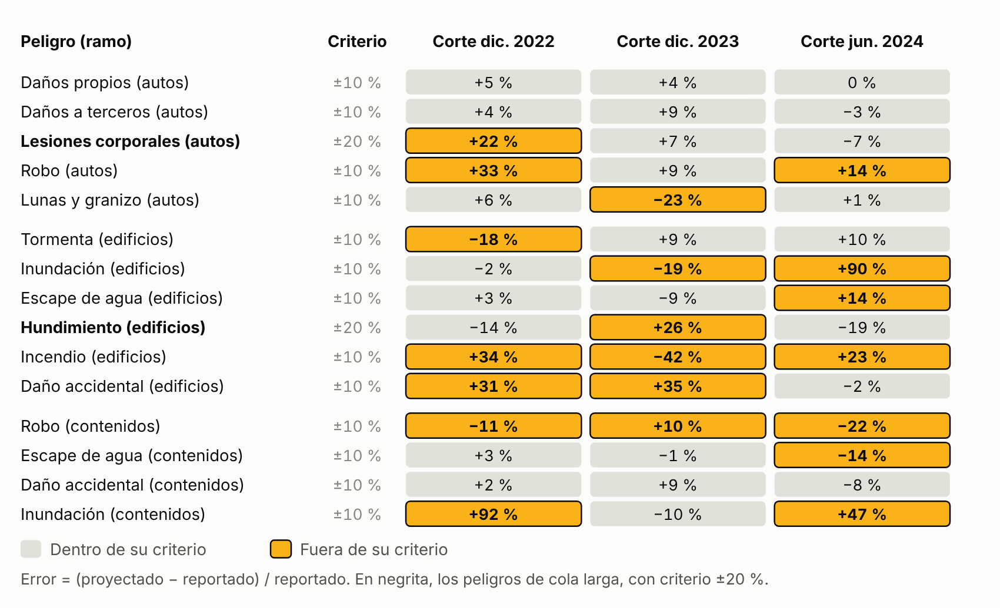
<figcaption>Figura A2Backtesting del IBNR. El chain-ladder de reporte se reestimó con los datos disponibles en tres cortes anteriores; cada celda compara los avisos que proyectaba recibir después del corte con los reportados hasta diciembre de 2024. Las cifras del año recién cerrado que cita el texto comparan el IBNR de ese año con su reestimación con todos los datos.</figcaption>
</figure>

<figure class="fig" data-fig="deciles" data-opts='{"alto": 158}'>
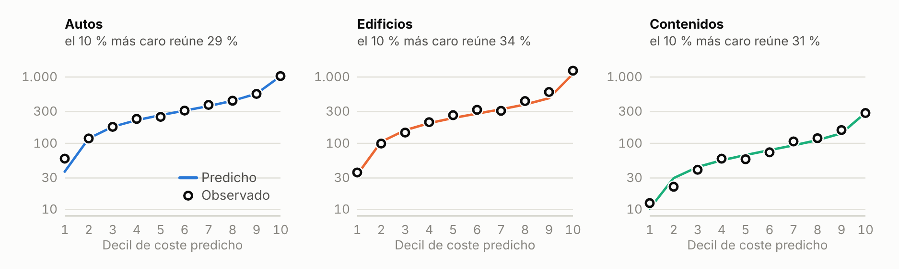
<figcaption>Figura A3Coste medio por periodo en 2024 por decil de coste predicho (escala logarítmica). Línea: predicho. Círculos: observado.</figcaption>
</figure>

<figure class="fig estrecha" data-fig="flujo_ia">
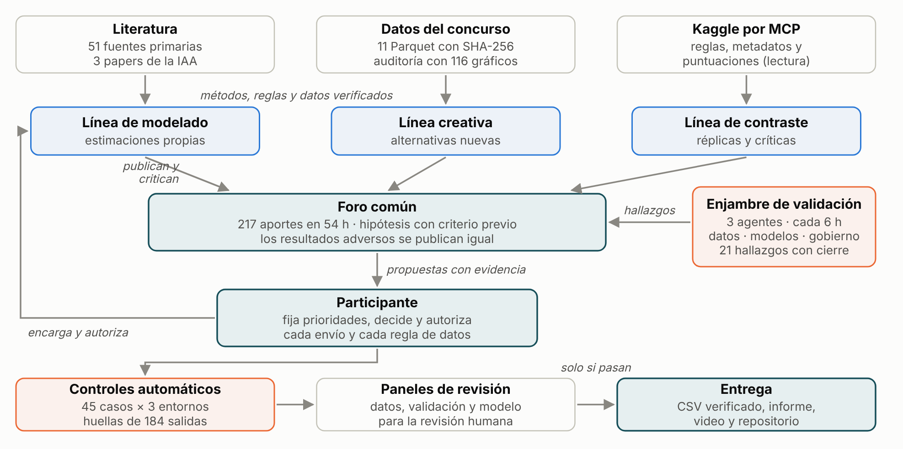
<figcaption>Figura A4Organización de la IA. El participante encarga y autoriza; las líneas publican en el foro; un enjambre de tres agentes audita cada seis horas; nada llega a la entrega sin pasar los controles automáticos.</figcaption>
</figure>

### Glosario breve

| Término | Significado |
| --- | --- |
| D² Tweedie | 1 menos el cociente entre la desviación Tweedie del modelo y la de predecir la media; 0 equivale a no saber nada y 1 a acertar cada periodo |
| T0 | Incurrido neto observado al 31-12-2024 de los siniestros aceptados del periodo |
| IBNR | Siniestros ocurridos y aún no reportados al cierre |
| Exposición efectiva | Exposición nominal multiplicada, mes a mes, por la proporción de siniestros de ese peligro que ya se habría reportado |
| Cuerpo | La distribución sin el 0,5 % de periodos más costosos, usada solo como diagnóstico |
| Preinscripción | Hipótesis, datos y criterio de aceptación escritos antes de calcular |
| Sonda de nivel | Envío idéntico a la mezcla salvo un ramo multiplicado por un factor fijo; solo lee cómo responde la puntuación pública al nivel de ese ramo |
| Credibilidad | El peso Z = τ²/(τ² + σ²) que recibe una estimación con ruido frente al nivel que ya se tenía |

### Referencias principales

- Smyth y Jørgensen (2002). Fitting Tweedie's compound Poisson model to insurance claims data. ASTIN Bulletin 32(1).
- Delong, Lindholm y Wüthrich (2021). Making Tweedie's compound Poisson model more accessible. European Actuarial Journal.
- Denuit, Charpentier y Trufin (2021). Autocalibration and Tweedie-dominance for insurance pricing with machine learning. Insurance: Mathematics and Economics.
- Henckaerts, Côté, Antonio y Verbelen (2021). Boosting insights in insurance tariff plans with tree-based machine learning methods. North American Actuarial Journal.
- Yang, Qian y Zou (2018). Insurance premium prediction via gradient tree-boosted Tweedie compound Poisson models. arXiv:1508.06378.
- Fissler, Lorentzen y Mayer (2023). Model comparison and calibration assessment. arXiv:2202.12780.
- Denuit, Sznajder y Trufin (2019). Model selection based on Lorenz and concentration curves, Gini indices and convex order. Insurance: Mathematics and Economics 89.
- Lindholm y Nazar (2024). On duration effects in non-life insurance pricing. European Actuarial Journal.
- Verbelen, Antonio, Claeskens y Crevecoeur (2022). Modeling the occurrence of events subject to a reporting delay via an EM algorithm. Statistical Science.
- Lindholm, Richman, Tsanakas y Wüthrich (2022). Discrimination-free insurance pricing. ASTIN Bulletin.
- Wüthrich y Merz (2023). Statistical Foundations of Actuarial Learning and its Applications. Springer.
- Goldburd, Khare, Tevet y Guller. Generalized Linear Models for Insurance Rating. CAS Monograph 5.
- Bühlmann y Gisler (2005). A Course in Credibility Theory and its Applications. Springer.
- IAA AI Task Force: Professional Considerations for Actuaries Interacting with Artificial Intelligence (2026); Artificial Intelligence Governance Framework (2025); Documentation of Artificial Intelligence Models or Systems (2025).

### Procedencia de las cifras

Cada número de este informe sale de `docs/entrega/datos/cifras_entregables.json`, que guarda la ruta y el SHA-256 de cada fuente que lee y se regenera con `herramientas/cifras_entregables.py`; `herramientas/verificar_entregables.py` comprueba que el texto coincide con ese archivo. Las cifras del foro cuentan los aportes hasta el registro de la selección final (CLA-20261023-002, 23 de octubre, 14:51 UTC); los posteriores, sobre estos documentos, están en el mismo registro. El foro completo (con identificadores sintéticos omitidos), el registro de decisiones y los recibos de cada envío se conservan como expediente de trabajo en `docs/expediente/` y `registro/`.

