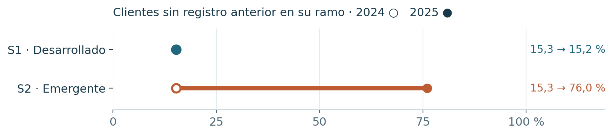
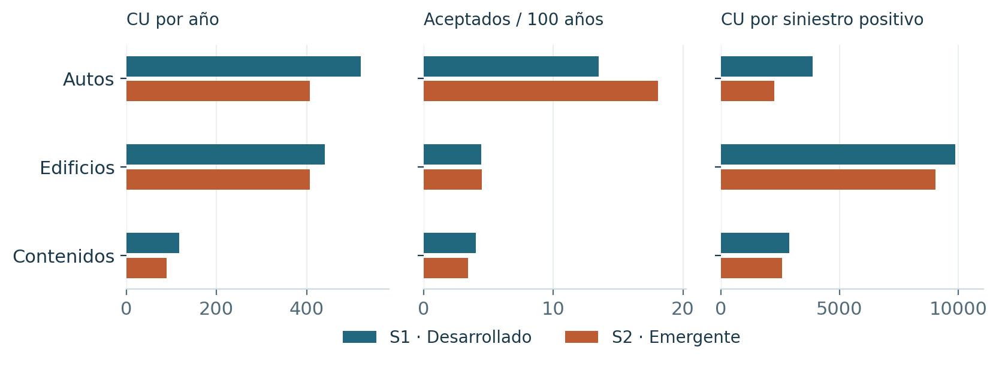
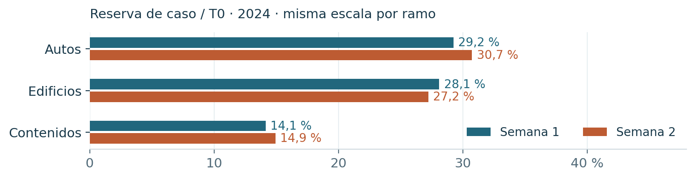

# Una prima de riesgo, dos mercados

IAA AI Hackathon 2026 · Manuel Rodríguez · Equipo individual · Corte del 26 de octubre de 2026

El reto pide el coste último esperado por periodo de póliza de 2025 en autos, edificios y contenidos: la prima de riesgo, antes de gastos. La primera semana aporta cuatro años de historia; la segunda reduce la historia a dos años y cambia la composición de la cartera. El informe compara qué se conservó del método y qué exigió adaptación. [S1, S2]

## Qué cambió al pasar al emergente

{{TABLA_CARTERA}}

La comparación de experiencia de la página siguiente usa únicamente 2023-2024, con exposición conciliada. Los volúmenes de esta tabla describen toda la historia disponible de cada semana; no miden por sí solos una diferencia de riesgo.

En 2025, el 76,04 % de los periodos emergentes pertenece a clientes sin registro anterior en su ramo, frente al 15,19 % desarrollado. En el emergente de 2024 era 15,31 %. La validación sobre renovaciones necesita una lectura adicional sobre clientes sin historia. El primer año del archivo se omite de esta medida porque carece de pasado observable. [S1]

## El mismo objetivo, distinta adaptación

| Etapa | Semana 1 · Desarrollado | Semana 2 · Emergente |
| --- | --- | --- |
| Datos | Reconstrucción de claves, exposición y capitales; copias de siniestros excluidas | Exposición conciliada; edad por bandas, variables ausentes y más faltantes |
| Riesgo | Mezcla de coste total y frecuencia × severidad por peligro | Transferencia de estructura con variables comunes y calibración en el emergente |
| Nivel de 2025 | Factores por ramo con sondas y credibilidad | Factores globales y por celda; contraste separado de estructura y nivel |
| Estado al corte | S41 seleccionada; privado revelado | F3c medida en público; selección definitiva pendiente |

El incurrido neto observado T0 sirve para estudiar y conciliar los datos. El coste último del reto requiere supuestos sobre siniestros aún no reportados y reservas. La revisión documental no convierte T0 en último observado ni acredita suficiencia de reservas.

<!-- PAGE -->

# La experiencia comparable: 2023-2024

Los dos mercados se observan al cierre de 2024. Cada siniestro aceptado se asigna una sola vez por mercado, ramo, póliza y fecha; T0 suma incurrido menos recuperaciones, sin volver a descontar la franquicia. La exposición usa días inclusivos / 365, con cuatro decimales. [S1]

{{TABLA_EXPERIENCIA}}

Las diferencias reúnen composición, cobertura y madurez. En autos emergentes la frecuencia reportada es mayor y la severidad positiva es menor. En edificios, el incendio concentra el 45,49 % de T0 emergente frente al 22,56 % desarrollado; trasladar una tasa agregada sin revisar su mezcla de peligros perdería información. Las demoras están truncadas por el corte de reporte.

## Calidad con el mismo criterio en ambas semanas

{{TABLA_CALIDAD}}

Las exclusiones de siniestros son disjuntas. Originales = copias + anteriores a cobertura + rechazados asignados + aceptados asignados. La causa de las ocurrencias anteriores a cobertura no se determina con estos archivos. El objetivo reconstruido coincide por fila y centavo con ambas bases preparadas. [S1]

| Disponibilidad al cotizar | Semana 1 | Semana 2 |
| --- | --- | --- |
| Edad | Exacta | Bandas |
| Autos: kilometraje y telemática | Columnas presentes, con nulos | Columnas ausentes |
| Cliente: banda crediticia y nacimiento | Presentes | Ausentes; se incorpora género |
| Clima de 2025 | Presente en el archivo | Presente en el archivo |

Columna ausente y dato nulo se distinguen. El clima enlaza todas las cohortes por dirección y año; su disponibilidad al cotizar sigue pendiente. Género requiere revisión adicional.

<!-- PAGE -->

# De un modelo por peligro a la transferencia

## Qué se trasladó y qué se volvió a estimar

| Aspecto | Semana 1 · Desarrollado | Semana 2 · Emergente |
| --- | --- | --- |
| Estructura predictiva | LightGBM y CatBoost Tweedie, con componentes de frecuencia × severidad por peligro | Estructura aprendida en el desarrollado con variables comunes; niveles y ajustes propios en el emergente |
| Desarrollo de reporte | Curvas por peligro incorporadas a la exposición efectiva | Curva fuente contrastada con la experiencia emergente; incertidumbre por escasez de historia |
| Validación local reportada | D² de 0,138 en 2024 frente a 0,071 de tasa por ramo | D² de 0,121 en 2023 frente a 0,083 del mejor modelo solo emergente |
| Ajuste de nivel | Tres factores de ramo con credibilidad | Nivel global, celdas de ramo × negocio y factores propios |
| Dependencia del público | Sondas con regla previa | Sondas globales y por celda; no equivalen a evidencia de generalización privada |

Las métricas locales anteriores proceden de cortes y algoritmos distintos y se identifican con su año. No son una comparación directa de cuál mercado es más fácil. El D² Tweedie de potencia 1,5 compara desviaciones frente a predecir la media; no expresa un porcentaje de pólizas acertadas. [S2, S3]

## Resultados medidos, con el tipo de muestra visible

{{TABLA_RESULTADOS}}

Las poblaciones son distintas. El privado de S41 y el público de F3c no se dibujan como si fueran un mismo test. La referencia emergente del informe usa el archivo F3c ya medido; esta edición no lo promueve a selección definitiva ni sustituye las alternativas conservadas.

## Separar el modelo de lo aprendido del tablero

{{TABLA_CADENA}}

Desde 0,15390 hasta 0,16914 la diferencia pública fue 0,01524. El nivel global y el paso de nivel/forma por celda aportaron 0,01044; los otros dos pasos, 0,00480. Es una descomposición de la cadena pública registrada, no una estimación causal de mejora privada. [S3]

En una tarificación real faltaría esa lectura del tablero. Harían falta experiencia comparable del bloque a incorporar y una política explícita de credibilidad e incertidumbre. Las variantes posteriores con intervalos compatibles con cero o pérdidas por cohortes se conservan; no se presentan como mejoras consolidadas.

<!-- PAGE -->

# Validación, IA y límites del uso

## La misma pregunta para las dos semanas

La reserva de caso = incurrido - pagos. El porcentaje mostrado está dentro del coste ya reportado: no prueba suficiencia ni sustituye IBNR. Los abiertos asignados son 10.120 en el desarrollado y 1.055 en el emergente, sobre toda su historia. Los retrasos observados excluyen lo que aún no se ha reportado. [S1]

| Control o límite | Semana 1 · Desarrollado | Semana 2 · Emergente |
| --- | --- | --- |
| Observación del último | Una sola valoración; supuestos de reporte y reserva | La misma limitación, con solo dos cohortes |
| Selección | S41 obtuvo 0,13864 privado; S22 conservado obtuvo 0,13876 retrospectivamente | Público de F3c observado; privado aún no revelado y 2024 ya adaptativo |
| Reproducción | CSV exacto reconstruido; 162/181 huellas iguales, con diferencias intermedias documentadas | Hay replays desde insumos guardados; la revisión local de F3c conserva una dependencia f3_eval sin localizar |
| Generalización | Influencia de pocos clientes y reutilización de cortes | Cambio de cartera y pérdidas en algunas cohortes; sin mejora privada acreditada |
| Responsabilidad | Decisiones y autorizaciones del participante registradas | Aprobación final del informe y elección definitiva siguen siendo humanas |

La comparación de S22 y S41 se conoce después del cierre. Identifica un coste retrospectivo de selección y no demuestra que el ganador fuera identificable antes. En la segunda semana se deben conservar también las alternativas y los resultados adversos. [S2, S4]

## Qué aportó la IA y qué se comprobó

Claude y Codex produjeron código, hipótesis, revisiones y documentación con autoría y linaje. El participante dirigió y autorizó el trabajo. Para esta edición, Codex reconstruyó los agregados y verificó cada etiqueta histórica contra su base preparada: 136 controles del productor y 1.927 del cotejo separado, con sumas escalares, Decimal y asignación por búsqueda binaria. El clima añadió 196 controles. Son bloques parcialmente solapados; no se suman como validaciones independientes. [S1]

El código de reproducción y los recibos distinguen ajuste, inspección, replay y revisión propia. Las revisiones entre asistentes no acreditan validación profesional independiente. La reproducción por otra persona y la revisión general del participante permanecen pendientes según sus registros. Esta forma de documentar responde a las prácticas IAA priorizadas: propósito y límites, ficha de datos y responsabilidad humana. [S5]

<!-- PAGE -->

# De la prima de riesgo a la comercial

Las veinte referencias emergentes usan la prima de riesgo R del CSV F3c guardado, sin nuevas predicciones. Para exposición e y comisión c, la convención del proyecto es P = [R × (1 + r) + 85e] / [1 - 0,15 - c - 0,08 - 0,08], con r = 0,12 en hogar y 0 en autos; c = 0,20 con corredor y 0 en directo. La suma de riesgo, reaseguro, gasto fijo y cargos proporcionales se concilia para cada póliza. [S6]

{{TABLA_GASTOS}}

{{TABLA_REFERENCIAS_PRIVADAS}}

Importes del periodo en CU; exposición con cuatro decimales. P se calcula sin redondeos intermedios; el total suma las filas mostradas, redondeadas a centavos. La comisión emergente de comparison_site está vacía y estas veinte referencias no usan ese canal. Son escenarios de la receta medida, sujetos a la selección final de semana 2. Los gastos quedan fuera de la predicción de coste para Kaggle.

## Evidencia que acompaña al informe

[S1] EDA común validado, datos_panel.json y sus recibos. [S2] Resultados privados de semana 1 y recibo de reproducción completa. [S3] Informe conjunto previo de Claude y SENSIBILIDAD_SEMANA2.md, corte 26 de octubre. [S4] Requisitos locales de linaje F3c y control de entregas Codex. [S5] Prácticas IAA priorizadas: Consideraciones profesionales §3.1, Documentación §2 y Gobernanza §2.8. [S6] F3c por SHA-256, gastos y referencias originales. Rutas, hashes y comprobaciones completas en el índice de esta edición.

S41 es la selección final registrada de parte 1. F3c es la referencia pública medida que respalda los ejemplos al corte. La parte 2 permanece abierta: este informe no acredita una marca definitiva, revisión profesional independiente o suficiencia de reservas.
